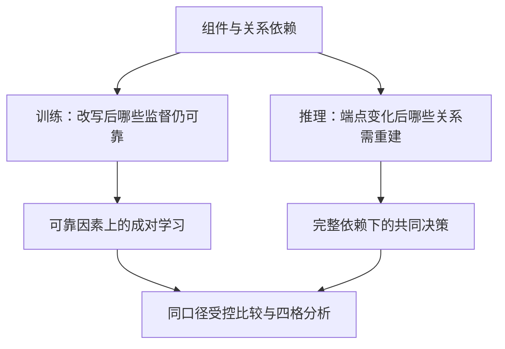
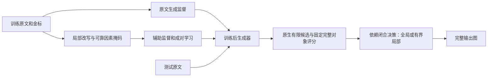
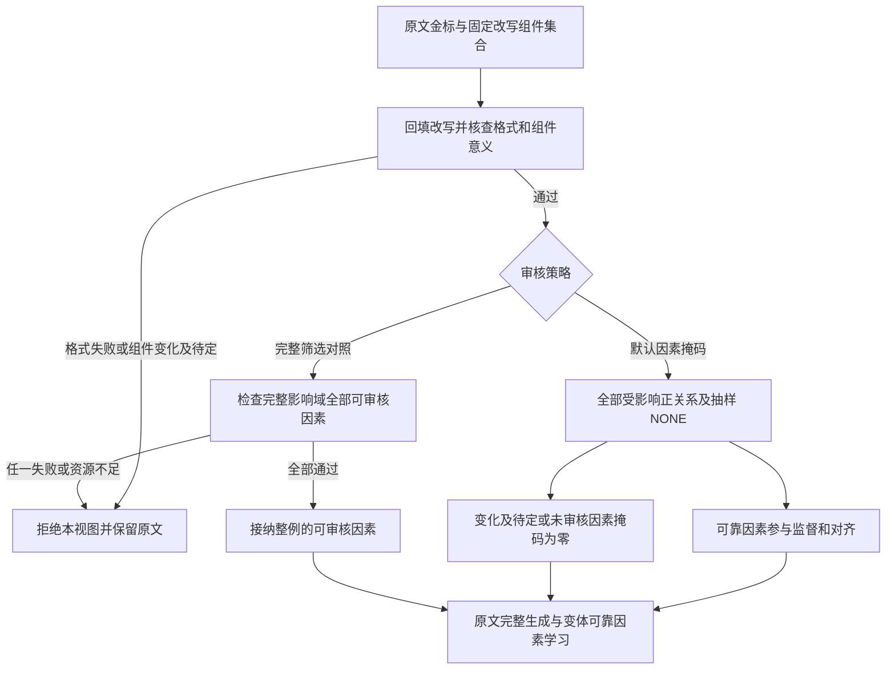
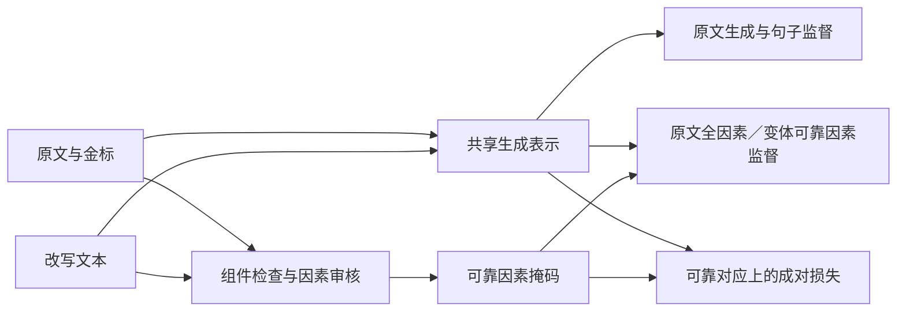

# 面向关系感知学习与依赖闭合修正的端到端论辩挖掘方法研究

武汉大学计算机科学与技术学术型硕士学位论文

作者：Chen Tang

2026年10月

数据说明：第三至五章标注“（情景）”的表格来自真实AAEC、CDCP训练侧文本上按预设条件构造的预测图，构造过程使用金标控制结果中心，不是训练后模型在独立测试集上的输出；审核、评分校准及设备成本的补充数值同属该情景。标注“（实测）”的表格来自实际执行的模型调用或求解运行。两类证据的完整对应见2.5.2节表2-2。

英文题目　End-to-End Argument Mining via Relation-Aware Learning and Dependency-Closed Repair

## 摘要

端到端论辩挖掘需要同时识别文本组件、论辩角色和有向关系。组件与关系的依赖使局部改写和预测修正都可能产生连锁变化。本文以ICIC的多候选重排序与有界修正为基础，研究可靠对应因素上的成对学习，以及依赖闭合的结构修复。

训练方法通过组件核查与关系因素掩码确定原文和变体之间可继承的监督。原文承担完整图生成目标，变体仅在通过检查的因素上提供辅助监督和分布对齐。完整影响域整例筛选作为可选对照。推理方法分别提出原生组件与完整关系候选，显式区分未评分与低分，将组件变化及关联关系重建统一评价；在开发侧固定的风险与资源规则下选择单对象、集合局部或全局求解。

实验在319篇AAEC及580篇CDCP训练侧文本上，为25种配置、3个种子建立67425个预测图，并以文档配对重采样估计区间。完整框架的组件F1为85.20±0.34、78.30±0.34，严格关系F1为67.80±0.34、39.90±0.34；相对同口径ICIC继承配置，关系F1提高3.40、3.00个百分点。贡献按比较职责拆分：同视图、同掩码下，完整成对项相对无成对项的关系增量在AAEC为1.15个百分点且区间不含零，在CDCP为0.75个百分点但区间略跨零；同一训练检查点下，完整修正配置相对固定组件的纯关系修正提高1.60、1.90个百分点，集合动作相对单对象动作的增量区间跨零，故默认采用单对象闭合。逐对象分析显示端点遗漏减少与端点具备后的关系选择改善可以同时贡献收益，但交互区间不支持超加性。真实文本案例与CasiMedicos补充诊断表明，候选可达不等于正确选择，错误高分会阻止恢复。

上述主表数值为基于金标构造的受控情景，用于确定各项贡献的证明比较与报告口径；独立测试集上的目标模型结果需按同一协议替换。本文据此给出两阶段框架的适用条件与简化原则。

关键词：端到端论辩挖掘；可靠对应；成对学习；依赖闭合；图修正；结构化预测

## Abstract

End-to-end argument mining jointly identifies text spans, argumentative roles, and directed relations. Their dependencies make both training paraphrases and prediction edits potentially affect multiple objects. Building on ICIC candidate reranking and bounded repair, this thesis studies paired learning over reliable correspondences and dependency-closed structural repair.

The training method uses component checks and relation masks to identify transferable supervision. Original texts retain full-graph generation targets; augmented views contribute auxiliary supervision and alignment only on checked factors. Whole-view filtering is an optional control. The inference method separates native component and complete-relation proposals, distinguishes missing scores from low scores, and evaluates endpoint changes with their dependent relations. Single-object, local set-level, and global solvers are selected under fixed development-side resource and risk rules.

Experiments cover 319 AAEC and 580 CDCP training-side texts, comprising 67,425 graphs for 25 configurations and three seeds, with document-paired bootstrap intervals. The complete-system component F1 scores are 85.20±0.34 and 78.30±0.34; strict relation F1 scores are 67.80±0.34 and 39.90±0.34, exceeding the matched ICIC-inherited configuration by 3.40 and 3.00 points. Contributions are attributed by dedicated comparisons: with identical views and masks, the full paired objective adds 1.15 points on AAEC with an interval excluding zero and 0.75 points on CDCP with an interval marginally crossing zero; under the same training checkpoint, the complete repair configuration improves over fixed-component relation repair by 1.60 and 1.90 points, while set-level actions add no reliable gain over single-object closure, which is therefore the default. Object-level analysis separates endpoint availability from subsequent relation selection and does not establish super-additive interaction. Source-linked cases and a supplementary CasiMedicos diagnosis show that candidate reachability does not imply correct selection and that confidently wrong scores block recovery.

The main-table figures form a controlled, gold-informed scenario that fixes the evidential role of each comparison; results of trained target models on held-out test data are to be substituted under the same protocol. The thesis states the conditions under which the two-stage framework applies and when simpler variants suffice.

Keywords: End-to-End Argument Mining; Reliable Correspondence; Paired Learning; Dependency Closure; Graph Repair; Structured Prediction

## 第一章 绪论

### 1.1 研究背景与问题提出

论辩挖掘研究文本中的主张、理由及其连接方式。与仅判断作者赞成或反对某一议题相比，该任务还需要定位论证内容，并识别不同组件之间的支持或攻击关系，从而将自然语言论述转化为可分析的结构[1]<!--ref:lawrence2019--><!--anchor:section:Abstract-->。组件与关系抽取服务于论证结构分析，但抽取准确并不直接证明论证有效或事实真实。

图1-1以一个人为构造的图书馆片段说明任务输入与输出。原文中的“增加图书馆经费”和“延长开放时间”表达两个观点，“图书馆现有座位不足，而且开放时间偏短”提供相关理由。论辩挖掘需要共同确定这些文字的范围、论辩角色及连接关系。若只识别出观点而遗漏理由，或把完整理由截成一部分，关系预测所依赖的端点也会随之改变。


图1-1 原始文本中的组件与关系示意

该例为便于说明而构造，不是AAEC或CDCP的标注样本，也不作为实验效果证据。本文后续沿用这一片段解释关系影响域和组件替换，使任务、训练与推理三个层面的讨论具有一致的直观参照。

生成式建模将组件和关系编码为同一输出序列，使多个子任务共享上下文[7]<!--ref:kawarada2024--><!--anchor:section:4-->。共享表示并未消除输出对象之间的依赖。当组件跨度没有进入候选集合时，以该组件为端点的关系就无法严格匹配；当组件存在而显示编号错误时，则可能通过确定性检查修复引用。候选遗漏、语义判断错误与编码不一致具有不同成因，需要分别处理。

训练数据增强也受到同一依赖关系的约束。将上述理由改写为“图书馆座位不够用”，可能仍然支持增加经费，却不再说明延长开放时间的必要性。如果直接继承原关系标注，增强样本就会引入监督噪声。仅检查改写集合内部的关系还不够，连接到集合外组件的关系以及原先无关系的端点组合也可能发生变化。

推理阶段的输入原文保持不变，但模型可能漏掉“延长开放时间”，或仅抽取理由的一部分。补回组件、扩展边界或调整类型之后，关联关系必须依据新的端点对象重新判断。本文据此开展分别作用于两个阶段的研究：训练阶段保持文本改写后的关系监督，推理阶段恢复预测修改后的依赖结构。两项研究以真实文本上的严格组件和关系评价为共同依据，并分别考察收益、失败情形与计算代价。

这两类依赖错误是否具有足够规模，是采用复杂机制的前提。关系影响域检查应与简单改写检查比较，集合修正应与固定组件的纯关系修正比较；若简单方法已覆盖主要问题，复杂设计就应收缩。既存CPU诊断、Luna扩样及新增原生语料试验已记录端点恢复、标签混淆、候选缺失和评分误删（D.1及4.6.6）。这些观察支持检验所针对的问题，但其模型和候选配置与正式系统不同，不能替代目标系统的问题发生率；目标系统的错误链按附录B.2的轨迹字段记录。

### 1.2 国内外研究现状

相关研究从组件识别逐步扩展到联合结构预测，并形成生成建模、数据增强和预测后修正等路线。本文按这些机制组织综述，重点关注输入是否包含金标组件、关系依赖如何进入模型，以及修改后如何判定结构质量。AAEC和CDCP的任务表示及评价规则统一在第二章说明。

#### 1.2.1 端到端论辩挖掘与生成建模

组件与关系的联合预测是端到端论辩挖掘的基础。Stab和Gurevych围绕说服性作文建立组件与关系分析方法[2]<!--ref:stab2017--><!--anchor:section:3-->；Eger等将组件识别与论证结构预测纳入神经端到端学习框架[4]<!--ref:eger2017--><!--anchor:section:Abstract-->；Morio等通过双仿射解析和任务特定参数化支持非树状结构预测[5]<!--ref:morio2020--><!--anchor:section:Abstract-->。这些工作使组件识别、关系判断和结构约束能够在统一任务中研究，同时提示不同语料不能一律按树结构处理。

生成式方法进一步统一了多个子任务的输出接口。Kawarada等将论辩挖掘表述为文本到文本生成，为本文的直接生成式对照候选[7]<!--ref:kawarada2024--><!--anchor:section:4-->。Cabessa等把组件分类、关系识别和关系分类组织为生成任务，其方法基于已有组件列表展开，评价范围与从原始文本定位跨度的设定不同[8]<!--ref:cabessa2025--><!--anchor:section:2.2-->。AASP则以受约束的预定义动作逐步构建论辩结构，将结构信息引入自回归生成过程[9]<!--ref:das2025aasp--><!--anchor:section:Abstract-->。本文依据该工作的2025年公开预印本讨论其机制。

GMAM通过约束指针与重构位置编码生成组件和关系序列[47]，提供了处理输出依赖的一种紧凑方式。UniASA则将多种论辩结构任务统一为序列生成，并引入子任务分解的多视图学习[48]。前者适合参照结构生成机制，后者适合考察统一表示与辅助任务的作用；本论文的成对学习另以同一原文及其经过检查的改写为对应单位。统一生成、辅助目标与对应约束解决的问题有所联系，其比较需要固定输入及完整对象评价，而不能仅按是否使用大模型分类。

结构与语义信号为生成提供了更具体的条件。DENIM使用篇章结构感知前缀辅助端到端预测[12]<!--ref:sun2024--><!--anchor:section:Abstract-->；Das等以关联组件间的关键短语表达概念联系[13]<!--ref:das2025key--><!--anchor:section:3-->；FOL-AM利用一阶逻辑规则组织关系查询和多跳推理[14]<!--ref:sun2025fol--><!--anchor:section:1-->。后两项工作以已分割组件为前提，适合用于比较关系语义建模思想，不能直接把分类分数视为严格整图抽取成绩。

组件边界仍是生成系统中的重要误差来源。Caputo等在2026年采用成对标签进行细粒度组件分割，并分析自动分割对后续分类的影响[6]<!--ref:caputo2026acs--><!--anchor:section:Abstract-->。同年的ARGUS系统整合组件分割、组件分类、关系识别与分类，并连接符号求解器开展论辩框架分析[10]<!--ref:caputo2026argus--><!--anchor:section:Abstract-->。结合LLM论辩挖掘综述所讨论的任务和评价差异[11]<!--ref:li2025--><!--anchor:section:Abstract-->，本文将研究重点落在可独立检验的监督保持与结构恢复机制，而非模型规模或生成式接口本身。

#### 1.2.2 关系保持数据增强

数据增强通过改变表达扩充监督，但生成内容与原标签之间的对应需要单独检查[15]<!--ref:ding2024--><!--anchor:section:Abstract-->。CoDa从训练实例提取生成约束[16]<!--ref:evuru2024--><!--anchor:section:Abstract-->，SegMix在任务相关片段上进行结构感知混合[17]<!--ref:pei2023--><!--anchor:section:Abstract-->。这些方法表明，增强的作用不仅取决于样本数量，也取决于生成条件和标签可靠性。

论辩挖掘中的直接近邻是质量导向合成QOS。该方法将上下文和组件组织为槽位化输入，在改写后恢复跨度并继承组件类型及关系标注；其方法节说明，论辩关系并未显式提供给生成模型，而依赖语义保持使原关系继续成立[35]<!--ref:bao2025qos--><!--anchor:section:4.1-->。本文沿用槽位化改写与标注恢复这一研究基础，进一步关注改写的关系影响范围：同时考察集合内部、跨边界的合法端点组合，以及已有关系和无关系状态。

QOS与同文提出的多样性导向合成DOS分别提供质量和多样性的参照[35]；本文的QOS式适配只继承其中的槽位化改写思想，不能代表两种方案或原论文完整系统的复现。2026年10月公开的对抗强化学习合成研究交替优化生成器与判别器，生成新的文本—结构标注对[49]。结构质量与多样性的联合考虑已有直接近邻，不能作为本文排他的研究空白。本文限定为保留原图监督的局部改写，其增量分别由关系影响域检查和对应因素学习的对照检验。两类数据构造目标不同，比较时先统一训练规模和下游抽取器，再解释结构新颖性与表达变化。

关系抽取研究为这种质量控制提供了相邻思路。ConsistRE以关系条件和上下文约束组织细粒度生成[38]<!--ref:zheng2024--><!--anchor:section:Abstract-->，CovEReD通过反事实实体替换研究文档级关系预测的一致性[37]<!--ref:modarressi2024--><!--anchor:section:Abstract-->，ODDA关注低资源条件下增强样本的质量与多样性[39]<!--ref:zhong2025--><!--anchor:section:Abstract-->。Wang等将LLM生成样本用于联合实体关系抽取，结合一致性正则化、伪标签与迭代反馈[36]<!--ref:wang2026ssl--><!--anchor:section:Abstract-->。对后一工作的认识限于出版方摘要和方法摘录，未核实的细节不用于排除性比较。

增强还可能改变模型对表面线索的依赖。话语标记补全的效果因语料而异[40]<!--ref:rocha2025--><!--anchor:section:1-->，弱监督论辩挖掘也需要处理组件边界和关系噪声[18]<!--ref:sun2026weak--><!--anchor:section:Abstract-->。因此，本文同时评价标签漂移、表达多样性、接受覆盖和训练成本，并在同一批增强样本上比较不同学习目标，以区分数据构造与成对监督的作用。“保持”是生成和审核目标，其语义可靠性仍需真实审计与任务评价支持。

#### 1.2.3 结构化预测与论辩图修正

结构化预测可以在生成时施加约束，也可以在生成后选择和修正候选。语法约束解码通过限制后继token控制输出形式[19]<!--ref:geng2023--><!--anchor:section:Abstract-->，AASP则把结构动作约束纳入生成过程[9]<!--ref:das2025aasp--><!--anchor:section:Abstract-->。这类约束保证的是已编码的规则，跨度是否准确、关系是否成立还需要依据文本与标注评价。

生成后修订和多候选聚合提供了另一类接口。Self-Refine利用反馈迭代修订输出[20]<!--ref:madaan2023--><!--anchor:section:Abstract-->，自一致性通过采样多条路径聚合答案[22]<!--ref:wang2022--><!--anchor:section:Abstract-->。在缺乏外部反馈的推理设置中，自纠错也可能无效或降低表现[21]<!--ref:huang2023--><!--anchor:section:Abstract-->。论辩分析中的LLM-refine生成不同Claim、Evidence和Warrant组合，再选择分割结果[23]<!--ref:tran2025--><!--anchor:section:4.2-->。上述研究支持对候选与判断过程分别分析，而不是默认更多修订必然带来收益。

对象与关系的联合处理也存在直接近邻。Re-Cent以关系标签引导跨度对抽取，并通过关系与跨度对之间的相关性实施修正[43]<!--ref:li2025recent--><!--anchor:section:Abstract-->。Pirozelli等的论辩重构流程提供组件合并、重写和关系检查步骤，其允许改写组件表述，区别于原文字面跨度抽取[44]<!--ref:pirozelli2026--><!--anchor:section:3-->。Xiao和Li的ARGUS研究则把LLM自解释转为抽象论辩框架，以形式语义定义最小代价修复目标[24]<!--ref:xiao2026repair--><!--anchor:section:Abstract-->；它与前述同名论辩挖掘系统不是同一工作，修复目标也不同于本文的抽取对象效用。

本文的直接基础是作者参与完成的ICIC 2026多候选重排序与有界修正方法MCR-BR[34]<!--ref:tang2026icic--><!--anchor:section:4.1-4.4-->。原方法已包含候选跨度替换、类型调整和关系修改。本文进一步把兼容组件集合替换及全部受影响关系的重建作为完整事务，显式规定评分、约束、预算和回退，重点研究修改之间的依赖如何进入决策。

评价目标为上述设计划定了边界。F1的最优决策一般不能由单个对象的边际概率直接替代[41]<!--ref:waegeman2014--><!--anchor:section:4-5-->，校准概率与最优F1阈值的关系也依赖特定条件[42]<!--ref:lipton2014--><!--anchor:section:4-->。概率校准用于检查置信度与经验正确率的对应[45]<!--ref:guo2017--><!--anchor:section:Abstract-->。本文据此区分对象概率、代价敏感效用和严格抽取F1，以同候选、同评分的比较检验事务机制，并独立报告错误接受与计算成本。

#### 1.2.4 综合评述与本文研究位置

不同语料的任务表示和训练来源会影响方法比较。MT-AM利用辅助论辩语料开展多任务训练[25]<!--ref:morio2022--><!--anchor:section:Abstract-->；AMELIA统一19个数据集的格式，并比较单任务、多任务及模型合并策略[26]<!--ref:savigny2026amelia--><!--anchor:section:Abstract-->。句子级泛化研究还观察到模型对数据集相关词汇线索的依赖[27]<!--ref:feger2025--><!--anchor:section:Abstract-->。本文以两种原生任务检验方法的适用范围，并将附录中的历史跨域结果单独保留。多任务训练、单源零样本迁移和目标域校准具有不同数据条件，不合并为一种“泛化”成绩。

表1-1从方法机制而非异口径分数比较最接近的研究。相关工作已经建立了结构保持增强、多候选选择及对象修正的基础；本文的研究位置在于两种依赖处理：改写前后监督对应的维护，以及组件变化后关联关系的完整重建。前者通过近邻增强、匹配中心和同数据学习消融评价，后者通过同候选同评分的动作比较及结构化全局解码评价。

表1-1 近邻方法与本文研究位置

|研究|任务或输入条件|相关机制|本文比较重点|
|:---|:---|:---|:---|
|QOS[35]<!--ref:bao2025qos--><!--anchor:section:4.1-->|论辩标注文本的槽位化增强|改写后恢复跨度并继承类型及关系|内部与跨边界关系、NONE检查及资源匹配|
|ConsistRE与CovEReD[38]<!--ref:zheng2024--><!--anchor:section:Abstract-->[37]<!--ref:modarressi2024--><!--anchor:section:Abstract-->|关系抽取及文档级关系预测|关系条件生成或反事实一致性|论辩角色依赖与组件关系成对学习|
|AASP[9]<!--ref:das2025aasp--><!--anchor:section:Abstract-->|自回归论辩结构生成|受约束动作构建结构|生成过程约束与生成后事务决策的区别|
|Re-Cent[43]<!--ref:li2025recent--><!--anchor:section:Abstract-->|联合实体关系抽取|关系引导跨度对抽取与修正|组件集合修改的依赖域与整体接受条件|
|前期MCR-BR[34]<!--ref:tang2026icic--><!--anchor:section:4.1-4.4-->|从原文生成多个完整论辩图|整图重排序及有界组件关系修改|集合替换、完整关系重建与风险成本归因|

表中的机制依据已核对的原文归纳。外部对照选择进一步覆盖结构解析、文本生成、结构感知生成、动作生成与大模型系统，见附录G。系统层面的主要复现候选为Kawarada等的文本生成方法与UniASA；GMAM、DENIM作为结构生成补充，QOS／DOS作为数据构造近邻。选择依据是输入、表示及代码入口的可核对程度，而非仅选取较低的已发表分数。AAEC的stance处理、CDCP完整源集合和预测坐标仍须接入共同评价器后才确认可比性。其他语言和任务范围见附录A.3。

### 1.3 研究问题与主要研究工作

组件与关系之间的依赖是两项研究的共同出发点。训练阶段改变文本表达而保持经过检查的图监督，推理阶段保持原文而修改预测图。图1-2概括二者的研究关系；它表示问题与方法的对应，不表示将测试预测重新当作训练金标。



图1-2 组件关系依赖下的两项研究内容

#### 1.3.1 研究问题

RQ1：在局部改写后，怎样识别可用于学习的组件与关系对应？在相同来源、变体规模和更新预算下，因素级辅助监督与成对学习分别提供多大增量？完整筛选是否值得其额外拒绝和审核成本，由单独对照回答。

RQ2：在候选和评分充分时，怎样完整处理组件修改的关系依赖，并控制误改与计算成本？单对象、集合动作以及局部、全局求解分别在什么规模和预算下适用？有限候选之外的遗漏不归因于搜索器。

两阶段四格比较用于识别相对ICIC继承配置的条件增量；对象成员分析用于解释重叠、独有恢复和新增损失。它们不另列为第三项算法创新。

#### 1.3.2 主要研究内容

（1）可靠对应因素上的关系感知成对学习。保留关系影响域和完整标注输运，通过逐因素状态区分通过、变化、原标签分歧和未审核。原文承担完整图生成监督；变体只在有效组件及可靠关系上提供辅助监督与分布对齐，避免将未知监督当作已经保持。完整影响域整例筛选作为可选数据策略，与默认因素掩码分别比较。

（2）候选质量与评分约束下的依赖闭合修正。将成分提案、原生类型及源组表示作为输入条件，把组件变化及全部受影响关系重建组织为统一事务。通过缺失分数保护、开发侧风险选择及全局或局部求解，分别控制不可评价的修改、误改代价与计算开销。依赖闭合是共同语义；集合动作和局部搜索是可替换实现。

候选接口与评分训练用于落实这两项研究，不额外包装为独立创新。训练辅助头与推理评分器的监督对象和使用阶段保持区分。

两项研究均包含多项同时改变的条件，整套配置的改善不能直接归于其中某一机制。表1-2预先固定每个问题由哪一比较承担证明责任，并列出该比较不能单独推出的结论。后续章节按此表报告；系统总增量称为“两阶段系统条件增量”，与机制证据分开判断。

表1-2 研究问题与承担证明责任的比较

|需要回答的问题|承担证明的比较|不能由此单独推出|报告位置|
|:---|:---|:---|:---|
|整套新训练是否有用|T1/I0对T0/I0|成对项是全部收益来源|表3-3、表5-3|
|成对学习是否有额外作用|同视图、同掩码、同辅助头下完整成对对无成对|增强构造本身更优|表3-4|
|可靠对应构造是否优于近邻构造|同规模、同辅助头、无成对项下可靠对应对QOS式适配|成对学习的作用|表3-4|
|整个新推理配置是否有用|T1/I1对T1/I0|收益来自某一事务机制|表5-3|
|组件可变的共同决策有何作用|同候选、同评分下完整I1对RelationOnly，及组件优先分步对联合决策|不同可行域下所有差异都来自搜索效率|表4-3、表4-4|
|集合动作或局部求解是否值得保留|单对象、集合局部、同目标全局|局部或复杂方法必须胜出|表4-4、表4-8|
|审核与评分是否可靠|按实际使用单位分层的审核结果；同一冻结流程中的评分与接受轨迹|组件审核可靠即关系掩码可靠；平衡池指标即部署概率质量|表3-5、表4-7|

表中各比较不要求每个损失项、每个数据集或每项次级检验都显著为正；若某一机制只在一种语料或一类错误上成立，贡献表述相应收缩。

#### 1.3.3 前期成果与本论文的关系

本文以前期论文Improving End-to-End Argument Mining with LLMs via Multi-Candidate Reranking and Bounded Repair为基础，作者为Chen Tang、Min Peng和Gang Tian，官方公开记录归于ICIC 2026 Posters Volume I[34]<!--ref:tang2026icic--><!--anchor:section:4.1-4.4-->。表1-3区分已公开机制与本论文深化内容，已有模块作为研究基础保留，其结果仍归于原配置。

表1-3 前期成果与本论文深化内容

|研究层次|ICIC已公开机制|本论文深化内容|结果归属|
|:---|:---|:---|:---|
|训练与表示|结论专项适配、线索提示、句子辅助监督|关系影响域约束增强及成对因素学习|原表支持前期训练配置|
|候选生成与选择|多候选组件、关系构建、整图重排序|保留初始图接口，建立固定候选空间|候选质量与后续决策分别分析|
|组件及关系修正|类型调整、候选跨度替换、删边与局部重预测|兼容集合替换、完整依赖重建与事务接受|新增机制采用独立实验|
|评分与评价|覆盖、语义、合法性混合评分及非下降接受|完整对象正确性、计数效用与风险分析|新效用及原生超边评价单独报告|

原方法已经能够修改组件类型和候选跨度，本文的增量集中在可靠因素上的学习以及修改后的依赖完整性和决策依据；集合动作是否有额外收益需单独验证。LoRA、提示、辅助头和散度函数分别是继承基础或实现手段，不单独计为原创贡献。前期共同成果的来源见附录C.1。

### 1.4 论文组织结构

第一章明确两项研究问题及与ICIC的继承关系。第二章区分原生严格评价、历史协议目标及公共配置。第三章给出可靠因素筛选、标注对应和学习目标。第四章依次说明候选、评分、依赖闭合及求解选择，并集中报告真实推理诊断。第五章以ICIC继承基线组织四格及对象分析。第六章总结适用条件与实证替换顺序。附录保存坐标、配置、性质证明、前期结果及数值情景的构造方法，使开发诊断与论文主结果保持可追踪的对应。

## 第二章 任务表示与方法基础

两项方法需要在同一任务表示下讨论训练监督和预测修改。本章先定义组件、关系及其身份，再说明生成、候选与评价接口，最后给出第三至五章共用的实验协议。语料特有的结构要求与算法选择分别记录，避免把实现约束当作所有论辩文本的共同性质。

### 2.1 论辩组件与关系表示

#### 2.1.1 组件及二元关系

本章用$D=(x_1,\ldots,x_n)$表示固定评价分词器下的输入文档，其中$x_i$为第$i$个评价token；第三、四章用$x$表示同一整篇输入。下文在涉及第四章的删除操作时明确写“删除集合$D$”，不以裸字母代指输入文档。组件定义为$c=(s,e,t)$，其中$1\leq s\leq e\leq n$，跨度采用从1开始的闭区间，$t$为语料规定的类型。实现同时保存原文字符坐标与评价token坐标，并检查往返一致。评价token与模型子词是不同对象，改变评价分词器时需重新建立坐标映射。

二元关系记为$r=(c_i,c_j,\ell)$，包含完整源组件、目标组件及关系标签，方向由提供理由或攻击的一方指向目标。预测结构写为$G=(C,R)$。“端到端”指从原始文本评价组件和关系，不提供测试金标组件，并不要求整个系统仅调用一次模型。

#### 2.1.2 多前提关系与任务边界

CDCP的多前提关系保留为$h=(S,c_j,\ell)$，其中$S$为非空源组件集合，$c_j$为目标。源集合的顺序规范化，但不拆成若干独立二元边。超边匹配要求源集合中全部组件、目标及标签同时正确；漏掉一个源成员就不再是同一完整关系。二元图是源集合大小为1的特例。本文用$R$统称关系对象，计算时保留其实际元数[3]<!--ref:park2018--><!--anchor:section:3-->[46]<!--ref:niculae2017--><!--anchor:section:4-->。

表2-1 域内任务与评价边界

|语料|组件类型|关系对象|额外边界|
|:---|:---|:---|:---|
|AAEC|MajorClaim、Claim、Premise|Support、Attack二元关系|Claim对MajorClaim的stance单列，不转换为普通关系|
|CDCP|Fact、Testimony、Value、Policy、Reference|Reason、Evidence原生超边|多前提不静默展开；类型不归并为Claim/Premise|

表2-1依据语料与联合预测研究区分两种任务[2]<!--ref:stab2017--><!--anchor:section:3-->[3]<!--ref:park2018--><!--anchor:section:3-->[46]<!--ref:niculae2017--><!--anchor:section:4-->。CDCP中的结论角色用于第三章的增强中心选择与专项模块触发，不改变原生组件标签。第五章分别评价两种语料的原生任务，不将域内比较解释为跨域迁移。粗粒度跨域映射仅属于附录E的历史协议，不反向改变本章的原生金标。

### 2.2 合法结构与对象身份

#### 2.2.1 语料约束与候选范围

相对于固定语料协议$\mathcal A$，以$\mathcal G_{\mathcal A}$表示合法结构集合。检查内容包括跨度位于原文、类型合法、关系端点存在、关系标签合法，以及语料确实要求的重叠、方向和拓扑规则。树或有向无环图不是跨语料默认条件；嵌套、多前提及其他结构由具体协议处理，不通过删除测试金标来满足预设约束。

本文采用文档级候选协议。AAEC枚举同文档不同组件的有向对，禁止自环，但不额外施加跨段或组件类型配对的硬掩码；未标注关系的候选状态为NONE，不依据stance补造普通边。CDCP的候选源为所选组件按位置排列后的连续非空区间，目标不能属于源集合；标签为Reason或Evidence，其余状态为NONE。主配置对同一端点槽位使用单一关系状态，若数据审计发现并存标签，则采用显式合法标签组合，保留全部标注。

组件重叠、嵌套及其他语料特定限制由数据审计固定为协议清单。若发现与设定不一致的样本，应修订并重新冻结协议。无环性仅作为经过语料验证的可选硬约束，其启用状态须在实验配置中报告。

#### 2.2.2 语义身份与序列化

组件身份由文档、规范坐标和类型共同确定，可理解为“哪段文字承担哪种论辩角色”。关系身份由完整端点及标签确定，超边还包括规范排序后的完整源集合。JSON编号只是序列化引用：纯编号重排不产生新组件，不计作编辑，也不触发重新打分；跨度或类型改变则产生不同对象，需要重新判断相关关系。

组件序列化与关系引用采用固定字段顺序；类型门控只读取已经生成的前缀。完整示例、坐标往返和异常处理见附录A.6。统一sources字段只是表示入口，多前提任务还需候选、评分、优化与评价共同保留完整源集合。

### 2.3 生成建模与参数高效适配

对序列化输出$Y=(y_1,\ldots,y_L)$，自回归生成定义为：

$$P_\theta(Y\mid D)=\prod_{t=1}^{L}P_\theta(y_t\mid D,y_{<t}).$$

Transformer通过注意力聚合上下文[30]<!--ref:vaswani2017--><!--anchor:section:Abstract-->。本文继承的参考骨干为Qwen2.5-7B-Instruct[31]<!--ref:qwen2024--><!--anchor:section:Abstract-->，正式运行前将按2.6节登记具体权重revision、分词器及环境；当前骨干名称仅为参考设置。序列生成概率受长度和字段顺序影响，因此概率较高的输出仍需接受结构与语义评价。

LoRA在冻结权重上引入低秩更新[32]<!--ref:hu2021--><!--anchor:section:Abstract-->：

$$W=W_0+\frac{\alpha}{r}BA,\quad A\in\mathbb R^{r\times d_{in}},\quad B\in\mathbb R^{d_{out}\times r}.$$

其中$r$是秩，$\alpha$是缩放系数。连续提示以可学习向量表达任务条件，其基础来自提示调优研究[33]<!--ref:lester2021--><!--anchor:section:Abstract-->。第三章继承上述参数高效机制及前期结论条件门控，进一步定义增强文本与因素学习接口；这些通用机制本身不作为本论文的新增理论。

### 2.4 候选空间与结构决策

多候选选择先从已生成的完整图中确定初始状态：

$$G_{\mathrm{rank}}=\arg\max_{G\in\mathcal S}E_{\mathrm{rank}}(G),\qquad G_0=L_{\mathcal A}(G_{\mathrm{rank}}).$$

其中$L_{\mathcal A}$为各方法共用的确定性合法化过程，其规则与变更单独记录。若无法得到合法状态，则显式返回失败，不进入后续修正。原始重排序胜者与合法初始图因此可能不同。

结构恢复涉及三个环节：候选是否覆盖正确对象，评分是否能够识别较好的方案，搜索是否能在预算内找到该方案。增加候选数量可能扩大覆盖，但不能自动改善判断或求解。Candidate Oracle只在离线分析中使用金标度量候选空间，不进入测试时的决策。

第四章在初始选择后固定跨度集合$U$、带类型组件集合$\mathcal V$和关系候选集合$P$，下文将这组有限候选集合称为候选宇宙。“完整影响域”均相对于声明的候选范围定义，不意味着枚举任意文本跨度或所有非空组件子集。未进入候选宇宙的正确对象对当前修正器不可达，其影响由覆盖及可达上界分析说明。

合法性检查、语义评分与统计校准分别回答不同问题。合法性只涉及编码和结构规则；概率含义需在真实预测负例与独立校准材料上检验；使用不同模型参数也不保证生成器和评分器的错误统计独立。由于搜索可能反复选择错误高分对象，本文同时评价固定提案上的评分质量和最终接受轨迹上的误改。

### 2.5 严格评价与统计口径

对组件或完整关系对象，分别汇总$TP$、$FP$、$FN$。下式的$P$和$R$仅表示精确率与召回率，正文采用Precision和Recall指称这两个指标，以区别于第四章的关系候选池$P$及图中的关系集合$R$：

$$P=\frac{TP}{TP+FP},\quad R=\frac{TP}{TP+FN},\quad F_1=\frac{2TP}{2TP+FP+FN}.$$

主指标采用精确组件micro-F1和严格关系micro-F1。前者要求跨度与类型完全匹配；后者还要求全部端点跨度、类型、方向和关系标签正确。CDCP以完整源集合计数，不以展开后的边数替代原生关系数。边界F1和给定金标组件的关系分类作为辅助诊断，域内细粒度Relation-F1与跨域无标签Link-F1分别命名和展示。

每个预测语义对象最多匹配一次金标，多余重复项计FP。若图归一化预先去重，则同时报告原始重复率，并对全部方法使用相同规则。解析、超长或图验证失败的文档仍进入评价，其金标对象计入FN，失败率另报。数据ID缺失或重复需报错；分母为零时采用预先固定的零值约定，并保留原始计数。

micro-F1先汇总对象再计算，不等于分类别或逐文档F1的均值。分数采用百分制，差值以百分点表示。跨种子报告均值与样本标准差，文档级置信区间在每次重采样后重新汇总计数，重复文本按组重采样。历史表中的“±”在原统计记录未绑定时保留原符号，不重新解释为某一种统计量。

#### 2.5.1 与ICIC的协议关系

ICIC公开表为前期来源值。本文主表使用一套与真实文本关联的原生对象，双方配置都在同一文档、金标和字符键下计数。T0/I0代表完整继承配置在该情景中的输出，不是复现得到的检查点；不能把它与公开ICIC值混称为同次实验。

前期按ICIC原协议尺度设定的规划值保留于5.1节。它与本文原生图不构成可逆投影，不计算跨协议提升。实际复现需分别核准原划分、跨度、类型、stance及CDCP转换，并使双方预测共同进入各自评价器。

#### 2.5.2 数值情景的构造与证据身份

数据直接取自官方训练档案：AAEC原训练清单322篇，按原文哈希去重后319篇；CDCP原训练581篇，按既有异常记录排除00411后为580篇。共含8694个原生组件、3975条完整关系，其中CDCP有85条多源关系，最长8个源成员。重复组和排除原因逐项保存在数据清单，未把重复文本当独立文档。

情景使用原生半开字符坐标，按明确规则修整跨度首尾空白，原坐标、变化及原文均保留。2.1节的token表示是目标训练接口；实际训练须完成字符到token的可逆映射。构造过程不读取官方测试文本。

每个错误组件由原生跨度的截短、类型替换或遗漏构成；每条关系引用实际被选组件的完整身份。全部预测图满足冻结的非重叠、端点存在、槽位互斥及CDCP源组连续约束，无环及单出度未设为硬约束。构造过程读取金标以控制各配置的结果中心，配置名称表示该输出对应的方法条件。

全文的证据身份集中由表2-2说明，各章表题以“（情景）”“（实测）”标注，正文只在影响推断时重复限制。

表2-2 结果来源与证据身份

|证据类别|内容|所在位置|能够支持的判断|不能支持的判断|
|:---|:---|:---|:---|:---|
|真实语料与标注|AAEC、CDCP训练侧原文、原生组件与完整关系|2.5.2、各案例原文|计数口径、对象身份和案例可读性|任何方法的效果|
|受控数值情景|25种配置×3种子的预测图、配对区间、成员分解、源组分组|表3-3、表3-4、表4-3、表4-4、表4-6、第五章|比较职责、统计口径和报告结构是否自洽|目标模型在独立测试集上的收益|
|情景补充记录|组件与关系审核分层、评分—决策联动、学习曲线、设备时延|表3-5、表4-7、表4-8、附录H|结果出现时应如何分层报告与判读|人工审核质量或设备实测成本|
|实际模型调用|Luna改写与复核、候选覆盖、CasiMedicos评分与输出|表3-6、表4-5、表4-9、表4-10、表4-11、附录D|所测小样本上的真实问题与失败形态|目标Qwen训练后的表现|
|构造输入上的实际求解|4组构造分数上的16条运行、26次求解调用|4.6.8、表4-12、表4-13|给定输入下的程序行为与动作可达性|真实评分分布下的抽取效果|

### 2.6 公共实验协议

#### 2.6.1 数据划分与使用范围

AAEC和CDCP分别按表2-1的原生任务进行域内实验。数据发布版本、原文哈希、文档ID、坐标映射和异常样本清单在划分前冻结。所有原文与其增强变体按源文档分组；相同文本但ID不同的文档按全文哈希去重或共同分组，防止变体和重复文本跨越训练、开发与测试边界。

数值情景使用上一节的319／580篇训练侧文档。三折OOF、拟合—校准—策略隔离和独立测试属于目标模型的实验协议：原文及所有变体必须同折，每折生成器和跨度头排除持出源文档；所有评价与调参职责在读取独立测试标签前冻结。训练侧情景计数不解释为持出结果。

评分器使用训练侧OOF记录，并按固定源文档分组进一步划分拟合、校准和策略选择用途。按照当前去重规模，拟定AAEC三部分为255、32、32篇，CDCP为464、58、58篇；正式清单须按源哈希冻结并确认组间不共享原文或变体。校准部分只拟合概率变换，策略部分只选择阈值与预算；这些角色属于同一训练侧总量，不另增加隐含开发集。评分器及规则冻结后，才在独立评价集汇总最终结果。上述隔离针对信息使用路径，不能据此认定生成器与评分器的误差独立。

#### 2.6.2 运行配置与可复现记录

比较方案统一骨干、源文档分组与严格评价，方法间仅改变声明的增强条件、学习目标或修正策略。表2-3列出公共设置与规模，表2-4及配套JSON补齐实现参数；结果按语料、方法和种子关联，跨章复用同一记录。

表2-3 公共配置与评价规模

|项目|统一设置|使用说明|
|:---|:---|:---|
|骨干与适配|Qwen2.5-7B-Instruct；LoRA rank 16、alpha 32、dropout 0.05|继承ICIC专项模块，基础权重冻结|
|学习配置|AdamW；学习率2×10⁻⁴；5个epoch；有效批量32源文档|每批4源文档，累计8步，末批按有效文档数归一化|
|长度与种子|输入4096、输出2048；总上下文8192；种子17、29、43|生成、训练及评价身份分别记录|
|数值情景材料|AAEC 319、CDCP 580篇去重训练侧文本|非独立测试成绩；官方测试未读取|
|匹配增强规模|AAEC 500变体／0.82M token；CDCP 900／1.35M|同数据学习消融保持变体与更新条件一致|
|评分验证|训练侧OOF完整对象；自然候选分布|CasiMedicos诊断另有166组件、6390关系，不能替代目标模型校准|
|资源口径|单张80GB设备；CPU 4线程；模型调用与求解分项计费|冷启动、缓存和一次性构造分开登记|
|局部与全局求解|AAEC每文档3秒，CDCP 5秒；大预算60／90秒|单次上限不高于剩余总时限|
|外层与编辑预算|每轮32次尝试、3次接受；最多4轮；组件24、关系96|尝试耗尽不禁止提交已评估的合格项|

正式运行前须冻结数据与折清单、各模型及分词器版本、生成与审核提示、采样参数、损失系数、校准方式、求解器和资源上限。生成、增强、验证与编码统一指定Qwen2.5-7B-Instruct，跨度与评分头结构见表2-4；原文生成、头监督、组件对齐及关系对齐的权重分别设为1、1、0.5、0.5，增强视图默认不承担完整图生成损失。模型工件revision和实际设备在启动时解析、校验并写入运行清单。运行后按附录A关联配置、候选与逐文档计数，分开保存生成、评分和求解成本。

表2-4 补充实现配置

|模块|固定参数|身份与用途|
|:---|:---|:---|
|模型与分词器|Qwen/Qwen2.5-7B-Instruct|四类模型职责共用该家族；实际revision待启动解析|
|跨度与对象头|起止各一线性层；2层MLP，隐藏1024、dropout 0.1|跨度BCE；完整对象sigmoid；新头须实际训练|
|优化细节|AdamW，衰减0.01，β=(0.9,0.999)，ε=10⁻⁸|warmup 3%，梯度裁剪1，bfloat16|
|头部训练|学习率10⁻³，评分头10 epoch|生成适配仍5 epoch；不得改写为ICIC实际轮数|
|损失权重|原文生成1；头监督1；组件／关系对齐各0.5|默认不对未完整审核变体计算整图生成损失|
|生成与校准|增强temperature 0.7、top-p 0.9；评价temperature 0|按对象族Platt校准；3折OOF及8∶1∶1用途划分|
|硬件与资源|1张A100 80GB、64GiB RAM、4 CPU线程|有限提案，预检槽位50000，评分批4096|

配置写法沿用ICIC对骨干、LoRA、优化器及修正预算的集中登记方式；ICIC原文没有给出本表GPU型号、所有新头和固定训练轮数，这些字段为本文新设。Luna诊断任务使用gpt-5.6-luna、low，其温度、精确快照、token用量未由接口提供，不套用本表参数。配套配置文件保存上述设计参数。

#### 2.6.3 统计分析与计算成本

核心比较固定17、29、43三个种子，均进入结果汇总。主指标为组件与严格关系micro-F1，跨种子报告均值与样本标准差；文档级配对重采样重复2000次，每次先汇总对象计数再计算micro-F1。重采样使用相同文档索引配对各方法和种子，得到固定三个种子条件下的文档不确定性，不将重复种子的同一文档视作新增独立文档。区间、效应量、持平、下降和失败配置采用同一报告口径。

成本统计覆盖全部尝试。训练阶段记录源文档访问量、增强token量、有效更新步数、可训练参数量、设备时间和显存；未通过筛选的生成也计入成本。推理阶段记录候选生成、评分、拒绝事务、求解及最终输出的全部开销，包括模型调用、输入输出token、CPU时间、端到端时延和峰值显存。缓存命中时分别报告逻辑预算与实际消耗。

关键比较按表1-2分配证明责任：训练侧以数据构造整体比较和同视图、同掩码的完整成对对无成对比较为关键对照；推理侧以RelationOnly检验组件可变性，以组件优先分步检验共同决策，以单对象动作检验集合表达，以同目标全局ILP检验求解策略取舍。其余消融和交互用于机制解释。多个损失项的联合作用直接报告其配对差值与区间，不以逐项区间相加代替联合区间。各关键比较统一报告效应量、文档配对区间、错误代价和完整成本。

局部与全局ILP先比较相同逐文档总求解预算，另以相同端到端时限评价部署条件；软件、线程、缓存条件和共同准备开销保持一致，大预算结果不自动视为最优。固定输入的求解比较只计各策略在共享准备之后的追加成本，端到端成本另行报告。95%区间为固定三种子条件下逐比较的文档配对区间，未作多重比较校正；区间跨零不能解释为等效，也不以多个未校正区间共同确认全部机制。

全文差值及区间均由未舍入的逐种子统计量计算，表中显示的两位小数相减可能与所列差值相差0.01个百分点。求解状态、成本及失败记录见附录H.4。

### 2.7 训练与推理的接口

训练阶段输入带标注文档，只改写指定组件文字，并检查组件角色与关系监督是否保持。推理阶段输入未提供金标的新文档，原文保持不变，允许修正模型预测的组件与关系。图2-1给出数据流和阶段接口，绪论图1-2则用于说明二者的研究分工。



图2-1 训练监督保持与推理结构恢复的两阶段接口

合格的原文与增强文用于更新生成器，测试文档仅交给训练后的模型。结论专项建模、多候选生成和初始重排序继承ICIC基础；关系影响域与成对因素学习、依赖闭合事务及接受决策为本论文的深化内容。训练辅助头不进入测试路径，推理评分不回传生成器，各阶段保留独立的拒绝和失败出口。

第三章辅助头在训练金标跨度上学习因素标签，第四章评分器在交叉拟合预测上判断完整对象是否正确，二者不直接共用概率。训练改进在推理策略固定时评价，推理改进在同一生成检查点和候选宇宙内评价；不同训练检查点可以产生不同候选，因为候选质量本身属于训练效果。

### 2.8 本章小结

本章以完整语义对象统一组件、二元关系和多前提超边，区分候选覆盖、评分判断与预算内搜索。严格评价、公共实验协议和阶段接口为后续方法提供共同基础。第三章在这一表示上研究改写后的监督保持，第四章研究组件预测变化后的结构恢复，第五章再评价两阶段组合。

## 第三章 关系影响域约束的增强与成对学习

### 3.1 引言

增强的价值取决于可用于学习的监督，而不只取决于生成多少文本。局部改写可能影响内部关系和连接到只读组件的关系，但“可能发生”并不说明漂移普遍存在，也不直接证明完整筛选必要。现有64个Luna变体尚未检出关系标签变化，提示应将额外筛选收益与学习目标分开研究。

本章保留关系影响域与标注输运，重点转向可靠对应因素上的学习。默认先检查组件意义和角色，再对受检关系记录原标签是否认可、改写后是否保持及是否待定；未确认的变体因素不参加辅助监督和对齐。原文始终保留全部金标与生成目标，避免以审核分歧重写数据集。完整影响域整例筛选作为替代策略，而非所有训练必须通过的前提。

默认结论中心仅用于选择改写区域，不改变原生类型；其增量由匹配随机中心检验。前期专项适配、提示和句子监督提供共同起点，新增贡献由固定数据及固定推理策略的对照识别。

### 3.2 前期专项建模基础

#### 3.2.1 类型条件低秩适配

本节说明前期专项建模与新增学习目标的接口。参考骨干为 Qwen2.5-7B-Instruct，冻结基础权重，在注意力投影中保留全局和结论专项低秩分支；LoRA 参数化沿用已有方法[32]<!--ref:hu2021--><!--anchor:section:Abstract-->。对于 $W_0\in\mathbb R^{d_{out}\times d_{in}}$，定义

$$
h'_t=W_0h_t+\frac{\alpha}{r}B_gA_gh_t
+g_t\frac{\alpha}{r}B_cA_ch_t,
\qquad A_\cdot\in\mathbb R^{r\times d_{in}},\quad B_\cdot\in\mathbb R^{d_{out}\times r}.
$$

全局分支参与所有位置的计算，结论分支由 $g_t\in\{0,1\}$ 控制。字段按 id、type、span 排列；可见前缀中的结论类型值完整闭合后，门控在该组件的后续字段开启，并在组件结束时关闭。AAEC 和 CDCP 的触发类型分别为 Claim/MajorClaim 和 Policy/Value；输入、未闭合类型字段及关系区域均令 $g_t=0$。教师强制训练也仅使用可见前缀。

这一门控作用于类型确定后的跨度等字段，不回溯修改已输出类型。参考配置取 $r=16$、$\alpha=32$，以单一全局 rank-32 分支作为参数量匹配对照；实际计算成本另行测量。

#### 3.2.2 线索提示与原有监督

连续提示沿用参数高效提示调优机制[33]<!--ref:lester2021--><!--anchor:section:Abstract-->。对 therefore、thus、in conclusion、consequently、hence、to conclude 作不区分大小写的词边界匹配；命中时在聊天模板输入嵌入之前插入四个向量 $P_i\in\mathbb R^d$，未命中则不插入。提示位置不计入原文坐标。

词典只控制提示启用，不赋予结论标签。话语标记的收益不能由标记数量直接推定[40]<!--ref:rocha2025--><!--anchor:section:6.1-6.3-->；原文与增强文分别按各自文本触发提示；该规则沿用前期配置，本章不将其单独计为新增机制。

生成目标对有效回答 token（含 EOS）取平均，聊天输入和提示向量不参与该项损失：

$$
L_{gen}(x,G)=-\frac1{T_y}\sum_{t=1}^{T_y}\log p_\theta(y_t\mid x,y_{<t}).
$$

句子辅助任务沿用 ICIC 专项监督思路：按句末标点和文档结尾分句，对输入最后一层隐藏状态作句内均值池化，经线性层和 sigmoid 得到 $\hat z_i$。句子与结论类金标跨度相交时令 $z_i=1$，否则为零；跨句组件可标记多个句子。定义

$$
L_{sent}=-\frac1{N_s}\sum_{i=1}^{N_s}
\left[z_i\log\hat z_i+(1-z_i)\log(1-\hat z_i)\right],\qquad
L_{ICIC}=L_{gen}+\lambda_{sent}L_{sent}.
$$

参考配置取 $\lambda_{sent}=0.5$。句子头只读取输入表示，用于共享表示学习。上述生成目标与句子监督构成继承目标 $L_{ICIC}$；3.3节构造增强视图，3.4节在此基础上引入组件、关系头及成对监督。

### 3.3 关系影响域与标注迁移

#### 3.3.1 改写区域与关系因素

本章的文本改写是训练数据增强：只替换已标注组件所对应的文字，不重写整篇文章，也不重新决定组件类型或关系答案。改写集合由组件组成，不必对应一个连续段落。“内部”与“跨边界”均相对于这个集合定义，与是否跨句、跨段没有直接等价关系。

表3-1用人为构造的中文片段说明二元关系，不作为AAEC或CDCP的实测样本。

表3-1 关系保持改写的组件示意

|组件|角色|原始文字|改写处理|
|:---|:---|:---|:---|
|$c_1$|Claim|学校应该增加图书馆经费。|可改写|
|$c_2$|Premise|图书馆现有座位不足，而且开放时间偏短。|可改写|
|$c_3$|Claim|图书馆应该延长开放时间。|文字只读|
|$c_4$|Claim|食堂应该增加素食窗口。|文字只读|

在此示意中，设定$c_2\to c_1$和$c_2\to c_3$为Support，$c_2\to c_4$为NONE。可改写集合取$A=\{c_1,c_2\}$：前一条Support的两端均在集合内，后一条只有一端在集合内，分别属于内部和跨边界因素。$c_2\to c_4$同样跨越边界，但标签为NONE，表示该合法端点组合没有标注关系。NONE不作为输出边，与组件不存在的状态不同。



图3-1 默认因素掩码与可选完整筛选的不同接受路径

“内部／跨边界”描述端点与改写集合的位置关系，“正关系／NONE／语义未知”描述因素状态，二者分别记录。默认路径保留有效组件，屏蔽关系层面的不确定监督；完整筛选路径才因任一可审核因素失败拒绝整例。已知联合源真子集的语义未知状态按3.3.4节处理，不伪装成已经确认的NONE。

对训练金标图 $G=(C,R)$，每篇文档固定一个中心。AAEC优先集合为Claim与MajorClaim，CDCP为Policy与Value；后者只定义本方法的触发角色，不改写原生类型。将种子、文档身份和规范化组件键按UTF-8规范JSON编码，计算SHA-256，按哈希及组件键升序选取第一个对象。主参考种子为17，同一文档全部尝试复用同一中心；不依据生成成功率换中心。

优先集合为空时，从全部合法金标组件按同一顺序回退，并记录fallback；组件集合为空时保留原文、跳过增强。改写集合$A$由中心及所有指向中心的金标关系的完整源成员组成，去重、不递归扩展。无入关系时仅改写中心；超过三源成员的金标超边仍完整纳入，新增NONE因素的元数预算不截断金标。其余组件文字只读。

若槽位重叠或完整输入超过冻结上下文上限，则跳过该文档增强并记录原因，不删除源成员或改选中心。默认因素掩码版本仅审核声明的有限子集；完整筛选版本在完整影响域无法处理时跳过，二者分别登记审核覆盖。不同模型的上下文及调用上限由运行清单提供；未提供时不启动生成。每文档最多四次尝试、两个接受变体，原始样本始终保留。该选择控制定义和资源，不意味着结论中心已经优于其他中心。

记 $\Omega(C)$ 为协议允许的完整端点组合集合，因素 $\omega=(S,v)$ 由非空源组件集合 $S$ 和目标 $v$ 构成。AAEC 中 $|S|=1$，枚举全部合法有向组件对；内部正边、边界正边和其余合法对均纳入候选。因素标签 $y_\omega$ 为协议规定的关系状态。在可审核因素宇宙内，无标注关系记作NONE；已标注联合源真子集的语义未知例外按3.3.4节定义，先从语义监督和审核域中排除。若协议允许同一端点组合具有多个标签，则使用合法标签组合表示状态，不能通过任取一个标签丢失监督。

CDCP 保留 $(\{c_{i_1},\ldots,c_{i_k}\},c_j,\ell)$ 的原生多前提超边，$\ell\in\{\mathrm{Reason},\mathrm{Evidence}\}$。源成员按原文顺序规范化，整条超边作为一个关系对象，不展开为独立二元关系。

训练因素宇宙包含全部金标超边的端点组合，并补充满足源范围规则、最多含三个源成员的候选组合。超过三个源成员的金标关系仍全部保留。源范围的连续性依据所选组件序列判定，而非要求原文字符之间没有间隙。

NONE 仅在上述有限宇宙内定义，不涉及组件集合的全部子集。三源成员预算使更长的金标超边缺少同元数NONE对照，可能形成长度相关的监督偏置，需按元数诊断。这一辅助头不用于估计长超边的完整对象正确率。

设 $V(\omega)=S\cup\{v\}$，完整影响域定义为

$$
\mathcal D_A=\{\omega\in\Omega_{sem}(C):V(\omega)\cap A\ne\varnothing\}.
$$

其中 $\Omega_{sem}(C)=\Omega(C)\setminus\mathcal U_{sem}$，未知集合见3.3.4节；AAEC没有这一联合源子集例外。二元情形即 $\{(u,v):u\in A\lor v\in A,(u,v)\in\Omega_{sem}(C)\}$。全部端点位于 $A$ 中的因素属于内部因素，仅部分端点位于 $A$ 中的属于边界因素。这里的“完整”限定于预先声明的因素宇宙；NONE也是标注协议中的无边状态，不代表任意语义解释下均无联系。改写可能经指代或篇章语境影响两个只读端点，这类域外漂移纳入人工审计。资源裁剪版本另报因素覆盖率，并标记为近似设置。

#### 3.3.2 条件生成与标注迁移

增强模型接收全文、可改写组件的槽位和类型、只读端点目录及影响域标签。条件可采用“全部合法端点目录、显式正关系表、语义未知例外清单、其余可审核因素为NONE”的无损编码，避免逐条重复大量无边因素；验证和训练时仍按展开后的因素执行。输出限定为组件 ID 到替换文本的映射，不允许新增组件、修改类型或自行重建关系表。

程序按原始字符区间执行槽位替换，随后对完整文档重新分词，建立组件对应

$$
\phi:C\longrightarrow C',\qquad
(s_c,e_c,t_c)\longmapsto(s'_c,e'_c,t_c).
$$

组件 ID 仅用于追踪身份，新的跨度由回填文本计算。只读组件也可能因前文长度变化而移动，因而必须更新全部组件坐标。$\phi$ 是组件之间的双射，不是新旧 token 之间的双射。关系和超边的全部端点按 $\phi$ 输运，得到 $\phi(G)$。重叠槽位、坐标往返不一致或无法无损输运的尝试直接拒绝，原始训练样本仍保留，不通过删除异常金标来迁就增强操作。

沿用表3-1，$c_1$可改写为“学校应为图书馆投入更多经费”，$c_2$可改写为“当前图书馆的座位数量不够，开放时长也较短”。目标是改变表达，而保留组件角色及两条Support。程序不沿用原字符位置，而根据回填后的长度重新确定$c_1$、$c_2$以及后续只读组件的坐标，再通过$\phi$迁移关系端点。

若$c_2$只被改成“图书馆现有座位不足”，它仍可能支持$c_1$，却删除了支持$c_3$的开放时长信息。此时，仅检查内部正边会遗漏问题，跨边界检查应将该变体识别为候选拒绝项。同样，若改写加入支持$c_4$的新内容，即使两条原Support仍然存在，原NONE标签也不再适合直接继承。语义验证器可能漏判，因此上述条件仍需由3.6.5节的审核诊断及后续人工抽审检验。

#### 3.3.3 接受规则与可靠因素

所有版本先检查格式、槽位身份、坐标往返和完整端点引用，再在全文上下文中检查改写组件的含义、角色、指代、否定与模态。格式失效或确认改变组件含义时拒绝整个变体；组件意义待定时也不接纳该变体。原始文档和金标不因模型判断而删除。

通过组件检查后，默认采用因素掩码。关系审核子集 $J_A\subseteq\mathcal D_A$ 包含全部受影响正关系，并按固定哈希最多抽取内部、跨边界NONE各4项；已知CDCP联合源的单成员不机械记作负例。正关系无法在资源内全部核查时，本次变体不进入关系学习，但通过检查的组件仍可提供组件级监督。未审核的NONE不被当作已经稳定。

验证器分别判断原文因素和改写因素。仅当原标注获认可、改写后状态仍一致、完整端点对应有效时，令 $m_R(\omega)=1$；原标签分歧、变化或待定均令其为0。组件同样保存 $m_C(c)$，用于头监督和对齐的只读端点也在全文上下文中审核，不能只因字面未变就判定其论辩角色稳定；关系掩码为1还要求全部端点的组件掩码为1。判定来自固定模型，故“可靠”表示通过声明的检查，不是人工金标准语义保证。

默认策略不因某个关系未通过而丢掉所有有效组件，也不把该关系改为NONE。变体保存完整输运图以供追踪，但只有掩码为1的标签参与增强侧损失。完整筛选对照则检查声明影响域的全部因素，任一变化或待定即拒绝整例，其余生成和训练资源按共同规则登记。若完整筛选损失源覆盖却未改善学习，采用因素掩码即可。

每篇最多四次尝试、最多两个接受视图；记录模型、提示、原始判断、掩码、对应、拒绝原因及全部成本。原文和变体按源文档共同分组。3.6.5节Luna比较的“成分＋内部正”与“完整影响域”是前期诊断配置；本节因素掩码是在该诊断基础上确定的默认设计。

验证时先不给出待判断因素的正确答案，取得分类后再与原标签比较；当前实际Luna记录使用显式待审标签，属于提示不同的开发诊断，不能作为此盲分类规约的验收。独立上下文或参数分离都不能保证审核误差独立。

#### 3.3.4 CDCP联合源子集与NONE的区别

严格抽取评价只问一个完整对象是否在金标中。若金标为 $h=(\{c_1,c_2\},c_3,\mathrm{Reason})$，预测 $(\{c_1\},c_3,\mathrm{Reason})$ 就是不同对象，不能匹配该金标。但是完整联合理由成立，不推出单一成员在语义上既不支持也不反对目标。

为此，训练语义头另定义未知集合 $\mathcal U_{sem}$：对已标注联合源，若同目标的非空真子集没有任何单独正关系标注，则将该端点因素列为语义未知。显式正标注优先，不屏蔽已有单源正关系。$\Omega_{sem}=\Omega\setminus\mathcal U_{sem}$ 为可审核因素宇宙，完整影响域与抽样集合均在该宇宙内定义。完整筛选的“全部”指这里已声明的可审核域，未知项另计数量，不称为已经通过。

原文和变体的语义关系头均不把 $\mathcal U_{sem}$ 当作NONE负例；相应监督与对齐掩码都为0。原文完整生成目标仍保留原始超边，金标不删不改。第四章评分器预测的是“完整对象是否与标注精确匹配”，因此该真子集可作为完整对象不匹配的负例，其0标签不解释为语义上没有关系。推理NONE继续表示该槽位未选正关系。由此分开标注存在性、语义审核与推理决策三种用途。

### 3.4 成对组件与关系学习

增强样本通过检查后，还需要让模型学会“不同表达对应相同论辩功能”。本节保留原文完整金标训练，增强文只使用通过掩码的辅助标签，并比较可靠对应因素的预测分布。例如，表3-1中的$c_2$换了说法后仍应被识别为论据，其对$c_1$、$c_3$的关系判断也应与原文一致。这一目标约束的是类型与关系判断，而不是要求新旧文本具有相同词序、长度或跨度坐标。仅使两个预测相同仍可能得到共同错误，因此成对约束必须与金标监督配合。

图3-2给出从增强样本到参数更新的训练架构。原文与增强文经过同一个生成器，组件对应 $\phi$ 将两个视图的类型分布和关系状态分布连接起来；生成目标、句子监督与新增辅助目标共同作用于可训练表示。基础模型权重保持冻结，辅助头仅在训练阶段使用。



图3-2 关系影响域增强与成对学习的训练架构

图3-2区分原文生成路径、变体可靠监督与成对学习；具体梯度来源在3.4.3节说明。图中改写全文进入共享表示，但未审核标签不进入增强侧损失。

#### 3.4.1 输入表示与训练头

组件类型头和关系状态头以共享生成器的输入表示为基础，使用金标跨度定位训练因素。下游生成器只接收任务指令及原文或增强文；增强构造阶段使用的金标槽位、类型与关系条件仅用于监督，不进入该模型的输入。

令 $h_i^x$ 为输入子词隐藏状态，$B_x(c)$ 为组件字符跨度对应的输入子词集合，$h_{end}^x$ 为全文输入结束且回答尚未开始处的隐藏状态。坐标映射和输入隔离的实现验收要求见附录F.2。组件表示与类型分布定义为

$$
u_c^x=\operatorname{MeanPool}_{i\in B_x(c)}h_i^x,\qquad
p_C^x(c)=\operatorname{softmax}f_C([u_c^x;h_{end}^x]).
$$

因果模型的早期 token 只能访问左侧上下文。拼接 $h_{end}^x$ 为跨度表示补充全文上下文通道，并不改变模型的因果注意力结构；组件头不输入待预测的金标类型。

关系头显式区分源和目标，写为

$$
p_R^x(S,v)=\operatorname{softmax}f_R
\big([\operatorname{Pool}(\{u_c^x:c\in S\});u_v^x;
 h_{end}^x;\eta(S,v)]\big),
$$

其中 $f_C$、$f_R$ 为两层感知机，$\operatorname{Pool}$ 为源成员表示的算术均值。$\eta$ 包括源成员数、源起点的最小值和均值、源终点的最大值和均值，以及目标起止位置；坐标均除以文档 token 数，不包含金标类型或关系标签。二元关系采用单一源表示，超边按规范顺序组织源成员，以完整源集合和目标为监督对象，输出状态包含 NONE。两个辅助头在开发评价和测试时移除。

#### 3.4.2 对齐与金标锚定

组件对齐应覆盖被改写的组件及其正关系所连接的只读端点，定义

$$
A^+=A\cup\bigcup_{\substack{\omega\in\mathcal D_A\\y_\omega\ne\mathrm{NONE}}}V(\omega).
$$

即改写组件以及通过正边或超边相连的只读端点。NONE 因素进入关系项，但不因此把全部远处组件都纳入组件对齐。对通过组件检查的视图 $x'$，以下公式中的 $A^+$ 进一步与 $\{c:m_C(c)=1\}$ 取交集，组件对齐为

$$
L_C^{align}(x,x')=\frac1{|A^+|}\sum_{c\in A^+}
\operatorname{JS}\big(p_C^x(c),p_C^{x'}(\phi(c))\big),
$$

其中 $\operatorname{JS}(p,q)=\tfrac12\operatorname{KL}(p\|\bar p)+\tfrac12\operatorname{KL}(q\|\bar p)$，$\bar p=(p+q)/2$。不对任一视图停止梯度。

将通过检查的集合 $\{\omega\in J_A:m_R(\omega)=1\}$ 划分为正关系组 $D_+$ 和 NONE 组 $D_0$，令 $\mathcal B=\{b\in\{+,0\}:|D_b|>0\}$。关系对齐采用组间、组内两级平均：

$$
L_R^{align}(x,x')=\frac1{|\mathcal B|}\sum_{b\in\mathcal B}
\frac1{|D_b|}\sum_{\omega\in D_b}
\operatorname{JS}\big(p_R^x(\omega),p_R^{x'}(\phi(\omega))\big).
$$

这样可避免数量较多的 NONE 因素仅凭数量淹没正关系。当可靠关系集合为空时，该项置零，不人为添加关系；原文全部关系的生成监督仍保留。$A^+$ 为空时组件对齐也置零。

低JS可能来自两个视图一起预测错误，故同时保留标签锚定。对视图 $x$、受监督组件集合 $M_C$ 和受监督关系因素集合 $M_R$，令 $M_R^{+}$、$M_R^{0}$ 分别为其中的正关系与NONE因素，$\mathcal B_M=\{b\in\{+,0\}:|M_R^{b}|>0\}$。辅助监督完整定义为

$$
S(x;M_C,M_R)=\underbrace{\frac{1}{|M_C|}\sum_{c\in M_C}\operatorname{CE}\big(p_C^x(c),t_c\big)}_{\text{组件项}}
+\underbrace{\frac{1}{|\mathcal B_M|}\sum_{b\in\mathcal B_M}\frac{1}{|M_R^{b}|}\sum_{\omega\in M_R^{b}}\operatorname{CE}\big(p_R^x(\omega),y_\omega\big)}_{\text{关系项}},
$$

其中 $\operatorname{CE}$ 为交叉熵，$t_c$ 为组件原生类型；组件项在 $M_C=\varnothing$ 时取0，关系项在 $\mathcal B_M=\varnothing$ 时取0，两项等权相加。原文取 $S(x,G)=S(x;C,\Omega_{sem}(C))$，即全部原生组件及可审核因素，语义未知集合不参与关系头监督；变体取 $S_m(x',\phi(G))=S\big(x';\{\phi(c):m_C(c)=1\},\{\phi(\omega):\omega\in J_A,m_R(\omega)=1\}\big)$，即只对掩码为1的组件和关系归一化。未审核关系既不作为正例，也不作为NONE负例；金标锚定仍不构成排除全部退化解的保证。

#### 3.4.3 按源文档归一化及梯度接口

设源文档 $d$ 接受 $m_d$ 个视图。原文承担完整图生成及继承句子监督；增强文只作为输入视图，不将含未审核关系的输运图作为完整生成答案。头监督定义为

$$
L_{heads,d}^{sup}=\frac{S(x_d,G_d)+\sum_{j=1}^{m_d}S_{m_j}(x'_{dj},\phi_j(G_d))}{1+m_d}.
$$

成对项先在每个非空因素组内平均，再按同源接受视图平均。总损失为

$$
L_d=L_{ICIC}(x_d,G_d)+\lambda_{sup}L_{heads,d}^{sup}
+\lambda_C\bar L_{C,d}^{align}+\lambda_R\bar L_{R,d}^{align}.
$$

默认 $\lambda_{sup}=1$、$\lambda_C=\lambda_R=0.5$。无变体时只保留原文对应项；有变体但无可靠关系时，关系对齐置零，组件学习仍可进行。接受视图已通过组件检查，被改写组件的 $m_C$ 均为1，因此计入 $m_d$ 的视图不会出现空组件项。批内按源文档平均，梯度累积末批按实际文档数归一化，不把接受变体多的源文档自动赋予更高权重。

按 $1+m_d$ 平均使每篇源文档的头监督总权重固定，代价是原文在头监督中的占比随接受视图数变为 $1/(1+m_d)$；原文完整生成损失 $L_{ICIC}$ 不受影响。完整筛选与因素掩码通常接受不同数量的视图，二者的比较因此同时包含这一占比差异，这是数据策略的一部分。成对学习消融固定同一批视图与掩码，不受该差异影响。

两个视图均保留梯度。生成和句子损失更新继承模块，组件与关系头及成对项通过输入表示更新全局LoRA；类型前缀门控的结论专项分支只由相应生成路径更新。基础权重冻结，辅助头在评价时移除。推理评分器另行训练，不使用这些辅助头的类别概率冒充完整对象正确率。

全文改写后所有标签都被确认的额外版本可以计算增强图生成损失，但须独立命名并控制更新量。本文默认不采用该版本，以免将未审核监督重新从生成目标引入。

### 3.5 算法及性质

#### 3.5.1 数据构造与参数学习

算法3-1将增强构造和参数学习分为两个阶段。前一阶段在固定预算内生成并筛选文本变体，后一阶段按源文档归一化训练。两阶段的数据构造及损失计算均只访问训练划分；开发集的参数选择与停止规则按第二章2.6节执行，测试标签不参与上述过程。

**算法3-1 关系影响域增强与成对学习**

```plaintext
输入：训练文档及金标图 D_train，数据协议，固定增强与语义验证模型，
      每文档尝试上限 B_try、接受上限 B_accept，训练更新上限 U，
      审核模式 mode ∈ {FactorMask, FullFilter}。
输出：训练后的端到端生成器 θ，以及增强样本、组件映射和来源记录。
01  检查训练划分、全文哈希分组、坐标和标签协议
02  for 每篇源文档 d ∈ D_train do
03    保留原文 x_d 和完整金标图 G_d；令 Views_d = ∅
04    按3.3.1固定中心及完整入源；不可处理则记原因并继续下一文档
05    建立 Ω(C_d) 并排除语义未知集合得到 Ω_sem，构造改写集合 A
06    构造完整影响域 D_A；令 attempts = 0
07    while attempts < B_try 且 |Views_d| < B_accept do
08      attempts ← attempts + 1；生成组件槽位的替换文本
09      回填全文、重新分词，建立全部组件的双射 φ
10      if 格式、槽位、坐标或端点检查失败 then
11        拒绝整个变体，记录原因及成本
12        continue
13      end if
14      检查全文角色与表达退化
15      if D_A ≠ ∅ then
16        if mode = FullFilter then J_A ← D_A；不可完整审核则拒绝本次视图
16a       else J_A ← 全部受影响正关系 ∪ 固定抽样内部及边界 NONE
16b       在 J_A 中排除已定义的语义未知因素，逐项核查原／新状态并建立 m_R
17      end if
18      if 组件含义变化／待定、结构失败，或完整筛选版本任一因素失败 then
19        拒绝整个变体，记录原因及成本
20        continue
21      end if
22      将全文视图、φ(G_d)、φ、可靠因素掩码和来源加入 Views_d
23    end while
24    保存 Views_d；集合为空时仍保留原文
25  end for
26  for step = 1, …, U do
27    按源文档等频取训练批次；读取原文及其已接受视图
28    依可见前缀门控，仅计算原文完整生成损失及继承句子监督
29    从输入表示计算原文可审核因素的头监督及变体掩码内的头监督
30    依 φ 计算可靠因素上的成对损失；无变体或空可靠域时置零
31    保留两个视图的梯度，按同源变体及源文档两级归一化
32    按3.4.3节的梯度路径执行一次反向传播；基础模型权重冻结
33    if 达到2.6节预先确定的停止条件 then
34      break
35    end if
36  end for
37  返回生成器及来源记录；开发评价和测试时移除训练辅助头
```

每篇文档的参考预算为最多四次尝试、最多接受两个变体，具体训练更新数由公共实验协议确定。参数学习在同一次反向传播中更新可训练参数：全局LoRA、触发的连续提示及辅助头按各自损失路径更新，结论专项分支由生成损失更新。无增强样本时保留原文监督；梯度累积的最后一个不足批次按实际源文档数归一化。

#### 3.5.2 性质与适用条件

**性质一：标注输运保持。** 若可改写槽位互不冲突、$\phi$ 为组件双射，且类型和每个完整关系因素均按 $\phi$ 输运，则 $G$ 与 $\phi(G)$ 的组件数、组件类型及带方向和标签的关联结构保持。证明为：双射保证每个原组件恰对应一个新组件；端点逐一映射保证每条关系及超边既不新增也不丢失，逆映射可恢复原图。该性质针对标注对象成立，不能证明改写后的自然语言仍支持这些标签。

**性质二：单因素预测稳定的充分条件。** 对某一因素，设原视图正确类别为 $y$，分布 $p$ 的间隔为 $\delta=p_y-\max_{k\ne y}p_k>0$。若增强视图分布 $q$ 满足 $\|p-q\|_\infty<\delta/2$，则 $\arg\max q=y$。因为对任意 $k\ne y$，$q_y-q_k>p_y-p_k-\delta\geq0$。这只是逐因素条件，平均 JS 降低不意味着每个因素均满足该界，也不能使原先错误的预测自动正确。

两项性质解释了标签输运与预测约束的作用范围，不构成新的通用等变学习定理。本章约束的是辅助图因素分布，而非证明自回归生成的完整图分布严格等变。文本语义漂移、验证器偏差、金标噪声与候选宇宙外关系均可能破坏预期效果；最终判断仍以未参与增强的真实测试文本为依据。

### 3.6 实验结果与分析

#### 3.6.1 比较口径与贡献拆分

本节固定推理配置I0，比较T0（ICIC继承训练）与T1（可靠因素上的成对学习）及其中间配置。普通增强、QOS式适配和可靠对应使用同规模、同辅助头的条件；成对学习对照固定视图和掩码。按表1-2，“整套新训练是否有用”由T1/I0对T0/I0回答，“成对学习是否有额外作用”由同视图、同掩码下完整成对对无成对回答，二者分别报告。

表3-2 训练侧比较的固定条件

|比较|固定项|变化项|解释范围|
|:---|:---|:---|:---|
|整套新训练|骨干、I0、更新预算|T0／T1|两阶段系统中训练侧的条件增量|
|数据构造|骨干、辅助头、I0、规模与预算|普通／QOS式／可靠对应|构造方案整体差异|
|成对目标|同一视图与掩码、辅助头、I0|无成对／组件／组件及关系|目标函数条件增量|
|完整筛选|生成池、尝试预算与目标|因素掩码／整例拒绝|审核与源覆盖取舍|
|中心选择|区域规模、输入长度与更新预算|结论／匹配随机中心|区域选择的附加作用|

#### 3.6.2 严格抽取结果

表3-3 训练方法的条件结果（情景；固定I0）

|方法|AAEC组件|AAEC关系|CDCP组件|CDCP关系|
|:---|:---|:---|:---|:---|
|ICIC继承配置 T0/I0|83.70±0.34|64.40±0.35|76.45±0.34|36.90±0.34|
|仅原文辅助头|83.90±0.34|64.90±0.34|76.60±0.34|37.25±0.33|
|普通增强＋同一辅助监督|83.85±0.34|64.85±0.34|76.60±0.34|37.20±0.33|
|QOS式适配＋同一辅助监督|84.00±0.34|65.20±0.34|76.80±0.34|37.55±0.34|
|可靠对应＋辅助监督，无成对项|84.10±0.34|65.45±0.34|76.90±0.34|37.75±0.34|
|同数据＋组件成对项|84.25±0.34|65.95±0.34|77.15±0.34|38.05±0.34|
|T1/I0：组件及关系成对学习|84.50±0.34|66.60±0.34|77.50±0.34|38.50±0.34|
|完整筛选替代因素掩码|84.49±0.34|66.57±0.34|77.48±0.34|38.48±0.34|
|匹配随机中心|84.48±0.34|66.52±0.34|77.48±0.34|38.44±0.34|

T1相对继承配置的关系增量为2.20和1.60个百分点。该总增量同时包含原文辅助头、可靠对应增强和成对目标三类改动，以及候选与输出分布随训练条件改变的作用，不能全部归于成对项。

#### 3.6.3 关键比较与解释

表3-4 关系F1差值与文档配对区间（情景）

|语料|比较职责|比较|差值pp|95%区间|
|:---|:---|:---|:---|:---|
|AAEC|整套新训练|T1/I0−T0/I0|2.20|[1.83, 2.57]|
|AAEC|分解链①|仅原文辅助头−T0/I0|0.50|[0.11, 0.88]|
|AAEC|分解链②|可靠对应增强−仅原文辅助头|0.55|[0.15, 0.96]|
|AAEC|成对学习（主判据）|完整成对−无成对|1.15|[0.71, 1.60]|
|AAEC|成对学习（分项）|组件成对−无成对|0.50|[0.08, 0.90]|
|AAEC|成对学习（分项）|再增加关系成对项|0.65|[0.26, 1.06]|
|AAEC|数据构造|可靠对应−QOS式|0.25|[-0.15, 0.65]|
|AAEC|可选策略|完整筛选−默认掩码|-0.03|[-0.43, 0.39]|
|AAEC|可选策略|随机−结论中心|-0.08|[-0.47, 0.35]|
|CDCP|整套新训练|T1/I0−T0/I0|1.60|[1.03, 2.21]|
|CDCP|分解链①|仅原文辅助头−T0/I0|0.35|[-0.30, 1.01]|
|CDCP|分解链②|可靠对应增强−仅原文辅助头|0.50|[-0.17, 1.18]|
|CDCP|成对学习（主判据）|完整成对−无成对|0.75|[-0.04, 1.55]|
|CDCP|成对学习（分项）|组件成对−无成对|0.31|[-0.45, 1.09]|
|CDCP|成对学习（分项）|再增加关系成对项|0.44|[-0.28, 1.18]|
|CDCP|数据构造|可靠对应−QOS式|0.19|[-0.51, 0.92]|
|CDCP|可选策略|完整筛选−默认掩码|-0.02|[-0.67, 0.61]|
|CDCP|可选策略|随机−结论中心|-0.06|[-0.79, 0.66]|

三个种子及全部唯一文本共同进入配对重采样；“完整成对−无成对”是在同一重采样中直接计算的联合差值，不由两个分项区间相加得到。按分解链，T1的总增量在AAEC可依次写为辅助头0.50、可靠对应增强0.55和完整成对项1.15，在CDCP为0.35、0.50和0.75；该分解依赖加入顺序，只作为描述，不作唯一归因。

成对学习的机制证据在两种语料上强度不同。AAEC中完整成对项的区间不含零，两个分项也各自不含零，支持“在固定视图与掩码时成对目标提供额外作用”。CDCP中联合差值方向为正，但区间下界略低于零，两个分项亦跨零；因此不能据此判定联合目标无效，也不足以在CDCP上单独确认其作用。本文将成对学习的贡献表述限定为：在AAEC上有同数据对照支持，在CDCP上方向一致而证据不足，CDCP的训练侧增益主要表现为整套配置的总增量。

数据构造方面，可靠对应相对QOS式适配的差值在两种语料上均为正但区间跨零，不支持“可靠对应构造本身显著优于近邻构造”；其作用主要在于为成对学习提供可用的对应因素。完整筛选和结论中心的差值接近零，说明默认因素掩码和匹配中心已足够，二者保留为可选策略。

#### 3.6.4 审核与训练记录

审核按实际使用单位分别报告。组件审核从既有改写池选取128个组件项目，覆盖32个文档下的63个改写视图；每项目保存两路判断及一个参照标注。两路一致率97.66%，Cohen’s κ为0.9202；接受110个组件项目，其中2个被参照标为不安全，比例1.82%。

组件审核只直接评价“改写后组件意义与角色是否保持”，不能据此确认关系掩码中的因素同样可靠。关系审核在同一批63个视图中按固定哈希分层抽样，每层48项：受影响正关系与抽样NONE各分内部、跨边界两类。每项同样保存两路判断与参照标注，并将“改写后状态待定”和“原标注分歧”分开记录。表3-5报告各层的一致性、进入训练的比例及其中残留的错误。

表3-5 关系因素审核的分层结果（情景）

|因素层|项目|两路一致|κ|接受（掩码为1）|接受中参照不安全|掩码为0：改写后变化|掩码为0：待定|掩码为0：原标注分歧|
|:---|:---|:---|:---|:---|:---|:---|:---|:---|
|正关系·内部|48|45（93.75%）|0.81|40|1（2.50%）|1|4|3|
|正关系·跨边界|48|43（89.58%）|0.74|35|2（5.71%）|2|7|4|
|NONE·内部|48|46（95.83%）|0.78|43|1（2.33%）|0|3|2|
|NONE·跨边界|48|44（91.67%）|0.70|39|2（5.13%）|1|5|3|
|合计|192|178（92.71%）|0.76|157|6（3.82%）|4|19|12|

关系层的一致性和接受质量均低于组件层，跨边界因素最弱：跨边界正关系的接受率为72.92%，接受后仍有5.71%被参照判为不安全，高于组件审核的1.82%。这说明第3.3节把跨边界因素单列的设计有必要，也说明“组件审核良好”不能外推为关系掩码同样可靠。按层加权，进入关系学习的157项中约3.8%仍含错误监督；被掩码的35项（18.23%）是该策略为降低错误监督付出的覆盖代价，其中12项属于原标注分歧，不计为改写漂移。在源覆盖上，63个视图中有58个至少保留一项可靠关系，32篇源文档中有31篇至少保留一个此类视图。

关系审核采用固定规则的小规模抽样，不审遍全部无边组合；样本中NONE项的κ受低变化率影响，需与一致率一并阅读。若正式审核中跨边界层的残留错误明显更高，应优先收紧该层的接受规则，而不是扩大组件审核规模。

训练记录包含两语料、三种子、八个检查点的学习曲线，以及附录B.4.2所列十类实现接口的检查状态。默认因素掩码保留通过检查的监督，完整筛选另计生成拒绝、源覆盖和审核成本，不用重复少量通过样本补齐规模。各检查项与研究结论的对应见附录H.2。

#### 3.6.5 Luna改写与筛选的真实诊断

在AAEC、CDCP训练侧各固定16篇文本，按长度四分位和预定哈希选样，每篇对至多3个组件生成简洁、流畅两个改写，共64个变体。生成者不读取关系标签；筛选与复核由两个全新上下文分别执行，均请求gpt-5.6-luna／low。复核不读取筛选接受标志。原文与改写后的标签分别判定，先排除原标签本就被模型否定或无法判断的因素，再统计改写诱发变化；这种设计不把模型质疑原标注误算为监督漂移。

表3-6 同一真实改写池的筛选与复核（实测）

|语料|筛选|接受／32|源覆盖／16|接受中变化|接受中待定|
|:---|:---|:---|:---|:---|:---|
|AAEC|仅格式|32/32|16/16|0|8|
|AAEC|成分＋内部正|30/32|15/16|0|6|
|AAEC|成分＋完整影响域|28/32|14/16|0|4|
|CDCP|仅格式|32/32|16/16|1|10|
|CDCP|成分＋内部正|29/32|15/16|0|9|
|CDCP|成分＋完整影响域|23/32|12/16|0|5|

表中“变化”是复核模型对成分含义、类型或关系标签变化的判定，“待定”包含原标签分歧，不计作确认稳定。AAEC的32个变体中24个未检出漂移、8个待定；CDCP为21个未检出、10个待定、1个成分含义变化。后者为00423的obligation改成debt，两路模型均认为范围收窄，但原上下文就在讨论债务，仍需人工裁决；不能称为已确认的严重语义错误。

448个关系因素与变体配对中，复核模型认可原标签的有430个，未检测到其中任何关系标签因改写改变；其余18个属于原标签分歧。因此本试验不支持“原始关系漂移较高”或“完整影响域比简化检查多发现漂移”。两种语义筛选都拒绝了同一个成分变化例；完整筛选在CDCP另拒绝3个复核未检出漂移的变体，简化筛选为1个。这里描述的是相对模型复核的拒绝代价，并非人工金标准误拒率。

64个变体均不是原样复制；AAEC和CDCP改写区域的字面编辑距离中位数分别为0.793和0.671，不能解释为语义多样性。两路变体状态判断分别在28／32和23／32例上一致。样本较小、改写要求保守、NONE只按预定槽位抽样且两路模型同源，结论只覆盖本池。该诊断促使本文将完整筛选降为可选对照，默认设计改为组件检查与可靠因素掩码。新设计仍需单独训练验证；表3-3和3-4不由此次审核结果推算。

#### 3.6.6 原文案例与可靠因素的解释

以下案例从既有实际改写中按问题类型选择，不作为漂移发生率的估计。完整回填文本和原审核记录保存在案例数据中；本节用它们解释新规则。

**K01 保持身份论据的改写与对应**

原文：`aaec_essay002`；证据类别：既有Luna改写（实测）与规则说明。

原文把保持个人身份与联系原籍、传授原有价值联系起来。组件ID和原生类型保持，原始坐标随回填迁移；下表只展示已有改写，并不表示目标生成器已经训练。

|组件与类型|原文及坐标|简洁改写|流畅改写|
|:---|:---|:---|:---|
|c007 / Premise|[1168,1204) it is crucial to keep one’s identity|maintaining one’s identity is essential|preserving one’s cultural identity is vital|
|c008 / Premise|[1209,1307) they need a connection back to their country as well as teach their children their value of origin|they need ties to their homeland and must teach their children its values|they need a link to their country of origin and a way to pass its values on to their children|

这些改写由既有Luna任务实际生成；因素掩码的训练效果不由这些句子直接推出。

只读目标c009 [1711,1795) / Claim：keeping the cultural traditions in the destination countries is tremendous important。原生金标含c008→c007及c007→c009两条supports，前者在改写集合内部，后者跨向只读目标。

以下审核状态为说明规则的设定，不是对既有Luna判断的重标。假设三个端点的组件检查均通过，内部关系判为保持，跨边界关系仍待定：

|真实金标因素|位置|假设审核状态|变体关系掩码|
|:---|:---|:---|:---|
|c008→c007 / supports|内部|保持|1|
|c007→c009 / supports|跨边界|待定|0|

默认掩码接纳视图的有效组件及内部关系，跨边界关系不参与变体头监督和对齐，也不改标NONE；完整筛选则拒绝该视图。两个版本都保留原文完整金标与生成监督。若任一组件含义变化或待定，则两个版本均拒绝整例，不沿用此处的部分保留分支。

**K02 个人催收经历不能直接改成一般事实**

原文：`cdcp_00377`；证据类别：既有Luna改写（实测）与规则说明。

原文的常见姓氏和多年来误接催收电话是作者的个人经历，原生标注为testimony。用更简洁的句子重述经历，可以改变措辞而保留该任务中的角色。

|组件与类型|原文及坐标|简洁改写|流畅改写|
|:---|:---|:---|:---|
|c000 / testimony|[0,26) I have a common last name,|I have a common surname,|My last name is fairly common,|
|c001 / testimony|[27,149) and for about three years I was bombarded with collection calls for other individuals with my last name and first initial.|and for roughly three years I was inundated with collection calls intended for people sharing my surname and first initial.|and for around three years collection agencies repeatedly called me about other people who had that surname and the same first initial.|

这些改写由既有Luna任务实际生成；因素掩码的训练效果不由这些句子直接推出。

**K03 obligation改为debt产生的审核分歧**

原文：`cdcp_00423`；证据类别：既有Luna改写（实测）与规则说明。

fluent改写将obligation写成debt。既有两路模型都提出范围收窄问题，但全文本就在债务语境内，因此这里保留为模型识别的疑似变化，不将其升级为人工确认的错误。按本文规则，组件含义待定即拒绝该视图；这与仅屏蔽不确定关系的情形不同。

|组件与类型|原文及坐标|简洁改写|流畅改写|
|:---|:---|:---|:---|
|c000 / value|[0,132) More information to the consumer with the initial notification would be more confusing and intimidating than it already is for them.|Giving consumers more information with the initial notice would make it even more confusing and intimidating.|Adding further details to the initial consumer notice would only increase the confusion and intimidation it already causes.|
|c001 / value|[133,285) Simplifying the initial notification while including information about how to contact someone if you do not recognized this obligation is the way to go.|The best approach is to simplify the initial notice while explaining how to contact someone if the recipient does not recognize the obligation.|A better course would be to make that first notice simpler and provide directions for contacting someone when the consumer does not recognize the debt.|

这些改写由既有Luna任务实际生成；因素掩码的训练效果不由这些句子直接推出。

前两例说明文字变化与原生角色保持可以同时成立；第三例说明组件意义待定时应拒绝视图。若只有关系状态待定而组件检查通过，默认方法屏蔽该关系及其对齐项、保留其余可靠组件。这两种动作取决于不确定性所在层次，不由“审核更严格”统一替代。

### 3.7 本章小结

本章以可靠对应而非完整筛选的必然优越性组织训练贡献。影响域用于定位需要关注的监督，标注输运保持对象身份，因素掩码决定哪些增强标签可以进入学习，原文生成和金标锚定保持不变。实验按比较职责分别报告：整套新训练在两种语料上均有区间不含零的条件增量；同视图、同掩码下的完整成对项在AAEC上提供可识别的额外作用，在CDCP上方向一致但证据不足。审核分层显示跨边界关系是监督可靠性的薄弱环节，组件审核结果不能代替关系审核。真实Luna小试未检出关系漂移，支持以组件检查加因素掩码作为默认设计，完整筛选和结论中心保留为可选策略。

## 第四章 多候选驱动的依赖闭合论辩图修正

### 4.1 引言

端到端论辩挖掘的预测错误不仅表现为关系标签错误，也包括组件遗漏、多检、边界偏移以及组件划分粒度不当。组件是关系的端点，修正一个组件可能同时改变多条关系的身份与合法性。因此，组件修正不能只比较节点自身的得分，关系修正也不能始终假设上游组件正确。本章在前期多候选重排序与有界修正方法 MCR-BR 的基础上，研究有限候选空间内的组件—关系协同修正。

组件可变修正的价值取决于端点相关错误的规模及候选中是否已有可恢复对象。组件类型、边界、遗漏与多检按固定顺序诊断，候选缺失另列；这些维度不相加为互斥因果比例。既存CPU和Luna观察集中于附录D，4.6.6给出CasiMedicos新评分与最终输出。当前低分优先用于定位候选和评分问题，不能证明更复杂的动作必需；目标模型的错误链按附录B.2的轨迹字段记录。

本章以I1表示新增依赖闭合修正配置，保留候选生成与初始重排序，并统一组件变化及关联关系的决策。集合局部子程序仍称BR-J，全局选择和单对象闭合单独列出。框架规定身份、目标、约束及接受条件，求解方式由固定开发规则选择；下文分别比较组件可变性、集合表达、误改和完整成本。

作者前期 ICIC 工作提出了多候选重排序与有界修正框架，在不同组件假设上构建完整论辩图，并结合连接覆盖、语义连贯性和形式合法性选择候选。原版修正不仅处理关系，还包含组件类型转换与跨度替换，因而不能将“允许组件修改”本身作为本章新增贡献。为区分版本，以下将原版记为 BR-O，将固定组件的保守关系修正版记为 BR-C。[34]<!--ref:tang2026icic--><!--anchor:section:4.1--><!--anchor:section:4.3-->

BR-C 固定初始组件、覆盖评价节点及其阈值，只删除关系或重新预测限定源节点的出边。这一约束避免了组件被错误修改，同时明确了其能力上限：若正确跨度从未进入初始图，则仅调整关系不能恢复该组件。BR-O 的修改范围更宽，但按节点或有限出边组织动作时，不能完整表达“一组旧组件被一组新组件替换，同时重新判断全部相关关系”的决策。特别是在拆分、合并和类型改变中，沿用旧端点编号并不意味着原关系对象仍然有效。

已有联合结构预测使用因子或整数规划表达组件和关系之间的约束，组件与关系联合建模本身已有明确研究基础。[46]<!--ref:niculae2017--><!--anchor:section:4-->近期 Re-Cent 也结合跨度抽取与关系纠正，说明“抽取后再纠正”不是新的通用范式。[43]<!--ref:li2025recent--><!--anchor:section:3.4--><!--anchor:section:3.6-->另有框架讨论组件合并、改写与关系重建；本章则保持原文不变，以可定位跨度为对象，不生成隐含前提。[44]<!--ref:pirozelli2026--><!--anchor:section:3-->本章的具体研究对象是：在 MCR 已保留的竞争假设以及有限补充候选中，如何以可变组件集合为修改单位，闭合处理其入边、出边及原无边状态，并依据同一评分体系比较完整修改结果。

据此，本章将问题定义为有预算的结构选择，并把同候选、同评分的全局ILP作为主要竞争方案。局部事务能明确一次变更及其依赖，但全局求解也可能提供更好的结构与保留率。研究重点是在共同准备成本、求解预算和变更要求下比较二者，而非将局部性、日志或有限终止直接视为优势。若真实比较不能形成有价值的质量、时延或变更控制取舍，则应简化局部机制或将其保留为可选修正策略。

图书馆论辩片段提供了一个人为构造的边界修正示意：假设初始组件$c_2$只包含“图书馆现有座位不足”，另一个候选还包含“而且开放时间偏短”。选择较长跨度会改变组件对象，原来连接短跨度的关系不能仅因显示编号相同就继续保留。算法须先构造“新组件及其关系”的完整候选状态，再判断整个修改是否值得提交。原文始终不变，修改的是对原文的结构解释；该片段不对应真实测试样本或运行结果。


图4-1 组件替换及受影响关系的事务式处理示意（人为构造）

图4-1展示推理阶段的事务单位和接受顺序，不预设较长跨度一定正确。旧对象删除后，其入边和出边均失效；新对象的合法关系组合重新参与选择，包括此前没有输出关系的位置。图中对象与关系变化表示数据流，接受或回退表示控制流。只有完整方案满足整图约束、预算及效用门，才一起提交；否则保留修改前的完整状态。

### 4.2 候选生成与初始图

候选生成既为初始图选择提供竞争结构，也限定后续修正能够访问的对象。初始选择沿用前期MCR接口；修正开始前，来自多次生成和补充提议的对象被汇总为固定候选宇宙。两个步骤共享候选来源，但承担不同的决策任务。

#### 4.2.1 组件假设及完整图生成

给定文档 $x$，生成器通过预先固定的采样和提示配置产生 $K$ 组组件假设：

$$
\mathcal C=\{C^{(1)},\ldots,C^{(K)}\}.
$$

每个组件包含原文跨度与类型。随后，关系生成器在固定的 $C^{(k)}$ 上预测关系，形成 $G^{(k)}=(C^{(k)},R^{(k)})$。关系阶段不得悄悄重写组件；关系字段解析失败独立记为失败，但已经通过坐标、类型及重叠检查的组件仍保留为候选；失败调用进入全部成本。同一候选的原始输出、解析结果及坐标转换均保留，避免将后处理改变误认为生成模型的预测。

这一流程比较的是完整结构，而非先依据组件置信度选定一组组件，再只对该组预测关系。不同候选之间的边界、类型和连接差异，既为初始选择提供信息，也为后续集合替换保留竞争假设。全部候选来自预测，不使用评价集金标准补充遗漏对象。

#### 4.2.2 原始覆盖评分的保留与边界

为保持与前期方法的可比性，初始选择沿用原 MCR 的加权形式：

$$
E_{\mathrm{rank}}(G)=0.4E_{\mathrm{dens}}(G)
+0.4E_{\mathrm{coh}}(G)+0.2E_{\mathrm{val}}(G).
$$

设 $\mathcal Q(G)$ 为预测图中的覆盖评价节点，$p_r\in\{0,1\}$ 为关系语义验证结果，$d^{\mathrm{in}}_{\mathrm{coh}}(j)$ 为指向节点 $j$ 且通过验证的关系数，则

$$
E_{\mathrm{dens}}(G)=
\frac1{|\mathcal Q(G)|}\sum_{j\in\mathcal Q(G)}
\min\left\{\frac{d^{\mathrm{in}}_{\mathrm{coh}}(j)}{\tau_j},1\right\},
\qquad
E_{\mathrm{coh}}(G)=\frac1{|R|}\sum_{r\in R}p_r.
$$

空覆盖集合或空关系集合的对应分量取零。AAEC的覆盖节点为预测Claim，CDCP为预测Policy/Value；MajorClaim不因缺少普通关系而被强制补边。本文的确定性参考配置按节点是否存在出边设置结构角色阈值：无出边取 $\tau_j=2$，否则取 $\tau_j=1$。CDCP原生超边按完整关系计一次入边，不按源成员数重复增加覆盖。上述规则是本文明确的设计配置，前期实验的实际执行细节仍以其独立运行记录为准。

$E_{\mathrm{val}}$ 在可解析性、跨度、类型及引用等全部协议检查通过时取1，否则取0；无环等结构条件仅在相应数据协议要求时启用。同分时按候选生成槽位选择。加权得分不等价于合法性硬约束，因此选出的候选还需通过所有对照共用的确定性合法化步骤，得到 $G_0$。该步骤仅执行无歧义的坐标规范化、相同语义对象去重及ID重排，并同步更新引用；歧义ID、越界、非法类型或剩余结构冲突直接报失败，不额外猜测跨度、删除冲突组件或补边。规则、变更和成本单独记录；不能得到合法状态时不进入学习型修正。

覆盖与连贯性共用 $p_r$，不是相互独立的证据。覆盖集合与当前边数还会改变均分的分母，删除低分对象或改变组件类型可能提高平均分，却未必提高真实准确率。本章因此保留上述评分用于初始候选选择，但不将它直接延用为可变组件修正的接受目标。

#### 4.2.3 固定跨度候选与组件冲突

修正开始前构建固定跨度集合$U$。受保护部分包含合法化后初始图及各候选输出中能够独立解析的合法组件跨度；对象先去重，不以概率阈值裁掉初始图。原生跨度头与类型提案提供补充部分；边界规则扩展为关闭的可选消融，不以候选数量增长代替覆盖提升。两部分分开计数，保护对象多于补充上限时不裁初始图；若总资源无法容纳保护部分，返回候选构造失败，而不是无声改变基线。

独立跨度头以训练金标监督起止边界，为候选召回提供补充，并在OOF中遵守与生成器相同的持出隔离。默认使用原生跨度头及组件提案，保留相应类型分布；仅在训练侧覆盖诊断支持时启用一次性的邻近边界、合并或切分扩展，扩展不递归。去重后按边界分保留补充候选。坐标转换、排序和异常细则见附录A.6，边界分仅用于召回排序。

受保护跨度不受补充长度和数量上限裁剪。候选的保护来源、补充来源及重叠数量分别登记；新增跨度不能通过改变去重或坐标规则隐式扩张候选空间。

对每个补充跨度默认保留类型头前2个原生类型；受保护对象的类型全部保留。记候选类型集合为$\mathcal T_*(u)$，构成$\mathcal V=\{(u,t):t\in\mathcal T_*(u)\}$。全类型展开为独立消融，不与默认有限池混称。NULL表示不选择，同一跨度至多一个类型。组件兼容按语料协议逐对判定；语义身份取决于规范跨度和类型，显示ID不进入评分。完整键与坐标映射见附录A.6。

#### 4.2.4 完整关系候选与无边状态

关系候选池$P$以完整端点槽位为单位构建。AAEC枚举有限组件池内可共存的有向对；CDCP默认由关系提案器输出最多64个完整源组与目标，并补充预测分段中相邻2／3成员的源组，每文档补充源组上限256。源组必须完整给出且与目标可共存，按提案分及规范键固定排序；不遍历全部跨度与类型笛卡尔积。原生连续性在最终选择图上复核，不以整个候选宇宙的固定邻接关系替代。初始图与成功解析候选图的合法完整关系槽位受保护，已有长超边完整保留；补充槽位的元数上限仅约束新增组合。

一个槽位包含协议允许的全部关系标签，原生超边的完整源集合只算一个端点组合。槽位优先分为固定对象评分的标签最大值；按该分数降序及规范化槽位键升序保留前$N_{slot}$个补充槽位，全部标签一起保留，NONE由不选正关系表示。用于排序的对象分在裁剪前按固定评分器求出，评分成本计入总成本；超出评分资源的预检上限则返回明确失败，不靠测试金标截断候选。

关系池枚举当前没有边的有向槽位，但独立裁剪不保证正逆两个方向共同保留。仅对二元关系，当正向与逆向完整槽位均在冻结池中、当前端点存在且两方向合法时，才枚举反向事务，并将两槽位全部合法标签共同纳入。缺少逆向槽位记为候选范围限制，不在搜索时补回池外关系；已有关系的纯删除仍可单独枚举。多源超边未定义多目标反向操作，不进入反向队列。初始保护、来源数量、去重、裁剪、未入队与评估后拒绝分开记录；候选池及分数在一次搜索前冻结。

不同语料的原生约束分别登记。CasiMedicos-Arg只允许单源二元关系；CDCP保留原生完整源集合及连续性要求。多个前提分别支持同一目标时，二元语料使用多条关系，不将其合并为超边；也不把CDCP的联合源范围拆成独立二元边。关系标签或组件类型同名不意味着标注准则相同，评分提示与严格评价均使用对应语料的定义（A.3及D.3）。

#### 4.2.5 裁剪前规模与资源预检

最终补充槽位上限4096不能限制其前面的提案、枚举和评分成本。本文将有限原生提案作为默认入口：补充跨度64、每跨度前2类型、CDCP完整源组与目标提案最多256，受保护对象另计。先流式检查实际合法槽位数，资源上限为50000；超限明确返回候选构造失败，保留原初始图、金标分母及已耗成本。

全类型、三源成员完全组合仍作为规模上界和覆盖消融。对m个跨度、每跨度q类，其宽松槽位量为AAEC的m(m−1)q²及CDCP的Σₖ₌₁³ C(m,k)(m−k)qᵏ⁺¹。该宇宙通常远大于默认提案池，不能把它的组合界写成默认实现已经枚举的数量。

资源裁剪按冻结的提案分或对象分进行，记录保护对象、补充对象、裁前／裁后数量及多源覆盖；任何候选质量判断都在冻结后进行。有限源组可能遗漏正确联合源，因此需要与全类型或扩大源组预算进行覆盖对照。局部和全局求解共享同一最终候选及评分快照，不能只给一种方法更好的池。

CasiMedicos真实验证复用前期固定的C层候选，不启用无额外聚合覆盖收益的D层边界扩展。它验证有限提案的一个诊断实例；CDCP完整源组提案器仍是待实现和训练验收的目标配置。

### 4.3 组件集合替换与受影响关系重建

组件修改与关系重建组成一次不可拆分的结构事务。算法先扩展删除集合以消除跨度冲突，再确定所有受端点变化影响的关系，最后对完整修改状态作出接受决定。纯关系修改也使用同一事务接口，因此可以在固定组件的条件下单独比较关系恢复能力。

#### 4.3.1 冲突闭合的集合替换

令当前组件集合为 $C$，一次提议指定新增集合 $B$ 与主动删除集合 $D_0$。本章的$D_0$和$D$均为待删除组件的集合，输入文档始终记为$x$。首先将 $B\cap C$ 中语义未变的对象视为保留项，从 $B$ 及 $D_0$ 中同时移除，再补齐所有与新增对象冲突的旧组件：

$$
D=D_0\cup\{c\in C:\exists b\in B,\operatorname{Conflict}(c,b)\},
\qquad C'=(C\setminus D)\cup B.
$$

$B$ 内部必须兼容。即使某个冲突组件位于提议窗口之外，也必须进入 $D$；否则，新状态仍可能含有非法重叠。扩大删除集合超过预算时，提议被拒绝，不能通过忽略窗口外冲突获得虚假的局部可行性。

主邻域包含 $0\!\to\!1$、$1\!\to\!0$、$1\!\to\!1$、$1\!\to\!2$ 和 $2\!\to\!1$，对应遗漏补回、多检删除、类型或边界替换、拆分和合并。初始设计限制每事务 $|D|+|B|\le3$，在冲突闭合后检查，而非只按最初指定的集合计数。更大邻域作为预算敏感性设置单独评价。

#### 4.3.2 全部受影响关系与纯关系事务

“依赖闭合”在本章以端点身份为边界：组件对象被删除或替换后，将所有引用它的关系以及新对象可能参与的关系一起纳入决策，避免只评估组件本身而遗漏关系损失。下文的“全部受影响关系”均指固定候选宇宙内的这一端点依赖域，不表示组件选择变化后所有新合法槽位都会自动进入事务。训练阶段的NONE来自既有标注，需要在改写后保持；本章的NONE是当前预测未选择正关系的状态，可能包含漏检，因此允许被改为一条经评分和约束接受的关系。

令变化对象集合 $A=D\cup B$ 包含删除的旧组件与加入的新组件，不同于第三章允许改写文字的组件集合。$P_A$ 包含候选池 $P$ 中接触变化对象集合 $A$ 任一对象的全部关系，同时覆盖入边、出边、原有正关系和原 NONE 槽位。删除旧组件后，所有引用旧语义键的关系必须删除；加入新组件后，其合法入出关系重新参与选择，不能按旧显示编号继承。

对于组件保持不变但关系存在错误的情形，保留纯关系提议 $S_R$，定义事务关系空间

$$
P_{\mathrm{tx}}=P_A\cup S_R.
$$

RelationOnly 事务取 $D=B=\varnothing$，通过 $S_R$ 表达增边、删边、换标签或反向。一个槽位进入 $S_R$ 时，其全部合法标签候选一同进入；二元反向修改遵循4.2.4节的双槽位条件；任一方向缺失或当前非法时不进入反向队列，不能仅重选已有方向后称为反向。

对每个 $C'$，算法先求受影响关系的合格可行补全（取得最优性证书时才称为最优），再比较完整的 $G'=(C',R')$，而非先依据组件分数提交 $C'$。事务外关系保持固定，但全局约束在整图上检查。本文固定采用最小合法化扩域：将组件变化后失效的已选事务外关系所在完整槽位加入$S_R$，其全部合法标签参与重求解，旧边删除与新边加入全部计费；仍不可行或超预算时拒绝。该分支只处理已选旧关系的合法性，不自动加入所有新合法而未选的非接触槽位。依赖闭合保证没有漏记端点变化造成的关系失效，并不意味着自然语言的语义影响只发生在一跳范围内。

CDCP的源连续性还依赖哪些中间组件被选中，因此需要区分“旧关系失效”和“未选槽位变得合法”。例如，当前组件按位置排列为$a,b,c,t$，固定候选池已包含$h=(\{a,c\},t,\mathrm{Reason})$。由于$b$位于两个源成员之间，$h$当前非法且未被选中。若删除$b$的事务获准提交，$h$便满足源连续性，但其端点$a,c,t$均未变化，故$h$不属于该事务的$P_A$；若该事务的$S_R$也未包含它，$h$仍保持未选状态。为保留整图合法性而扩域，并不自动触发对这类新合法槽位的枚举。

在上述新状态中，若保持$h$的端点不变，后续提议仍需将$h$所在槽位纳入$S_R$，实际进入并执行于队列，且通过合法性、效用门与剩余预算检查，才可能恢复$h$。若删除$b$未被接受、候选池不含$h$、槽位被队列截断，或后续预算耗尽，则不能由这个例子推断恢复发生。本文保留端点依赖闭合，不为所有非接触的新合法槽位自动扩大事务域；这属于有限邻域与搜索预算的限制，不影响已接受状态的合法性、固定评分差分或有限终止性质。

沿用图4-1，记短跨度旧对象为$c_2^{old}$，完整跨度候选为$c_2^{new}$。即使二者都显示为“组件2”且都标为Premise，它们的语义键仍不同。所有以$c_2^{old}$为端点的旧关系先从候选修改状态中全部移除；涉及$c_2^{new}$与$c_1$、$c_3$、$c_4$及其他合法端点的组合重新参与选择，不能按第三章示意图预置答案。若组件效用增加，但重建后的关系效用下降，则依照4.4.4的分项门拒绝整个方案。若两个分项均不下降、总增益达到严格门限且满足约束与预算，则整体接受。这个例子说明联合评价如何处理关系代价，不声称自动评分等于真实正确性。

### 4.4 对象评分与事务接受

联合事务需要可跨搜索状态比较的评分。为避免组件数、关系数或图结构变化引起评价口径漂移，本章在搜索前冻结完整对象的得分，并用固定计数效用比较新增与删除对象。分项接受门进一步约束组件和关系两个方向的代理代价交换。

#### 4.4.1 固定文本证据评分器

评分器分别估计组件与关系完整对象精确正确的概率：

$$
q_C(c\mid x),\qquad q_R(r\mid x).
$$

组件头根据跨度及全文表示预测 NULL/类型分布。关系头接收端点跨度表示、待核查端点类型、方向、关系标签及全文证据，以二元监督判断整个关系对象是否正确。其正例要求端点跨度、端点类型和关系标签同时满足精确匹配；仅在金标准端点上训练的关系分类准确率，不能替代这里的对象正确性概率。

评分器采用固定文本编码、跨度MLP与有向端点组合MLP，参数不与生成器共享。它与第三章训练辅助头的区别在于监督对象：推理评分器学习真实候选中完整对象的正确性，训练辅助头学习原文与增强文的配对因素。参数分离的解释边界见2.4节。

同一文档的文本表示、模型版本、校准参数及候选得分在搜索开始前冻结。缓存同时绑定完整语义键，不以显示编号代替端点身份。不将当前图的度数、已选边数或动态重编码加入 $q$，从而使同一个对象在不同搜索状态中具有相同分值。评分接口还须区分低置信度与未取得评分。对缺失、非有限或显式未评估的值，保留缺失状态；只有拟删除或加入的组件，以及经最小合法化扩域后的事务关系空间均有有效分数，才评估该提议。事务外未变对象在差分中相消，不以任意默认值参与变化对象的接受判断。该约束补充输入完整性检查，不改变固定效用、依赖闭合及接受门；启发式模型给出数值也不等于其正确性已被校准。D.3以既定候选开展有限对照。

#### 4.4.2 训练外候选与概率校准

评分器需要接触实际推理产生的错误，而不是只区分人工构造的容易负例。训练部分按源文档分组进行 out-of-fold（OOF）候选生成。对每一持出折，生成器和跨度头均不得训练于该折文档及其增强变体，再对持出文档产生完整候选、边界扰动和关系组合。候选与训练金标准进行精确匹配后，形成评分器监督数据。用于比较两种训练方法时，OOF 池共同包含两类生成器的候选并保留来源，避免评分器只适应某一生成器。

错误跨度和错误端点类型构成完整对象负例，原 NONE 槽位中的关系候选也必须进入训练池，但其正负标签由训练金标准决定，不能因生成器未输出该边便将其标负。若过采样困难负例或正例，应保存采样概率；用于校准的数据保持自然候选分布，不能以人工平衡比例替代部署先验。开发集按源文档分为校准部分与策略选择部分，分别用于概率校准及代价、阈值和预算选择。最终生成器拟合训练侧源文档，评分模型则遵守2.6.1的拟合、校准和策略用途，不将校准或策略标签合并回评分器拟合池。

初始配置采用训练内三折OOF，折划分与开发集用途按2.6节记录。OOF生成器的训练规模小于最终生成器，候选分布可能发生变化。概率变换仅拟合OOF校准记录，不使用已被最终生成器拟合过的文档来冒充独立校准样本。冻结后在独立评价集检查评分偏差，不据其标签重新调参。候选校准不直接保证搜索后动作可靠，4.6.4和4.6.5节进一步分析评分及误改。

#### 4.4.2.1 原有正确对象的保留风险

策略选择集同时记录F1、初始TP保留、错误新增及尾延迟。接受间隔δ使用预先声明的网格{0.01,0.05,0.10,0.20}；先剔除不满足开发侧风险上限的配置，再按质量与成本选择。开发侧目标为原TP损失率不超过5%；样本数不足或没有配置通过时返回不修正，不能在测试集降低风险门槛。

这一约束是有限开发集上的经验选择，不保证每篇测试文档的TP保留或F1不降。δ与分项代价κ在评价前按语料固定，局部和全局共用；不对测试文档临时选较高分结果。缺失评分保持未知并拒绝受影响事务；有效但不准确的分数则通过OOF训练、自然分布校准和对象诊断解决。

#### 4.4.3 固定计数效用

对对象类别 $X\in\{C,R\}$，设固定系数 $0<\kappa_X<2$，定义

$$
\Phi_X(G)=2\sum_{o\in X(G)}q_X(o\mid x)-\kappa_X|X(G)|,
\qquad
\Phi(G)=w_C\Phi_C(G)+w_R\Phi_R(G),
$$

其中 $w_C,w_R>0$。主配置以 $w_C=w_R=1$ 为起点，$\kappa_X$ 在开发阶段预先声明的范围内确定并冻结。基线 F1 可以用于初始化候选值，但不构成最优性依据。若为平衡两类对象数量而缩放，只使用固定训练集尺度，不除以当前图的组件数或关系数。

该效用具有明确的代价解释。令 $Y_X$ 为真实对象集合，且暂假设 $q_X(o\mid x)=P(o\in Y_X\mid x)$。由 $FP_X=|X(G)|-TP_X$、$FN_X=|Y_X|-TP_X$，得到

$$
\Phi_X(G)=(2-\kappa_X)\mathbb E[|Y_X|\mid x]
-\mathbb E[\kappa_XFP_X+(2-\kappa_X)FN_X\mid x].
$$

第一项不随预测图变化，故最大化该效用等价于最小化固定误检与漏检代价的条件期望风险。该推导依赖期望的线性性，不要求对象正确性相互独立。候选池外真实对象造成的漏检同样属于不可改变的部分；池内错误与池外遗漏必须分别分析。

此处采用的是代价敏感代理，不是期望 F1。一般 F1 决策涉及真实标签数量与对象正确事件之间的依赖，仅有普通边际概率通常不足以计算最优决策。[41]<!--ref:waegeman2014--><!--anchor:section:5-->特定条件下的 F1 最优阈值结论，也不能通过代入任意基线 F1 直接用于本章结构搜索。[42]<!--ref:lipton2014--><!--anchor:section:4-->上述风险恒等式为评分提供解释，不作为独立的基础理论创新。

#### 4.4.4 分项接受门与编辑成本

候选事务必须满足完整图合法、剩余预算允许以及

$$
\Delta\Phi_C\ge0,\qquad \Delta\Phi_R\ge0,\qquad
\Delta\Phi>\delta>0.
$$

两个分项门限制以明显降低某类代理效用为代价换取另一类增益，总效用门排除等分修改。它们是保守代理条件，可能拒绝真实有益的结构替换，也不保证真实组件或关系 F1 不下降。数值容差与正间隔 $\delta$ 在评价前固定，不通过测试结果调整。

组件编辑成本为 $d_C=|D|+|B|$，关系成本为 $d_R=|R\triangle R'|$。类型或边界变化引起的旧关系删除与新关系加入分别计费。成本仅用于硬预算和同效用时少改优先，不加入效用作为“接近初始图”的奖励。累计编辑量与最终图相对 $G_0$ 的净变化分别记录，避免反复修改同一对象却只报告最后一次差异。

#### 4.4.5 联合修正的教学算例

以下用人工设定的二元图与分数说明一次完整决策，不对应AAEC或CDCP的观测样本，也不用于评价方法效果。设当前预测图含三个组件：$c_1$为Claim，$c_2^o$和$c_3$为Premise。当前图选中两条Support关系，分别为$r_1^o=(c_2^o,c_1,\mathrm{Support})$和$r_2^o=(c_3,c_2^o,\mathrm{Support})$。候选池另含$c_2^a$与$c_2^b$，二者均为$c_2^o$的不同边界版本，与$c_2^o$相冲突，但不与$c_1,c_3$重叠。三个版本两两不能同时选中；当前图没有其他关系接触$c_2^o$。

（1）固定评分与预算。设$\kappa_C=0.4$、$\kappa_R=0.2$、$w_C=w_R=1$、$\delta=0.02$，剩余组件和关系编辑预算分别至少为2和4。三个边界版本的组件分数为$q_C(c_2^o)=0.20$、$q_C(c_2^a)=0.45$、$q_C(c_2^b)=0.35$；旧关系分数为$q_R(r_1^o)=0.18$、$q_R(r_2^o)=0.16$。因此，旧组件的效用贡献为$2\times0.20-0.4=0$，两条旧关系的合计贡献为$(2\times0.18-0.2)+(2\times0.16-0.2)=0.28$。未变化的组件和关系在求差时相消。

（2）构造替换与闭合域。先考虑$D=\{c_2^o\}$、$B=\{c_2^a\}$，则$C'=\{c_1,c_2^a,c_3\}$，$d_C=2\le3$。删除$c_2^o$后，$r_1^o$和$r_2^o$均失效，即使新的显示编号仍为“组件2”，也不能继承任何一条旧边。闭合域纳入这两条旧关系，以及新端点参与的全部候选槽位和合法标签，包括原来为NONE的组合；事务外对象保持不变。

（3）补全并接受候选a。设$r_1^a=(c_2^a,c_1,\mathrm{Support})$和$r_2^a=(c_3,c_2^a,\mathrm{Support})$的固定分数分别为0.40和0.35，其余新端点候选的分数均小于0.10。后者效用为负，取NONE优于加入这些关系。在本例无环且每个源至多一条出边的约束下，选择$r_1^a,r_2^a$合法，其关系贡献为$(2\times0.40-0.2)+(2\times0.35-0.2)=1.10$。由此得到$\Delta\Phi_C=0.50$、$\Delta\Phi_R=1.10-0.28=0.82$，总增益为1.32，大于0.02。删除两条旧边并加入两条新边使$d_R=4$。全部门限与预算通过后，才原子提交新组件及两条新关系。

（4）从同一旧图检查候选b。令$D=\{c_2^o\}$、$B=\{c_2^b\}$，组件效用增加0.30。对应的两条Support候选分数改为0.11和0.05，其余新端点候选仍小于0.10。暂不施加关系非下降门时，最高分补全只保留分数0.11的那条边，另一槽位取NONE，关系贡献仅为$2\times0.11-0.2=0.02$。即使采用这一补全上界，仍有$\Delta\Phi_R=0.02-0.28=-0.26$。该状态的$d_C=2$、$d_R=3$，总增益0.04也超过0.02，但关系分项下降。故实际包含分项门的ILP没有合格补全，整个提议被拒绝；当前图仍保留旧组件和两条旧边，不留下半完成状态。这里的无门限计算只用于解释不可接受的原因，不是算法先提交再回滚的执行顺序。

两次比较使用同一旧图、候选池、评分和预算，候选b不是在接受a之后继续评分。该算例展示了组件获益、失效关系及新关系重建如何共同决定提交；4.5.4节的集合可达性反例则回答另一个问题，即成组替换何时能够越过单对象动作的限制。

### 4.5 求解算法及性质

本章有两条求解路径共用同一效用、分项门与整图约束：局部路径固定一个组件提议，对其受影响关系寻找满足约束的补全，再由事务层比较所有已找到的合格方案；全局路径同时选择全部组件与关系。以下先给出局部子问题与执行过程，再说明固定评分带来的精确差值、集合事务的可达性及有限终止条件，最后在4.5.6节给出全局模型，在4.5.7节给出两条路径的路由与返回语义。

#### 4.5.1 局部整数规划关系补全

局部路径采用“有界组件提议＋局部 ILP 关系补全”。对一个已经通过冲突检查的 $C'$，令 $z_c=\mathbb I[c\in C']$ 为固定组件状态，$y_r\in\{0,1\}$ 表示关系候选 $r\in P$ 是否被选取。目标为

$$
\max_y\ w_C\Phi_C(C')+
w_R\sum_{r\in P}(2q_R(r\mid x)-\kappa_R)y_r.
$$

组件项在单次求解中为常数，但在比较不同提议时不可省略。求解包含以下约束：

$$
\begin{aligned}
&\sum_{t\in\mathcal T(u)}z_{(u,t)}\le1,
&&z_c+z_d\le1\quad\text{若 }\operatorname{Conflict}(c,d);\\
&y_r\le z_c\quad \forall c\in\operatorname{Ends}(r),
&&\sum_{r\in\Gamma_s}y_r\le1\quad\forall s;\\
&y_r=\mathbb I[r\in R]\quad\forall r\notin P_{\mathrm{tx}},
&&G'\in\mathcal G_{\mathcal A}.
\end{aligned}
$$

$\Gamma_s$ 表示同一关系槽位的互斥标签候选，全为零对应 NONE；$\mathcal G_{\mathcal A}$ 表示所采用协议的整图合法集合。前两项组件约束也作为提议合法性的显式检查。自环、非法类型组合及越界跨度在候选构建时排除，关系约束保证被选关系的全部端点存在，且不能绕过固定外部结构。若协议要求无环，引入 $0\le o_c\le M-1$、$M=|\mathcal V|$，对全部候选二元边加入

$$
o_v\ge o_u+1-M(1-y_{(u,v,\ell)}).
$$

该式同时覆盖固定外部边；超边在协议要求时对各源成员到目标的方向分别加入相同约束。不要求无环时不额外施加该限制。对于 CDCP 的源范围规则，在固定的 $C'$ 上计算候选超边是否合法，不合法者强制 $y_h=0$，包括因此失效的事务外超边；若这与外部固定约束冲突，当前事务不可行，必须扩大事务或拒绝。

分项效用门与编辑预算同样纳入 ILP。设 $y_r^0=\mathbb I[r\in R]$，关系编辑成本可线性写为

$$
d_R=\sum_{r:y_r^0=1}(1-y_r)+\sum_{r:y_r^0=0}y_r.
$$

将 $d_C,d_R$ 限制在各自剩余预算内，并约束 $\Delta\Phi_C,\Delta\Phi_R\ge0$。严格总效用门在数值实现中采用固定正间隔及比较容差，提交前再次验证 $\Delta\Phi>\delta$。这些条件必须参与求解，不能先求无约束最高分结果、发现它违规后便断言不存在可接受结果。完整求解的破同分顺序为最大主效用、最少实际编辑、最小完整状态规范键，使用依次固定前级目标的求解方式，不以任意小权重扰动主目标。比较容差写入配置。超时incumbent重新核对全部约束，并记录前级最优与破同分是否完成；未经证明不称唯一最优。实际求解器的数值和线程确定性仍须验收。

#### 4.5.2 有界执行、原子提交与回退

提议分为纯关系、插入、删除、替换、拆分和合并六类。纯关系枚举当前端点存在且合法的全部槽位，包含未选槽位；二元反向仅在冻结正逆槽位都存在且当前合法时共同进入$S_R$；未定义多源反向。插入枚举池中未选组件，删除枚举已选组件，替换枚举一个旧组件与一个新组件，允许类型与边界变化。拆分枚举一个旧组件与两个兼容新组件，两个新跨度均在旧跨度内且首尾包络等于旧跨度；合并为其逆操作。每项先完成冲突闭合，将与新增组件冲突的所有旧组件纳入删除集合，包括名义窗口之外的对象，再按实际$(|D|,|B|)$重新核对形态、跨度条件及三对象上限。不符合五种声明形态的提议不进入主邻域；名义插入若变成$2\to1$，单对象对照须拒绝。端点变化产生的旧入边、出边及完整超边全部删除，新增完整关系逐项重新计费。相关构造检查的历史来源见附录D.4。

共同调度单位为外层提议：评估一个组件或纯关系提议记一次尝试；该提议至少有一个阶段成功提交记一次接受。每轮最多尝试32项、接受3项，最多4轮；全程最多128项尝试、12项接受，组件累计编辑24、关系累计编辑96。BR-J一次接受对应一次原子提交；顺序方法最多对应两次阶段提交，阶段尝试、求解调用与提交另记，不能把外层额度称为相同计算量。顺序方法第一阶段已提交时，即使刚达外层接受上限，仍可在剩余实际资源内完成配套关系阶段。批长独立于上述额度。

每批从六类提议中轮转取项，在冻结对象分和剩余预算下评估，择优复核后原子提交。新评估消耗尝试额度，提交已有合格项只检查接受、编辑及实际资源；达到尝试上限不撤销已评估的合格项。首批全拒不立即停止，同一状态不因换轮重复评估；无法安全提交时返回最近完整合法图。排序、状态键、缓存游标和分项计费统一列于附录B.3，预算边界见附录B.4.3。

算法4-1 多候选驱动的依赖闭合修正

```algorithm
输入：原文、生成候选、冻结配置和有限资源清单。
输出：最后完整合法图或明确初始化失败，以及轨迹。
初始化预算；执行MCR选择及共用合法化，计入全部成本
if 初始化失败 then
  return 明确失败状态
end if
冻结候选、对象分与效用系数；G ← G0
for 每一轮，在轮数及全程预算内 do
  重置本轮计数；首次进入状态才建队列，否则续用游标与缓存
  while 本轮与全程尚有尝试及接受名额，且评估资源允许 do
    按剩余尝试名额取至多批长个提议Q；Gnoop ← G；H ← ∅
    for Q中每个未评估提议，在评估资源内 do
      外层尝试加1；调用算法4-2，登记求解、失败及实际开销
      将通过复核的完整状态加入H
    end for
    if H非空 then
      按总效用、较少编辑、语义键择优
      复核接受名额、编辑及提交资源；不再要求剩余尝试名额
      提交条件不足则保留Gnoop，记录原因并停止
      原子提交；失败则完整恢复Gnoop并停止
      更新实际编辑；外层接受加1；未见状态建队列，已见则续用
    else
      保留Gnoop；已遍历声明队列则停止，否则继续下一批
    end if
  end while
end for
return G及实际停止原因；中断只返回最后完整合法状态
```

算法4-2 单提议的闭合评估

```algorithm
输入：当前合法图G、提议、冻结候选分和剩余预算。
输出：经复核的完整候选状态，或拒绝状态。
复制G；抵消相同对象；完成冲突闭合
if 内部冲突、动作形态或组件成本不合规 then
  return 拒绝，原图不变
end if
构造端点依赖域；最小扩域处理失效的已选外部槽位
固定域外关系，将整图约束、效用门及剩余编辑预算加入ILP
求解并登记状态；超时有incumbent时保留非最优身份
if 无可行解或评分失败 then
  return 区分原因的拒绝状态
end if
复核整图合法、完整删增成本、两个分项门及严格总增益
return 复核通过的完整状态；否则丢弃副本并返回拒绝
```


图4-2 集合局部BR-J子程序的执行流程

图4-2给出数据流，算法4-1和4-2确定批次与失败语义。no-op独立于ILP，不要求严格增分；改变组件后的局部问题不一定包含原图。候选构造、评分、全部拒绝及超时尝试均计实际资源，只有成功提交才增加语义编辑账本。提交失败恢复组件、关系、语义键和缓存引用，但已消耗时间与调用不退还。缺少可行incumbent、数学不可行、评分失败和初始化失败分别记录。完整算法与日志接口在附录B中对应。

#### 4.5.3 固定评分下的精确差值

命题4-1：固定候选宇宙及对象评分时，两个预测状态之间的效用差可由新增、删除对象精确计算。

证明：对 $X\in\{C,R\}$，记 $a_X(o)=2q_X(o\mid x)-\kappa_X$，则

$$
\Delta\Phi_X=
\sum_{o\in X(G')\setminus X(G)}a_X(o)
-\sum_{o\in X(G)\setminus X(G')}a_X(o).
$$

固定评分使共同对象抵消，完整依赖重建使差集覆盖所有改变的关系。详细推导及评分变化时的适用边界见附录B.6。

#### 4.5.4 集合事务的可达性

命题4-2：存在合法状态，使全部单对象改动均不能通过严格改进条件，而一个集合替换可以通过。

附录B.6给出两个旧组件合并为一个新组件的合法构造：单对象严格改进无法通过，整体替换可以通过。该反例刻画动作表达能力，不提供真实F1保证。

该例说明成组事务可以跨越单对象严格改进的限制，而非证明真实样本上的 F1 必然提高。它也不意味着集合事务具有任意大小的搜索能力；本章默认邻域不能跨越所有可能的局部障碍。

#### 4.5.5 有限终止与真实指标边界

命题4-3：在有限候选状态空间内，严格提高同一固定 $\Phi$ 的接受序列不可能重复访问状态，因此必定有限终止。

严格增加同一固定效用排除状态重复；有限候选空间使接受序列有限。证明及预算停止的区别见附录B.6。

对于单项语料 micro-F1，设真实正确数为 $T$、预测数为 $P_0$、金标准数为 $Q$，$F=2T/(P_0+Q)$。当修改前后分母均非零时，直接展开可得

$$
F'-F=\frac{2\Delta T-F\Delta P_0}{P_0+Q+\Delta P_0}.
$$

该恒等式说明真实增益同时取决于正确数和预测数的变化。推理时不知道真实 $\Delta T$ 与 $F$，估计概率及固定 $\kappa$ 也不能替代它们。即使候选级校准良好，仍不能得到每次事务的误差上界。因此，本章只保证接受过程的代理效用单调，不宣称真实 F1 单调、期望 F1 最优或全局最优。

#### 4.5.6 全局整数规划选择模型

4.5.1节的局部模型令组件状态等于已确定的提议$C'$，求解的是固定组件后的关系补全。全局路径同时决定全部组件与关系，不能只把局部模型中的固定变量改为自由变量：CDCP源组连续性此时依赖哪些中间组件被选中，编辑量与分项门也改为相对初始图$G_0$定义。本节给出完整规约。

（1）决策变量与目标。对冻结候选宇宙中的每个带类型组件$v\in\mathcal V$设$z_v\in\{0,1\}$，对每个关系候选$r\in P$设$y_r\in\{0,1\}$；$z_v^0$、$y_r^0$表示$G_0$中的状态。记$a_X(o)=2q_X(o\mid x)-\kappa_X$，全局目标与局部路径使用同一可分解效用：

$$
\max_{z,y}\ \Phi(z,y)=w_C\sum_{v\in\mathcal V}a_C(v)z_v+w_R\sum_{r\in P}a_R(r)y_r .
$$

（2）结构约束。

$$
\begin{aligned}
&\textstyle\sum_{t\in\mathcal T_*(u)}z_{(u,t)}\le1\quad\forall u\in U, &&z_c+z_d\le1\quad\text{若 }\operatorname{Conflict}(c,d);\\
&y_r\le z_c\quad\forall r\in P,\ \forall c\in\operatorname{Ends}(r), &&\textstyle\sum_{r\in\Gamma_s}y_r\le1\quad\forall s;\\
&y_h+z_w\le1\quad\forall h\in P_{\mathrm{CDCP}},\ \forall w\in\operatorname{Btw}(h). &&
\end{aligned}
$$

前四项依次为同一跨度至多一个类型、组件两两兼容、关系的全部端点（含超边的全部源成员）均被选中，以及同一槽位标签互斥。最后一项表达CDCP源组连续性：对超边$h=(S,v,\ell)$，令$\operatorname{Btw}(h)$为起点严格位于$S$中最左与最右源成员起点之间、且不属于$S$的候选组件。由于选中组件互不重叠，“$S$在选中组件序列中连续”当且仅当$\operatorname{Btw}(h)$中没有组件被选中，故该约束对组件选择是精确的线性化。目标组件位于源区间内部的超边在候选构造时即排除。协议要求无环时，沿用4.5.1节的序变量约束。

以4.3.2节的$a,b,c,t$为例，全局模型含约束$y_h+z_b\le1$：删除$b$与选中$h=(\{a,c\},t,\mathrm{Reason})$在同一次求解中共同决定。局部路径中$h$不接触删除$b$的变化对象，只能由后续纯关系提议恢复；这是两条路径可达终态不同的一个具体来源。

（3）净编辑与分项门。编辑量按终态相对$G_0$的净差计数：

$$
d_C^{net}=\sum_{v:z_v^0=1}(1-z_v)+\sum_{v:z_v^0=0}z_v\le B_C,\qquad
d_R^{net}=\sum_{r:y_r^0=1}(1-y_r)+\sum_{r:y_r^0=0}y_r\le B_R .
$$

类型或边界改变对应不同变量，计为一次删除和一次加入，与局部路径的$|D|+|B|$口径一致；端点被删除而失效的旧关系在$d_R^{net}$中计费。分项门相对$G_0$定义为$\Phi_C(z)\ge\Phi_C(z^0)$与$\Phi_R(y)\ge\Phi_R(y^0)$，主配置$B_C=24$、$B_R=96$。求解后若$\Phi^\ast-\Phi(z^0,y^0)>\delta$且复核通过，则返回该终态，否则返回$G_0$。

$(z^0,y^0)$满足全部约束：$G_0$经共同合法化、其对象受保护地留在候选宇宙中、编辑量为零且分项门取等号。因此全局模型恒可行，求解器报告“不可行”只能来自实现或数值错误，按求解失败记录，不解释为“不存在可接受修改”。

（4）与局部路径的语义差别。局部路径每次事务相对当前状态检查分项门，累计编辑逐次相加；其任一终态都满足相对$G_0$的分项门，且净编辑不超过累计编辑，故属于全局可行域。反之，全局最优解可能需要局部路径中某一步分项下降才能到达，因而两者可行域不等价。表4-1汇总两条路径的定义差异。

表4-1 局部路径与全局路径的规约对照

|要素|局部路径（单对象闭合或BR-J）|全局路径|
|:---|:---|:---|
|决策变量|组件状态固定为提议后的$C'$；仅$y_r$，$r\in P_{\mathrm{tx}}$可变|全部$z_v$与$y_r$同时可变|
|目标|同一$\Phi$；单次求解中组件项为常数|同一$\Phi$|
|事务外对象|固定为当前状态，仅最小合法化扩域|无事务边界|
|CDCP连续性|在固定$C'$上预判，非法超边强制$y_h=0$|$y_h+z_w\le1$，$w\in\operatorname{Btw}(h)$|
|分项门参照|每次事务相对当前状态|终态相对$G_0$|
|编辑计数|累计：各次提交的删增之和|净：终态相对$G_0$的差异|
|预算数值|组件24、关系96（累计）|组件24、关系96（净）|
|缺失评分|触及缺分对象的事务拒绝|要求全池评分齐备，否则不进入本路径|
|求解调用|每个提议一次ILP；外层至多128次尝试|每文档一次主求解，另加破同分求解|
|返回|最近完整合法图及停止原因|经复核的终态，或$G_0$及状态码|

（5）破同分。依次求解三级目标：先最大化$\Phi$；再在$\Phi\ge\Phi^\ast-\varepsilon$下最小化$d_C^{net}+d_R^{net}$；仍有多个解时，按规范键顺序逐个固定对象取值并优先保持$G_0$状态，每次固定后确认前两级目标仍可达。$\varepsilon$为写入配置的比较容差；第三级设调用上限，未完成时记录“破同分未完成”，不称唯一最优。

#### 4.5.7 动作粒度、路由与返回语义

依赖闭合规定一次修改必须共同处理哪些关系，不要求所有输入都使用集合动作或局部搜索。默认路由按以下顺序执行，所用统计量与阈值在训练侧冻结：

1. 评分齐备检查。“齐备”指$\mathcal V\cup P$中每个对象都有有限的有效分数。全部评分失败时直接返回$G_0$；存在部分缺分时不进入全局路径，转入局部路径，由4.4.1节规则拒绝触及缺分对象的事务，其余事务照常评估。“冻结缺分对象后全局求解”只作为独立消融。
2. 规模判定。路由变量数取$n=|\mathcal V|+|P|$，即裁剪后（含受保护对象）的组件与关系决策变量，不计无环序变量和破同分辅助求解；约束数与$\sum_h|\operatorname{Btw}(h)|$另行登记。$n\le2500$时采用全局路径，否则采用有界局部路径；阈值由训练侧资源探测固定。
3. 求解与返回。全局路径使用与局部相同的逐文档时限（AAEC 3秒、CDCP 5秒）。取得最优证书时按$\delta$规则返回；超时但有不同于$G_0$的incumbent时，重新核对全部约束、分项门和$\Phi-\Phi(G_0)>\delta$，通过则以“可行非最优”返回并记录gap，否则返回$G_0$；超时且无改进incumbent时记“超时无改进”并返回$G_0$；求解器报错、数值异常或报告不可行时记“求解失败”并返回$G_0$。默认不在同一预算内回退到局部路径，以保持成本口径可比；回退方案作为独立配置报告。

局部路径默认采用单对象闭合；只有训练侧拆分／合并诊断及受控比较支持时才开启集合动作。算法4-1、4-2描述集合局部子程序，仍用于可达性分析和独立消融。小池直接全局求解不经过局部循环，大池也不因局部运行而获得真实F1改进保证。

相同候选、评分和时限的比较需同时报告预算语义及求解证书。综合配置I1是依赖闭合决策及上述固定路由；“集合局部BR-J”单独命名，防止把整套方法的总收益全部归给局部算法。

### 4.6 实验与分析

#### 4.6.1 受控比较与初始状态

受控比较规定同一T1检查点提供MCR初始图，并固定候选、完整对象分及合法化规则。BR-O对应继承策略I0；I1表示包含候选、评分保护和固定路由的完整新修正配置。原生候选补充本身在系统比较中计费。情景中的共享对象宇宙含金标，仅用于对象身份对齐，不作为盲提案覆盖的估计。按表1-2，组件可变的共同决策由I1对RelationOnly、单对象闭合对组件优先分步共同回答，集合动作和求解方式由单对象、集合局部与全局的比较回答。

表4-2 推理对照的职责

|方法|改变的条件|解释对象|
|:---|:---|:---|
|MCR初始图／BR-O|是否使用原ICIC修正|继承修正的起点|
|RelationOnly|固定组件，使用共同评分|可变组件的价值|
|组件优先分步|先提交组件，再处理关系|分步与联合决策差异|
|单对象／集合局部|只改变允许的组件替换形态|集合动作的额外价值|
|同目标全局ILP|全局净编辑可行域及搜索方式|解质量、gap与资源取舍|
|完整I1|按冻结规则选择实现并保护未评分对象|整个新增推理配置|
|未校准／缺失当低分／取消风险门|分别改变一个评分或策略条件|评分与风险控制的作用|

局部累计组件／关系预算为24／96，全局终态净预算使用相同数值；全局域包含相应局部终态，但不等价。顺序基线允许先提交组件，其终态不保证满足原图的关系分项下界；与全局直接比较时须另列无该下界版本。本文只将其作为分步策略对照，不作同可行域声明。

#### 4.6.2 严格抽取质量比较

表4-3 严格原生对象下的推理结果（情景）

|方法|AAEC组件|AAEC关系|CDCP组件|CDCP关系|
|:---|:---|:---|:---|:---|
|T1的MCR初始图|84.10±0.34|64.85±0.34|77.10±0.34|36.80±0.35|
|T1/I0：组件及关系成对学习|84.50±0.34|66.60±0.34|77.50±0.34|38.50±0.34|
|BR-C|84.10±0.34|65.65±0.34|77.10±0.34|37.55±0.34|
|RelationOnly|84.10±0.34|66.20±0.34|77.10±0.34|38.00±0.34|
|组件优先分步|84.70±0.34|66.95±0.34|77.70±0.34|38.95±0.34|
|单对象闭合|84.98±0.34|67.58±0.34|78.10±0.34|39.62±0.34|
|集合局部BR-J|85.10±0.34|67.72±0.34|78.23±0.34|39.82±0.34|
|全局ILP等预算|85.28±0.34|67.95±0.34|78.35±0.34|40.05±0.34|
|全局ILP大预算|85.40±0.34|68.10±0.34|78.40±0.34|40.20±0.34|
|T1/I1：完整框架|85.20±0.34|67.80±0.34|78.30±0.34|39.90±0.34|
|取消概率校准|85.12±0.34|66.45±0.34|78.21±0.34|38.65±0.34|
|缺失分数当低分|84.83±0.34|66.55±0.34|78.02±0.34|38.75±0.34|
|取消风险阈值|85.25±0.34|68.00±0.34|78.35±0.34|40.06±0.34|
|等token重生成|84.75±0.34|66.80±0.34|77.85±0.34|39.01±0.34|

完整I1在T1条件下比继承策略提高关系F1 1.20和1.41个百分点，这是整个新推理配置的条件增量，包含候选补充、评分保护和固定路由等多项改动。按表1-2，各机制由表4-4中的专门比较分别回答。

表4-4 关键推理差值及配对区间（情景）

|语料|比较职责|对照|差值pp|95%区间|
|:---|:---|:---|:---|:---|
|AAEC|整个新推理配置|T1/I1−T1/I0|1.20|[0.94, 1.48]|
|AAEC|组件可变性|完整I1−RelationOnly|1.60|[1.19, 2.01]|
|AAEC|共同决策|单对象闭合−组件优先分步|0.63|[0.24, 1.03]|
|AAEC|集合动作|集合局部−单对象|0.14|[-0.24, 0.55]|
|AAEC|求解方式|全局−集合局部|0.23|[-0.20, 0.65]|
|AAEC|评分保护|完整I1−缺失分数当低分|1.25|[0.83, 1.65]|
|AAEC|概率校准|完整I1−取消概率校准|1.35|[0.92, 1.74]|
|CDCP|整个新推理配置|T1/I1−T1/I0|1.41|[0.89, 1.92]|
|CDCP|组件可变性|完整I1−RelationOnly|1.90|[1.22, 2.58]|
|CDCP|共同决策|单对象闭合−组件优先分步|0.67|[0.02, 1.33]|
|CDCP|集合动作|集合局部−单对象|0.19|[-0.52, 0.90]|
|CDCP|求解方式|全局−集合局部|0.23|[-0.48, 0.93]|
|CDCP|评分保护|完整I1−缺失分数当低分|1.15|[0.49, 1.78]|
|CDCP|概率校准|完整I1−取消概率校准|1.25|[0.58, 1.92]|

各比较的解释范围不同。I1相对RelationOnly的差值说明“允许组件变化的某种配置”有价值，但第四章已说明BR-O同样能修改组件，因此它不单独证明相对继承方法的独有增量。共同决策的专门证据来自同动作粒度下的单对象闭合对组件优先分步：两者使用相同候选、评分和风险门，差别只在组件与受影响关系是否一起接受。该差值在AAEC区间不含零，在CDCP下界接近零，支持“组件与受影响关系一起接受”优于先提交组件再补关系，但CDCP上的证据较弱。

集合动作相对单对象的小增量区间跨零，故默认采用单对象闭合，集合动作保留为可选消融。全局相对集合局部的差值同样跨零；全局等预算与大预算的F1较高，但其可行域更大且只约束同一代理目标，不能推出真实F1排序。评分保护与校准的两项差值区间均不含零，说明在本文的候选与评分条件下，“缺分不当低分”和自然分布校准是推理侧最主要的可识别机制。

#### 4.6.3 候选、评分与恢复链

评价依次区分完整组件入池、全部端点入池、完整关系槽位入池、评分通过、端点被选择及最终关系输出。候选覆盖只规定可能恢复的上限；正确关系尚未评分或未进入最终合法图时，不计作TP。表4-5引用既存真实候选构造，固定C层为独立成分抽取，D层额外扩边界或源组。

表4-5 同一8篇样本的候选覆盖（实测；每语料分别计算）

|语料|层|组件命中|完整关系入池|组件候选|关系候选|
|:---|:---|:---|:---|:---|:---|
|CDCP|A 原池|6/50|1/22|55|692|
|CDCP|C 分离抽取|16/50|2/22|153|5944|
|CDCP|D 边界／源组|23/50|2/22|534|46866|
|CasiMedicos|A 原池|6/90|0/37|29|378|
|CasiMedicos|C 分离抽取|42/90|13/37|166|6390|
|CasiMedicos|D 边界／源组|43/90|13/37|541|52282|

CDCP只从1／22增到2／22，两个多源金标仍全部缺失；尚不足以比较强修正机制。CasiMedicos从0／37增到13／37，说明分离组件接口改善了候选覆盖，但D层没有再提高聚合正确关系数。实际D层新增和裁掉各1条，不能简单说每条关系都被保留；后续验证固定C层，不依据金标重新挑选边界。

本文不另报未经求解的Candidate Oracle成绩。若报告此项，应在固定候选宇宙、明确的图约束及预算内，离线以金标匹配目标求最优可行图，并登记是否取得最优证书；“候选中含有多少正确对象”只称覆盖，不等于该Oracle。第五章端点具备率也不等于受约束可达上界。

#### 4.6.4 误改、评分与资源的联合报告

表4-6 相对T1的MCR初始图的关系变化（情景；三个种子累计）

|语料|方法|恢复TP|损失TP|移除FP|新增FP|原TP保留%|关系F1下降文档次|
|:---|:---|:---|:---|:---|:---|:---|:---|
|AAEC|单对象闭合|263|17|1291|1057|99.70|228/957|
|AAEC|集合局部BR-J|281|22|1299|1054|99.62|213/957|
|AAEC|T1/I1：完整框架|276|10|1187|935|99.83|209/957|
|AAEC|全局ILP等预算|292|13|1281|1015|99.77|214/957|
|AAEC|取消风险阈值|479|195|1996|1727|96.60|280/957|
|CDCP|单对象闭合|86|5|1030|957|99.52|150/1740|
|CDCP|集合局部BR-J|89|2|1016|940|99.81|148/1740|
|CDCP|T1/I1：完整框架|92|2|945|869|99.81|145/1740|
|CDCP|全局ILP等预算|101|6|1029|952|99.42|142/1740|
|CDCP|取消风险阈值|135|40|1318|1240|96.14|172/1740|

原TP保留率的分母为共同初始图TP，下降文档次的分母为该语料文档数乘三个种子。总体F1提高不表示每篇都改善，TP保留接近100%也不表示没有新增FP。完整I1满足开发侧设定的5%损失门限；全局等预算恢复更多TP，但损失TP和新增FP也更多，I1在保留率上更保守。取消风险阈值后恢复TP最多，同时损失TP增至195和40条，说明风险门主要通过限制错误删除起作用。

评分质量与决策风险是两个验证对象，需要来自同一冻结流程才能相互解释。表4-7左侧为评分器在OOF校准部分自然候选分布上的指标，右侧为同一评分器版本、同一Platt参数和同一开发侧$\delta$下I1的实际接受轨迹。附录H.3中按正确性人为平衡的评分池只作为难例诊断，不用于本表，也不用于校准。

表4-7 同一冻结流程下的评分质量与接受轨迹（情景）

|语料|对象族|校准候选数|正例数（正例率）|AUROC|AP|先验常数Brier|Brier|ECE10|所选δ|接受新增中正确|接受删除中正确|
|:---|:---|:---|:---|:---|:---|:---|:---|:---|:---|:---|:---|
|AAEC|组件|2184|686（31.41%）|0.874|0.781|0.2154|0.1342|0.021|0.05|—|—|
|AAEC|关系|41906|779（1.86%）|0.912|0.412|0.0182|0.0139|0.004|0.05|276/1211（22.79%）|1187/1197（99.16%）|
|CDCP|组件|3317|892（26.89%）|0.851|0.702|0.1966|0.1405|0.026|0.10|—|—|
|CDCP|关系|58442|415（0.71%）|0.889|0.214|0.0071|0.0062|0.003|0.10|92/961（9.57%）|945/947（99.79%）|

“先验常数Brier”指对全部候选恒报该对象族正例率时的Brier分数，用于判断低绝对Brier是否来自稀有正例。关系评分的Brier相对该参照只降低约24%（AAEC）和12%（CDCP），AUROC虽高，AP仅为0.412和0.214。接受轨迹与此一致：删除决策几乎都正确，新增关系中正确对象只占22.79%和9.57%。I1的关系收益主要来自净移除FP（AAEC 252条、CDCP 76条）与少量净恢复TP（266条、90条）的组合，新增方向的精确率是推理侧的主要瓶颈。由此，评分改进应优先提高稀有正关系的排序质量（AP），而不是继续降低已经接近先验参照的Brier。

组件对象的接受轨迹按附录B.2字段记录，本表只列关系方向的接受质量。表中数字只说明同一流程下评分与决策如何对应，不推出评分质量的变化会按比例改变F1。

成本按“共享准备＋策略追加”拆分。同一T1检查点下，单对象、集合局部、全局和I1共用同一候选与评分快照，准备成本只计一次；各策略的差别只在求解阶段。T0/I0使用另一检查点与BR-O评分，单列为独立流程。

表4-8 推理时延的共享准备与策略追加成本（情景；秒）

|语料|流程或策略|生成|提案|评分|求解追加均值|求解追加P95|达时限比例|端到端均值|端到端P95|
|:---|:---|:---|:---|:---|:---|:---|:---|:---|:---|
|AAEC|T0/I0独立流程|17.33|0.77|11.91|0.93|—|—|30.95|37.71|
|AAEC|T1共享准备|17.87|0.80|12.28|—|—|—|30.95|—|
|AAEC|＋单对象闭合|共享|共享|共享|0.47|1.21|0.0%|31.42|38.29|
|AAEC|＋集合局部BR-J|共享|共享|共享|1.46|2.86|0.4%|32.41|39.50|
|AAEC|＋全局ILP等预算|共享|共享|共享|1.18|2.47|1.1%|32.13|39.15|
|AAEC|＋I1路由|共享|共享|共享|0.95|2.18|0.6%|31.90|38.88|
|CDCP|T0/I0独立流程|24.58|1.10|16.90|1.32|—|—|43.90|75.75|
|CDCP|T1共享准备|25.34|1.13|17.42|—|—|—|43.89|—|
|CDCP|＋单对象闭合|共享|共享|共享|0.69|1.83|0.1%|44.58|76.92|
|CDCP|＋集合局部BR-J|共享|共享|共享|2.09|4.41|2.3%|45.98|79.34|
|CDCP|＋全局ILP等预算|共享|共享|共享|1.68|3.96|3.2%|45.57|78.63|
|CDCP|＋I1路由|共享|共享|共享|1.37|3.37|1.5%|45.26|78.09|

共享准备每文档、每种子计算一次并缓存，各策略读取同一快照；求解追加成本在该快照上单独计时，达时限比例按AAEC 3秒、CDCP 5秒统计。端到端P95由逐文档总时延求分位数，不等于各分项P95之和。比较求解策略时只看追加列：单对象最便宜，集合局部最贵，全局居中；I1按规模路由，其追加成本介于单对象与全局之间。T1相对T0的准备成本略高（AAEC生成17.87对17.33秒），这部分属于训练变化带来的系统成本，不归入求解器取舍。小型构造问题上实际求解耗时另列于4.6.8节，二者不作硬件折算。

#### 4.6.5 冻结输入的既存求解对照

下表从既存真实记录中仅引用当前范围的CDCP与CasiMedicos，共64篇；CDCP具有稀疏和显式评分，形成96个文档／评分条件。三个时限、四种策略共1152条记录，均复用冻结输入，不能称为1152篇新文本。其共同评分为Luna启发式判断，尚未使用目标Qwen训练评分器。

表4-9 5秒求解上限下的既存严格结果（实测）

|语料|评分|策略|组件F1|关系F1|平均ms|
|:---|:---|:---|:---|:---|:---|
|CasiMedicos|sparse|BRJ-lite|9.23|0.00|3.63|
|CasiMedicos|sparse|GlobalILP-lite|9.67|0.00|2.25|
|CDCP|dense_native|BRJ-lite|20.81|1.60|11.35|
|CDCP|dense_native|GlobalILP-lite|21.39|1.59|7.82|
|CDCP|sparse|BRJ-lite|18.23|0.00|12.35|
|CDCP|sparse|GlobalILP-lite|18.23|0.00|6.32|

这些小池中，单对象与集合局部聚合计数一致，全局平均时间更低；CDCP显式评分修正后的关系F1仍低于共同初始图3.33。结果限制了“集合动作必要”和“局部天然更快”的主张，不能用情景主表覆盖。已有AAEC端点恢复及CDCP误删案例保留在历史诊断入口，未从扩样后的正例率推断总体效果。

#### 4.6.6 CasiMedicos的评分与最终输出验证

对同一8篇CasiMedicos英文文本追加11个全新上下文的gpt-5.6-luna／low评分任务。冻结C层包含166个组件、3195个单源有向槽位，每槽明确评价Attack和Support，共6390个完整关系分数；没有默认低分。评分输入不展示初始图、金标或预期增益。组件与关系ID、覆盖和数值范围全部检查，通过后才运行求解和金标评价。

初始化先在非重叠约束下最大化组件效用，再在已选组件上选取正效用关系；随后在同一初始图上比较单对象、BRJ-lite和全局ILP-lite。5秒求解和24／96编辑预算固定。阈值0.50为主配置，0.65为评分前登记的敏感性条件；阈值不由本批金标选择。全部8篇始终在分母内。此初始化修复了旧关系解析失败导致空图的接口，因此历史对比同时包含候选、评分和初始化变化，不单独归因于评分。

表4-10 CasiMedicos固定8篇的最终严格输出（实测）

|配置|阈值|组件F1|关系F1|关系TP/FP/FN|
|:---|:---|:---|:---|:---|
|旧初始图|—|8.25|0.00|0/4/37|
|组件后关系初始化|0.50|23.60|3.81|2/66/35|
|SingleObject|0.50|23.60|3.81|2/66/35|
|BRJ-lite|0.50|23.60|3.81|2/66/35|
|GlobalILP-lite|0.50|23.60|3.81|2/66/35|
|组件后关系初始化|0.65|23.60|0.00|0/45/37|
|BRJ-lite|0.65|23.60|0.00|0/46/37|

主配置将旧初始图组件F1由8.25提高到23.60、关系F1由0提高到3.81，但仅1篇关系F1提高，7篇不变。13条已入池正确关系最终只选中2条，同时输出66条错误关系。三个求解器都未在新初始化上增加正确关系；提高阈值至0.65后，两条正确关系均不再输出，关系F1回到0。不能据此把“更保守”写成“更可靠”，也不据该敏感性结果反向调主阈值。

表4-11 CasiMedicos完整对象评分的事后诊断（实测）

|对象|候选数|正确对象（正例率）|AUROC|Brier|先验常数Brier|恒报0的Brier|正例均分|负例均分|
|:---|:---|:---|:---|:---|:---|:---|:---|:---|
|C|166|42（25.30%）|0.393|0.503|0.189|0.253|0.658|0.725|
|R|6390|13（0.20%）|0.756|0.037|0.0020|0.0020|0.443|0.065|

先验常数Brier指恒报该对象族正例率时的分数，恒报0即全部判为错误；二者由表中计数直接算出，不是对原评分文件的重算。组件评分的AUROC为0.393，正确组件平均分反而低于错误组件，Brier 0.503也远差于先验常数参照0.189，说明当前提示评分没有学会严格原生边界和类型。关系候选6390个中仅13个正例，Brier 0.037看似很低，却比恒报0的0.0020高出一个数量级；低绝对Brier主要来自极低正例率，本身不说明预测能力，也不能跨对象族据此宣布关系概率已经校准。

排序与概率质量需分开讨论。关系AUROC为0.756，说明正例平均排在负例之前；但阈值大于0.5时选出7个正例和337个负例，Precision为2.03%、Recall为53.85%。随机排序的期望AP约等于正例率0.20%，故后续评分器还应报告AP或PR曲线，而不仅是AUROC。最终输出端的关系Precision为2/68＝2.94%，Recall为2/37＝5.41%，召回的分母包含未入池的24条金标关系。

本次初始化已经使组件分项效用达到有限池内最大值，随后组件非下降门将进一步变化限制在同组件效用的替换中。这是该诊断对后续修正的强约束；“无增量”只描述此起点与分数，不能证明三个算法一般等价或集合动作普遍无用。组件候选和分数仍可存在大量错误，因此代理分项最优并不矛盾于低真实F1。

两条正确关系都来自318_140；完整逐篇计数与输出键见附录D。当前可支持的结论是：组件接口修复使一部分正确结构可达，但有效评分和端点选择仍不足，增加求解范围没有解决该问题。CasiMedicos保留为补充适配诊断，不进入AAEC/CDCP主结果均值；后续如继续，应先用原生边界和类型监督训练评分器，并在独立文档上评价，而不是继续扩大弱评分候选池。

#### 4.6.7 真实输出中的恢复、误改与首个阻断

案例使用既有冻结预测和评分，不把它们重记为目标模型输出。先确定正确对象是否入池，再检查分数、选择和最后图；“解释”来自可回放的对象变化，不采用模型生成的理由作为内部因果证据。

**K04 端点恢复让一条正确关系进入输出**

原文：`aaec_essay001`；证据类别：既有Luna输出与求解运行（实测）。

初始图缺少严格匹配的关键端点。固定组件的RelationOnly没有恢复正确关系，BRJ-lite在恢复组件后命中一条关系；同时新增多条误边。该例说明端点可变性在这次运行中有作用，也说明恢复TP与增加FP可以同时发生。

|配置|组件TP/FP/FN|组件F1|关系TP/FP/FN|关系F1|
|:---|:---|:---|:---|:---|
|MCR-only|1/5/10|11.76|0/5/6|0.00|
|RelationOnly|1/5/10|11.76|0/3/6|0.00|
|BRJ-lite|4/6/7|38.10|1/9/5|12.50|

代表性完整关系：

1. `recovered_TP`，标签 `supports`，使用分数 0.82（`explicit`）。

   来源1 [1088,1191) / Premise：All of these skills help them to get on well with other people and will benefit them for the whole life

   目标 [591,714) / Claim：through cooperation, children can learn about interpersonal skills which are significant in the future life of all students

2. `added_FP`，标签 `supports`，使用分数 0.88（`explicit`）。

   来源1 [503,575) / MajorClaim：we should attach more importance to cooperation during primary education

   目标 [591,714) / Claim：through cooperation, children can learn about interpersonal skills which are significant in the future life of all students

3. `added_FP`，标签 `supports`，使用分数 0.78（`explicit`）。

   来源1 [503,575) / MajorClaim：we should attach more importance to cooperation during primary education

   目标 [2154,2231) / Claim：a more cooperative attitudes towards life is more profitable in one's success

完整前后图、全部候选及具体对象分数保存在配套 `case_records.json`，此处摘录并不替代整篇计数。

**K05 修正边界后仍须检查误边**

原文：`aaec_essay078`；证据类别：既有Luna输出与求解运行（实测）。

既有边界候选使部分组件重新匹配金标，最终恢复一条关系；关系精确率仍低。历史方法使用稀疏评分与默认0.05，不能把它当作本文完整评分策略的成功验收。

|配置|组件TP/FP/FN|组件F1|关系TP/FP/FN|关系F1|
|:---|:---|:---|:---|:---|
|MCR-only|0/5/15|0.00|0/4/10|0.00|
|RelationOnly|0/5/15|0.00|0/0/10|0.00|
|BRJ-lite|6/3/9|50.00|1/8/9|10.53|

代表性完整关系：

1. `recovered_TP`，标签 `supports`，使用分数 0.62（`explicit`）。

   来源1 [1766,1802) / Premise：it may spur its economic development

   目标 [1511,1587) / Claim：taking environmental consequences seriously can enhance working efficiencies

2. `added_FP`，标签 `supports`，使用分数 0.62（`explicit`）。

   来源1 [834,948) / Premise：unchecked and reckless uses of the local raw materials may happen, which can put a strain on the natural resources

   目标 [313,386) / MajorClaim：flourishing economies can go hand in hand with environmental preservation

3. `added_FP`，标签 `supports`，使用分数 0.70（`explicit`）。

   来源1 [1197,1269) / Premise：the products free of pollutants are increasingly prevalent among clients

   目标 [1283,1375) / Premise：eco-friendly businesses can make a favorable impression on customers today, triggering sales

完整前后图、全部候选及具体对象分数保存在配套 `case_records.json`，此处摘录并不替代整篇计数。

**K06 组件有所恢复但正确关系仍未入池**

原文：`aaec_essay037`；证据类别：既有Luna输出与求解运行（实测）。

候选池没有任何严格正确的完整关系。局部修改能够恢复部分组件，但无法从当前池中选出不存在的正确关系。关系F1仍为零，不能归咎于求解范围太小。

|配置|组件TP/FP/FN|组件F1|关系TP/FP/FN|关系F1|
|:---|:---|:---|:---|:---|
|MCR-only|0/5/21|0.00|0/4/16|0.00|
|RelationOnly|0/5/21|0.00|0/0/16|0.00|
|BRJ-lite|2/6/19|13.79|0/8/16|0.00|

代表性完整关系：

1. `added_FP`，标签 `supports`，使用分数 0.72（`explicit`）。

   来源1 [186,249) / Premise：It will help people around the world understand each other more

   目标 [0,68) / MajorClaim：International sporting occasions help to ease international tensions

2. `added_FP`，标签 `supports`，使用分数 0.62（`explicit`）。

   来源1 [522,594) / Premise：people regardless of nationality, origin and religion will live together

   目标 [186,249) / Premise：It will help people around the world understand each other more

完整前后图、全部候选及具体对象分数保存在配套 `case_records.json`，此处摘录并不替代整篇计数。

**K07 默认缺分与高分错误对象导致误改**

原文：`cdcp_01057`；证据类别：既有Luna输出与求解运行（实测）。

初始图唯一命中的关系在修正后丢失。对照下列评分来源，可以区分显式模型低分与历史默认0.05；未评分对象被当作低分会使已有正确结构受到错误删除压力。本文将此类必要评分缺失改为保护相关事务，不对历史结果改写。

|配置|组件TP/FP/FN|组件F1|关系TP/FP/FN|关系F1|
|:---|:---|:---|:---|:---|
|MCR-only|2/2/4|40.00|1/1/3|33.33|
|RelationOnly|2/2/4|40.00|0/0/4|0.00|
|BRJ-lite|2/2/4|40.00|0/1/4|0.00|

代表性完整关系：

1. `lost_TP`，标签 `reason`，使用分数 0.05（`historical_default_not_explicit`）。

   来源1 [139,178) / fact：The check either bounced or it did not.

   目标 [0,138) / policy：Either State or Federal law should provide some penalty for passing an NSF or "closed account" check that includes a presumption of guilt.

2. `added_FP`，标签 `reason`，使用分数 0.74（`explicit`）。

   来源1 [0,138) / policy：Either State or Federal law should provide some penalty for passing an NSF or "closed account" check that includes a presumption of guilt.

   目标 [227,480) / policy：either State or Federal law should also allow the drafter of the check a "safe harbor" wherein they can pay the face value of the check and some nominal compensation for the hardship suffered by the recipient of that check in order to avoid this penalty

完整前后图、全部候选及具体对象分数保存在配套 `case_records.json`，此处摘录并不替代整篇计数。

这四例分别显示恢复TP伴随FP、边界改善仍不足、候选缺失导致不可恢复，以及评分缺失或错误高分可能破坏正确结构。它们限定修正器可解决的问题：不能从不存在的候选中恢复金标，也不能以优化更充分弥补目标函数偏好错误对象。

#### 4.6.8 真实联合源上的构造机制运行

**K08 完整联合源与集合拆分**

原文：`cdcp_00662`；证据类别：原生金标与构造分数上的实际求解。

原标注把“偏好邮件”和“不能确定邮件已送达”作为共同来源，支持“未确认收件就打电话”的建议。严格评价按整个源集合匹配，单独一个来源不是同一金标对象，也不据此断言它在语义上毫无支持。构造初始图把两段合成一个组件；单独换回一段无法通过组件效用门，而两段一起替换能够通过。这里只验证给定输入和分数下的程序行为。

|角色|原生类型|原文|
|:---|:---|:---|
|源1|value|I generally prefer e-mail to telephone communication,|
|源2|value|but you can't be sure the e-mail has reached the person.|
|目标|policy|I would suggest a notice that says, "If you don't acknowledge receipt of this e-mail, we'll start phoning you."|

|构造输入条件|算法|关系F1|结果含义|
|:---|:---|:---|:---|
|native_cdcp_collective_split|RelationOnly|0.00|给定分数下实际求解|
|native_cdcp_collective_split|SingleObject|0.00|给定分数下实际求解|
|native_cdcp_collective_split|BRJ-lite|100.00|给定分数下实际求解|
|native_cdcp_collective_split|GlobalILP-lite|100.00|给定分数下实际求解|
|native_cdcp_score_failure|RelationOnly|0.00|给定分数下实际求解|
|native_cdcp_score_failure|SingleObject|0.00|给定分数下实际求解|
|native_cdcp_score_failure|BRJ-lite|0.00|给定分数下实际求解|
|native_cdcp_score_failure|GlobalILP-lite|0.00|给定分数下实际求解|
|native_cdcp_missing_score|RelationOnly|0.00|给定分数下实际求解|
|native_cdcp_missing_score|SingleObject|0.00|给定分数下实际求解|
|native_cdcp_missing_score|BRJ-lite|0.00|给定分数下实际求解|
|native_cdcp_missing_score|GlobalILP-lite|0.00|给定分数下实际求解|

在集合拆分情景，合并组件q=0.84，两个正确源各q=0.74；单独替换使组件效用从0.68降为0.48，两者一起替换则升为0.96。错误合并组件q提高至0.99且两个正确源各降为0.60时，组件门阻止替换，扩大求解范围也不恢复金标。评分缺失情景保留初始状态。这些分数是构造输入，不能当作Luna实测。

表4-12给出集合拆分情景中一次共同决策的完整轨迹，读者可仅凭本表复核该事务为何通过、单独替换为何失败。系数取主配置$\kappa_C=\kappa_R=1$、$w_C=w_R=1$，CDCP的$\delta=0.10$；记合并组件为$m$、两个正确源为$s_1,s_2$、目标为$t$。关系分数同为构造输入：初始关系$r_0=(\{m\},t,\mathrm{Reason})$为0.70，完整联合源$r_1=(\{s_1,s_2\},t,\mathrm{Reason})$为0.78，单源槽位$(\{s_1\},t,\mathrm{Reason})$、$(\{s_2\},t,\mathrm{Reason})$为0.30、0.35，各槽位Evidence标签均不高于0.20。目标$t$不变，其组件项在差分中相消。

表4-12 K08集合拆分事务的完整决策链（构造输入上的实际求解）

|步骤|对象与操作|分项计算|检查与结果|
|:---|:---|:---|:---|
|①初始状态|$G_0$含$m$（value）、$t$（policy）及$r_0$|$a_C(m)=2\times0.84-1=0.68$；$a_R(r_0)=2\times0.70-1=0.40$|合法；严格关系F1为0，$r_0$源集合与金标不同|
|②提议A：插入$s_1$|与$m$重叠，冲突闭合后$D=\{m\}$、$B=\{s_1\}$，形态为$1\to1$|$\Delta\Phi_C=0.48-0.68=-0.20$|组件分项门不满足，ILP无合格补全；拒绝，图不变|
|③提议B：拆分|$D=\{m\}$、$B=\{s_1,s_2\}$，两新跨度包络等于$m$，$d_C=3\le3$|$\Delta\Phi_C=2\times0.48-0.68=+0.28$|形态、组件成本通过，进入关系补全|
|④依赖闭合域|$r_0$因端点$m$删除而失效；$P_A$含$s_1$、$s_2$参与的全部槽位及标签，含原NONE组合|单源槽位效用$-0.40$、$-0.30$；$a_R(r_1)=+0.56$|$s_1,s_2$相邻，$r_1$满足源连续性；单源槽位取NONE|
|⑤分项与预算|删除$r_0$、加入$r_1$，$d_R=2$|$\Delta\Phi_R=0.56-0.40=+0.16$；$\Delta\Phi=0.44$|两分项$\ge0$，$0.44>\delta$，组件与关系剩余预算足够|
|⑥提交|原子提交$s_1,s_2,r_1$并移除$m,r_0$|—|严格关系F1由0变为100（局部分母）；外层接受计1|
|⑦全局对照|同一快照一次求解|候选终态$\Phi$（不含常数项$t$）：保留$G_0$为1.08，拆分不选关系为0.96，拆分并选$r_1$为1.52|最优解与局部终态相同；$d_C^{net}=3$、$d_R^{net}=2$|

错误高分情景中$a_C(m)=0.98$、两个源各为0.20，拆分的$\Delta\Phi_C=-0.58$，步骤③即被拒绝，全局路径同样受相对$G_0$的组件分项门约束而返回原图。评分缺失情景中任一源缺分，局部事务在步骤③前拒绝，全局路径按4.5.7节因评分不齐备不启用，均返回原图。三种情景的差别都可在本表的分项计算上定位，而不需要依赖配套日志。

表4-13 固定构造输入的实际求解结果（构造输入上的实际求解；关系F1，非模型成绩）

|构造问题|RelationOnly|SingleObject|BRJ-lite|GlobalILP-lite|
|:---|:---|:---|:---|:---|
|AAEC边界替换|0.00|100.00|100.00|100.00|
|CDCP联合源拆分|0.00|0.00|100.00|100.00|
|CDCP错误高分|0.00|0.00|0.00|0.00|
|CDCP评分缺失|0.00|0.00|0.00|0.00|

本表F1的金标分母限于构造问题中列出的局部组件及一条关系，并非整篇文档的抽取成绩。四种构造输入各运行四个求解配置，共16条输出、26次求解调用；单条运行实测耗时0.000006至0.003952秒，仅包含这组小型本地问题。AAEC边界替换可由单对象完成；CDCP合并组件必须拆成两个源成员时，集合与全局才可达。错误高分输入中所有方法均失败，评分缺失输入则保护原状态。16条结果均符合各自预设行为，不表示16次均恢复金标，更不替代主表中的目标训练或系统效果。

### 4.7 本章小结

本章把依赖闭合作为共同决策接口，将候选、评分和求解各自的责任分开。默认有限原生提案控制准备成本，缺失分数保持未知，开发侧风险约束决定接受配置；全局路径与局部路径共用同一效用与约束，二者在变量、连续性、编辑计数和返回语义上的差别已分别规定。实验按比较职责报告：整个新推理配置在T1下提高关系F1 1.20和1.41个百分点；组件优先分步对联合决策的比较在AAEC上支持共同决策的作用，在CDCP上证据较弱；缺分保护与校准是最清楚的可识别机制；集合动作与全局求解相对单对象的增量不显著，默认采用单对象闭合。评分—决策联动显示新增关系的精确率是主要瓶颈，真实CasiMedicos输出也表明候选可达不等于正确选择。后续应优先提高稀有正关系的排序质量与原生候选覆盖，再判断更复杂动作是否值得保留。

## 第五章 两阶段框架的综合分析

### 5.1 ICIC继承基线与协议边界

T0表示ICIC训练配置，I0表示其多候选重排序及有界修正；T0/I0是完整继承配置，不能用MCR初始图替代。T1和I1分别表示新增训练及推理配置。主四格只在同一批原生对象上比较，历史引用与旧目标分开保存。

表5-1 ICIC公开结果与原协议规划值（不参与配对检验）

|语料|来源|组件F1|关系F1|
|:---|:---|:---|:---|
|AAEC|ICIC原协议公开引用[34]|83.71|64.83|
|AAEC|原协议规划值，非实测|85.20|68.20|
|CDCP|ICIC原协议公开引用[34]|76.45|38.17|
|CDCP|原协议规划值，非实测|78.30|41.50|

原协议规划值只说明研究规划，不与真实文本关联的主图混用。CDCP公开38.17与下节完整源集合的严格值不作直接差分。

### 5.2 同一批原生图上的四格

表5-2 四格组合的严格原生结果（情景）

|配置|AAEC组件|AAEC关系|CDCP组件|CDCP关系|
|:---|:---|:---|:---|:---|
|ICIC继承配置 T0/I0|83.70±0.34|64.40±0.35|76.45±0.34|36.90±0.34|
|T1/I0：组件及关系成对学习|84.50±0.34|66.60±0.34|77.50±0.34|38.50±0.34|
|T0/I1：仅新修正|84.35±0.34|65.95±0.34|77.10±0.34|38.30±0.34|
|T1/I1：完整框架|85.20±0.34|67.80±0.34|78.30±0.34|39.90±0.34|

四格共用文档、金标、坐标及对象身份；预测组件和关系允许随配置变化。相同身份支持下列配对及成员分析，但四格本身不提供训练损失或推理搜索的因果证据；机制归因由第三、四章的专门比较承担。

表5-3 关系F1条件增量与交互（情景）

|语料|效应|差值pp|95%区间|
|:---|:---|:---|:---|
|AAEC|仅训练增量|2.20|[1.83, 2.57]|
|AAEC|仅修正增量|1.55|[1.20, 1.91]|
|AAEC|T1下修正增量|1.20|[0.94, 1.48]|
|AAEC|组合总增量|3.40|[3.03, 3.79]|
|AAEC|交互差|-0.35|[-0.74, 0.04]|
|CDCP|仅训练增量|1.60|[1.03, 2.21]|
|CDCP|仅修正增量|1.40|[0.82, 2.02]|
|CDCP|T1下修正增量|1.41|[0.89, 1.92]|
|CDCP|组合总增量|3.00|[2.36, 3.69]|
|CDCP|交互差|0.00|[-0.62, 0.61]|

交互差定义为F11−F10−F01＋F00。两个语料组合总增量为正，交互区间均跨零，因此不能把“结合后表现更好”解释成显著超加性。四格回答的是两阶段系统条件增量：训练、修正和组合的增量区间均不含零；它们说明整套配置在相互条件下各自有用，不替代表3-4和表4-4对成对学习、共同决策等机制的单独判断。

### 5.3 同一完整对象的作用分解

先从两种单阶段TP中减去基线TP，再计算共同与独有恢复；组合额外增加和丢失均独立计数。三种子同一对象表示三次配对条件，不当作独立文本。

表5-4 关系正确对象的成员分解（情景；三个种子累计）

|语料|共同恢复|仅训练恢复|仅修正恢复|组合独有新增|单阶段恢复在组合中丢失|基线TP被组合丢失|
|:---|:---|:---|:---|:---|:---|:---|
|AAEC|112|96|52|60|13|0|
|CDCP|22|27|23|16|1|0|

成员不是无文本的占位ID，而是以完整端点和关系标签标识的对象。不过“训练独有”等名称只描述四格输出的集合位置，不证明一个训练因素在模型内部造成了该恢复。以下首个可观察阻断将端点不足与端点具备后的未选关系分开。

表5-5 金标关系的端点与最终选择链（情景；三个种子累计）

|语料|配置|金标关系次|最终TP|端点不足|端点齐全但未选|
|:---|:---|:---|:---|:---|:---|
|AAEC|ICIC继承配置 T0/I0|9018|5699|1624|1695|
|AAEC|T1/I0：组件及关系成对学习|9018|5898|1519|1601|
|AAEC|T0/I1：仅新修正|9018|5839|1544|1635|
|AAEC|T1/I1：完整框架|9018|6006|1435|1577|
|CDCP|ICIC继承配置 T0/I0|2907|1038|659|1210|
|CDCP|T1/I0：组件及关系成对学习|2907|1085|608|1214|
|CDCP|T0/I1：仅新修正|2907|1079|641|1187|
|CDCP|T1/I1：完整框架|2907|1125|583|1199|

最后三列之和等于金标关系次。AAEC从T0/I0到T1/I1，端点不足由1624降至1435，端点齐全但未选由1695降至1577；CDCP分别由659降至583、1210降至1199。两类改善可以共存。CDCP仅训练条件下端点改善而后一类未选略增，说明更多正确端点进入图后，关系选择仍可能成为后续瓶颈。情景主图不含逐对象评分和搜索轨迹，因此不将后一类再细分成评分失败或超时；该细分按附录B.2字段在实际运行中记录。

四格案例固定种子17，按文档与完整关系键排序选取每个结果类别的首例，不按句子可读性挑选。配套案例册给出完整原文、跨度和四张图；本节摘录如下。

**四格例：仅训练恢复，aaec_essay018。**

来源 [919,978)／Premise：the current job market affects the decision of universities

目标 [1357,1459)／Claim：universities follow the requirement of job providers and decide subject suitable for particular gender；关系标签：supports。

同一关系在四个配置中的状态：t0_i0：未命中，端点齐全；t1_i0：命中，端点齐全；t0_i1：未命中，端点齐全；t1_i1：命中，端点齐全。这是四格输出的可观察差异，不作训练或修正的内部归因。

**四格例：仅修正恢复，aaec_essay043。**

来源 [772,964)／Premise：during times of war, people living in badly affected countries can forget about the gloomy environment and maintain a link with the rest of the world by listening to international sports event

目标 [1310,1413)／Claim：world sports events strongly participate in eventually pulling back people towards friendship and peace；关系标签：supports。

同一关系在四个配置中的状态：t0_i0：未命中，端点齐全；t1_i0：未命中，端点齐全；t0_i1：命中，端点齐全；t1_i1：命中，端点齐全。这是四格输出的可观察差异，不作训练或修正的内部归因。

**四格例：共同恢复，aaec_essay002。**

来源 [1323,1412)／Premise：children immigrated to a new country will face social troubles in school with new friends

目标 [1711,1795)／Claim：keeping the cultural traditions in the destination countries is tremendous important；关系标签：supports。

同一关系在四个配置中的状态：t0_i0：未命中，端点齐全；t1_i0：命中，端点齐全；t0_i1：命中，端点齐全；t1_i1：命中，端点齐全。这是四格输出的可观察差异，不作训练或修正的内部归因。

**四格例：组合独有恢复，aaec_essay012。**

来源 [1580,1714)／Premise：In the past time doctors used pig heart's valve to implant, but the patient could not be alive more than 3 years after the replacement

目标 [1249,1350)／Claim：Another technological innovations which help people around the world is related to medical equipments；关系标签：supports。

同一关系在四个配置中的状态：t0_i0：未命中，端点齐全；t1_i0：未命中，端点齐全；t0_i1：未命中，端点齐全；t1_i1：命中，端点齐全。这是四格输出的可观察差异，不作训练或修正的内部归因。

### 5.4 原生联合源与在线配置

CDCP完整源组按1、2、3及4个以上成员分组。F1从各组TP、FP、FN计算后跨种子平均；整体F1始终从所有计数汇总，不能平均分组F1。85条多源金标均保留，包括4、5、6、8成员各2条。

表5-6 CDCP源成员分组的关系F1（情景）

|源成员数|金标数|T0/I0|T1/I0|T0/I1|T1/I1|
|:---|:---|:---|:---|:---|:---|
|1|884|45.46|46.97|47.01|48.79|
|2|59|11.99|12.99|12.83|13.43|
|3|18|4.07|4.19|4.15|4.51|
|4+|8|19.53|20.74|20.74|20.74|

4个以上源成员只有8条金标，种子17在四格中均为零命中，另两个种子分别命中2条和1条；表中均值仍使用全部三个种子。整体增益不要求低频组都得到好结果。K08说明完整联合源在有限输入上的可达性，但不能填补长源组的总体统计证据。在线配置还须比较TP损失、完整准备时间与尾延迟；候选足够时优先验证单对象和全局方案，只有可达性及成本证据支持时启用集合局部。

### 5.5 本章小结

四格把相对ICIC继承配置的训练、修正和组合增量分开，形成两阶段系统条件增量；同一完整对象进一步显示共同恢复、独有恢复、端点阻断及新增损失。组合增益在两种语料上为正而交互不显著，低频长源组和逐文档下降同时保留。四格和成员分解解释“输出集合怎样变化”，机制是否成立仍以第三、四章的专门比较为准。

## 第六章 总结与展望

### 6.1 研究总结

本文围绕组件与关系依赖提出两项研究内容。训练侧用影响域定位可能变化的监督，用标注输运维护身份，用因素掩码确定可学习的对应；原文保留完整生成目标，可靠因素承担变体监督及成对学习。完整筛选与中心选择保留为可选策略，避免把额外审核本身等同于贡献。

推理侧分别组织原生组件和完整关系候选，将组件变化与依赖关系作为共同决策；缺失评分保护、训练侧风险规则及有限预算约束修改。单对象、集合局部与全局方案共用依赖闭合语义和同一效用，全局路径的变量、CDCP连续性、净编辑和返回语义单独规定，选择依据是可达性、评分条件与资源需求，而非预设复杂方案总能取得更高F1。

实验按“每个问题由哪一比较证明”组织结论。两阶段系统条件增量在两种语料上均为正：相对ICIC继承配置，完整框架的关系F1提高3.40、3.00个百分点，训练与修正各自的条件增量区间不含零，交互不显著。机制层面的证据强弱不一：同视图、同掩码下的成对学习在AAEC上有可识别的额外作用，在CDCP上方向一致但区间略跨零；单对象闭合相对组件优先分步的共同决策增益在AAEC上明确、在CDCP上较弱；缺分保护与概率校准的作用在两种语料上均清楚；集合动作、全局求解、完整筛选和结论中心均无可靠额外收益，因而作为可选配置。审核分层表明跨边界关系是监督可靠性的薄弱环节；评分—决策联动表明新增关系的精确率是推理侧的主要瓶颈。

### 6.2 适用条件与局限

可靠对应依赖组件语义核查与关系状态可判定性。联合源真子集的标注缺失不等于语义无关，应在语义学习中屏蔽，同时保留严格抽取的完整对象评价。因素掩码降低错误监督风险，也减少可用监督，收益应与源覆盖及审核成本共同分析；组件审核的质量不能外推到关系层，跨边界关系需单独抽审。

依赖闭合只在有限候选内工作，错误高分仍可主导最优代理解。原TP保留、较低Brier或更充分搜索均不保证真实F1单调提高；在稀有正例下，低绝对Brier可能接近恒报先验的水平，应同时报告AP或PR曲线。CasiMedicos诊断中的66条误边及修正无新增收益说明，原生边界、角色和评分应先于求解复杂度改进；该小样本仅支持问题定位。

主表数值是在训练侧文本上依据金标构造的受控情景，用于固定各比较的证明职责与报告结构，不能估计独立测试或跨语料推广效果；审核、评分校准与设备时延的补充数值同属该情景。具名外部系统尚未完成同协议运行，本文对外部方法只作机制定位，不作优劣结论。

### 6.3 后续工作与简化原则

后续按固定数据接口依次以实际运行结果替换ICIC参照输出、新训练输出、评分与修正记录，同时更新摘要、主表、区间和逐对象案例；结果允许持平、下降或适用条件收缩，不要求复现当前排序。训练侧优先验证同视图下的无成对、组件成对及完整成对，并对关系因素按正关系／NONE、内部／跨边界分层抽审；推理侧优先固定候选与评分比较RelationOnly、组件优先分步、单对象及全局求解，并让评分评价与接受轨迹出自同一冻结流程。外部比较至少完成Kawarada等或UniASA中一种方法的同协议实际运行。

可选完整筛选、集合动作或局部搜索若没有额外收益，应采用简化配置并收缩对应主张；若核心机制只在一种语料或一类错误上成立，贡献表述相应限定。主语料保持AAEC、CDCP，CasiMedicos只作为补充诊断。

## 参考文献

[1] LAWRENCE J, REED C. Argument mining: A survey[J]. Computational Linguistics, 2019, 45(4): 765–818. DOI: 10.1162/coli_a_00364. [来源](https://aclanthology.org/J19-4006/)

[2] STAB C, GUREVYCH I. Parsing argumentation structures in persuasive essays[J]. Computational Linguistics, 2017, 43(3): 619–659. DOI: 10.1162/COLI_a_00295. [来源](https://aclanthology.org/J17-3005/)

[3] PARK J, CARDIE C. A corpus of eRulemaking user comments for measuring evaluability of arguments[C]//Proceedings of the Eleventh International Conference on Language Resources and Evaluation. Miyazaki: European Language Resources Association, 2018. [来源](https://aclanthology.org/L18-1257/)

[4] EGER S, DAXENBERGER J, GUREVYCH I. Neural end-to-end learning for computational argumentation mining[C]//Proceedings of the 55th Annual Meeting of the Association for Computational Linguistics, Volume 1. Vancouver: Association for Computational Linguistics, 2017: 11–22. DOI: 10.18653/v1/P17-1002. [来源](https://aclanthology.org/P17-1002/)

[5] MORIO G, OZAKI H, MORISHITA T, et al. Towards better non-tree argument mining: Proposition-level biaffine parsing with task-specific parameterization[C]//Proceedings of the 58th Annual Meeting of the Association for Computational Linguistics. Association for Computational Linguistics, 2020: 3259–3266. DOI: 10.18653/v1/2020.acl-main.298. [来源](https://aclanthology.org/2020.acl-main.298/)

[6] CAPUTO E, GRECO S, LA CAVA L. Argument component segmentation with fine-tuned large language models[C]//Findings of the Association for Computational Linguistics: EACL 2026. Rabat: Association for Computational Linguistics, 2026: 5154–5167. DOI: 10.18653/v1/2026.findings-eacl.272. [来源](https://aclanthology.org/2026.findings-eacl.272/)

[7] KAWARADA M, HIRAO T, UCHIDA W, et al. Argument mining as a text-to-text generation task[C]//Proceedings of the 18th Conference of the European Chapter of the Association for Computational Linguistics, Volume 1. St. Julian’s: Association for Computational Linguistics, 2024: 2002–2014. DOI: 10.18653/v1/2024.eacl-long.121. [来源](https://aclanthology.org/2024.eacl-long.121/)

[8] CABESSA J, HERNAULT H, MUSHTAQ U. Argument mining with fine-tuned large language models[C]//Proceedings of the 31st International Conference on Computational Linguistics. Abu Dhabi: Association for Computational Linguistics, 2025: 6624–6635. [来源](https://aclanthology.org/2025.coling-main.442/)

[9] DAS N, VAIBHAV V, CHOUDHARY Y S, et al. End-to-end argument mining through autoregressive argumentative structure prediction[EB/OL]. arXiv:2510.16363v1, 2025[2026-09-14]. DOI: 10.48550/arXiv.2510.16363. [来源](https://arxiv.org/abs/2510.16363v1)

[10] CAPUTO E, GRECO S, LA CAVA L. ARGUS: Towards end-to-end argument mining with large language models[C]//Proceedings of the AAAI Conference on Artificial Intelligence, 2026, 40(48): 41547–41549. DOI: 10.1609/aaai.v40i48.42335. [来源](https://ojs.aaai.org/index.php/AAAI/article/view/42335)

[11] LI H, SCHLEGEL V, SUN Y, et al. Large language models in argument mining: A survey[EB/OL]. arXiv:2506.16383v6, 2025[2026-09-13]. DOI: 10.48550/arXiv.2506.16383. [来源](https://arxiv.org/abs/2506.16383v6)

[12] SUN Y, CHEN G, YANG C, et al. Discourse structure-aware prefix for generation-based end-to-end argumentation mining[C]//Findings of the Association for Computational Linguistics: ACL 2024. Bangkok: Association for Computational Linguistics, 2024: 11597–11613. DOI: 10.18653/v1/2024.findings-acl.689. [来源](https://aclanthology.org/2024.findings-acl.689/)

[13] DAS N, SARADHI V V, ANAND A. On the role of key phrases in argument mining[C]//Findings of the Association for Computational Linguistics: NAACL 2025. Albuquerque: Association for Computational Linguistics, 2025: 5774–5787. DOI: 10.18653/v1/2025.findings-naacl.319. [来源](https://aclanthology.org/2025.findings-naacl.319/)

[14] SUN Y, CHEN G, ALINEJAD-ROKNY H, et al. Learning first-order logic rules for argumentation mining[C]//Proceedings of the 63rd Annual Meeting of the Association for Computational Linguistics, Volume 1. Vienna: Association for Computational Linguistics, 2025: 14133–14148. DOI: 10.18653/v1/2025.acl-long.691. [来源](https://aclanthology.org/2025.acl-long.691/)

[15] DING B, QIN C, ZHAO R, et al. Data augmentation using LLMs: Data perspectives, learning paradigms and challenges[C]//Findings of the Association for Computational Linguistics: ACL 2024. Bangkok: Association for Computational Linguistics, 2024: 1679–1705. DOI: 10.18653/v1/2024.findings-acl.97. [来源](https://aclanthology.org/2024.findings-acl.97/)

[16] EVURU C K, GHOSH S, KUMAR S, et al. CoDa: Constrained generation based data augmentation for low-resource NLP[C]//Findings of the Association for Computational Linguistics: NAACL 2024. Mexico City: Association for Computational Linguistics, 2024: 3754–3769. DOI: 10.18653/v1/2024.findings-naacl.238. [来源](https://aclanthology.org/2024.findings-naacl.238/)

[17] PEI Y, BHUSE P, LIU Z, et al. SegMix: A simple structure-aware data augmentation method[EB/OL]. arXiv:2311.09505v1, 2023[2026-09-13]. DOI: 10.48550/arXiv.2311.09505. [来源](https://arxiv.org/abs/2311.09505v1)

[18] SUN W, LI M, DAVIS J, et al. Weakly-supervised argument mining with boundary refinement and relation denoising[C]//Proceedings of the Ninth Fact Extraction and VERification Workshop (FEVER). Rabat: Association for Computational Linguistics, 2026: 1–12. DOI: 10.18653/v1/2026.fever-1.1. [来源](https://aclanthology.org/2026.fever-1.1/)

[19] GENG S, JOSIFOSKI M, PEYRARD M, et al. Grammar-constrained decoding for structured NLP tasks without finetuning[C]//Proceedings of the 2023 Conference on Empirical Methods in Natural Language Processing. Singapore: Association for Computational Linguistics, 2023: 10932–10952. DOI: 10.18653/v1/2023.emnlp-main.674. [来源](https://aclanthology.org/2023.emnlp-main.674/)

[20] MADAAN A, TANDON N, GUPTA P, et al. Self-Refine: Iterative refinement with self-feedback[EB/OL]. arXiv:2303.17651v2, 2023[2026-09-13]. DOI: 10.48550/arXiv.2303.17651. [来源](https://arxiv.org/abs/2303.17651v2)

[21] HUANG J, CHEN X, MISHRA S, et al. Large language models cannot self-correct reasoning yet[EB/OL]. arXiv:2310.01798v2, 2024[2026-09-13]. DOI: 10.48550/arXiv.2310.01798. [来源](https://arxiv.org/abs/2310.01798v2)

[22] WANG X, WEI J, SCHUURMANS D, et al. Self-consistency improves chain of thought reasoning in language models[EB/OL]. arXiv:2203.11171v4, 2023[2026-09-13]. DOI: 10.48550/arXiv.2203.11171. [来源](https://arxiv.org/abs/2203.11171v4)

[23] TRAN N, LITMAN D, GODLEY A. Using large language models to analyze students’ collaborative argumentation in classroom discussions[C]//Proceedings of the Artificial Intelligence in Measurement and Education Conference (AIME-Con): Full Papers. Pittsburgh: National Council on Measurement in Education, 2025: 111–125. [来源](https://aclanthology.org/2025.aimecon-main.13/)

[24] XIAO Y, LI S. ARGUS: Argumentation-based minimal-change repair for verifiable LLM self-explanations[C]//Proceedings of the 42nd Conference on Uncertainty in Artificial Intelligence. Proceedings of Machine Learning Research, 2026, 337: 7536–7551. [来源](https://proceedings.mlr.press/v337/xiao26a.html)

[25] MORIO G, OZAKI H, MORISHITA T, et al. End-to-end argument mining with cross-corpora multi-task learning[J]. Transactions of the Association for Computational Linguistics, 2022, 10: 639–658. DOI: 10.1162/tacl_a_00481. [来源](https://aclanthology.org/2022.tacl-1.37/)

[26] SAVIGNY H, YUN B. AMELIA: A family of multi-task end-to-end language models for argumentation[J]. Argument & Computation, 2026, 17(1). DOI: 10.1177/19462174251413169. [来源](https://journals.sagepub.com/doi/10.1177/19462174251413169)

[27] FEGER M, BOLAND K, DIETZE S. Limited generalizability in argument mining: State-of-the-art models learn datasets, not arguments[C]//Proceedings of the 63rd Annual Meeting of the Association for Computational Linguistics, Volume 1. Vienna: Association for Computational Linguistics, 2025: 23900–23915. DOI: 10.18653/v1/2025.acl-long.1164. [来源](https://aclanthology.org/2025.acl-long.1164/)

[28] ZHAO X, WANG K, PENG W. ORCHID: A Chinese debate corpus for target-independent stance detection and argumentative dialogue summarization[C]//Proceedings of the 2023 Conference on Empirical Methods in Natural Language Processing. Singapore: Association for Computational Linguistics, 2023: 9358–9375. DOI: 10.18653/v1/2023.emnlp-main.582. [来源](https://aclanthology.org/2023.emnlp-main.582/)

[29] CHENG L, BING L, HE R, et al. IAM: A comprehensive and large-scale dataset for integrated argument mining tasks[C]//Proceedings of the 60th Annual Meeting of the Association for Computational Linguistics, Volume 1. Dublin: Association for Computational Linguistics, 2022: 2277–2287. DOI: 10.18653/v1/2022.acl-long.162. [来源](https://aclanthology.org/2022.acl-long.162/)

[30] VASWANI A, SHAZEER N, PARMAR N, et al. Attention is all you need[EB/OL]. arXiv:1706.03762, 2017[2026-09-13]. DOI: 10.48550/arXiv.1706.03762. [来源](https://arxiv.org/abs/1706.03762)

[31] QWEN TEAM. Qwen2.5 technical report[EB/OL]. arXiv:2412.15115, 2024[2026-09-13]. DOI: 10.48550/arXiv.2412.15115. [来源](https://arxiv.org/abs/2412.15115)

[32] HU E J, SHEN Y, WALLIS P, et al. LoRA: Low-rank adaptation of large language models[EB/OL]. arXiv:2106.09685, 2021[2026-09-13]. DOI: 10.48550/arXiv.2106.09685. [来源](https://arxiv.org/abs/2106.09685)

[33] LESTER B, AL-RFOU R, CONSTANT N. The power of scale for parameter-efficient prompt tuning[C]//Proceedings of the 2021 Conference on Empirical Methods in Natural Language Processing. Association for Computational Linguistics, 2021: 3045–3059. DOI: 10.18653/v1/2021.emnlp-main.243. [来源](https://aclanthology.org/2021.emnlp-main.243/)

[34] TANG C, PENG M, TIAN G. Improving end-to-end argument mining with LLMs via multi-candidate reranking and bounded repair[C/OL]//ICIC2026 Posters: Poster Volume I. Toronto, 2026[2026-09-20]. DOI: 10.65286/icic.v22i1.76896. [来源](http://poster-openaccess.com/article_detail.php?paper_id=5295&conf=ICIC&year=2026)

[35] BAO J, HUANG Y, SUN Y, et al. Exploring quality and diversity in synthetic data generation for argument mining[C]//Proceedings of the 2025 Conference on Empirical Methods in Natural Language Processing. Suzhou: Association for Computational Linguistics, 2025: 26581–26604. DOI: 10.18653/v1/2025.emnlp-main.1351. [来源](https://aclanthology.org/2025.emnlp-main.1351/)

[36] WANG X, SHEN H, QI H, et al. Enhancing low-resource joint entity and relation extraction using large language models within semi-supervised learning[J]. ACM Transactions on Knowledge Discovery from Data, 2026, 20(3): 49:1–49:25. DOI: 10.1145/3799423. [来源](https://doi.org/10.1145/3799423)

[37] MODARRESSI A, KÖKSAL A, SCHUETZE H. Consistent document-level relation extraction via counterfactuals[C]//Findings of the Association for Computational Linguistics: EMNLP 2024. Miami: Association for Computational Linguistics, 2024: 11501–11507. DOI: 10.18653/v1/2024.findings-emnlp.672. [来源](https://aclanthology.org/2024.findings-emnlp.672/)

[38] ZHENG Y, KE W, LIU Q, et al. Making LLMs as fine-grained relation extraction data augmentor[C]//Proceedings of the Thirty-Third International Joint Conference on Artificial Intelligence. International Joint Conferences on Artificial Intelligence Organization, 2024: 6660–6668. DOI: 10.24963/ijcai.2024/736. [来源](https://www.ijcai.org/proceedings/2024/736)

[39] ZHONG Y, GAO Y, ZHANG X, et al. ODDA: An OODA-driven diverse data augmentation framework for low-resource relation extraction[C]//Findings of the Association for Computational Linguistics: ACL 2025. Vienna: Association for Computational Linguistics, 2025: 267–285. DOI: 10.18653/v1/2025.findings-acl.15. [来源](https://aclanthology.org/2025.findings-acl.15/)

[40] ROCHA G, LOPES CARDOSO H, BELOUADI J, et al. Cross-genre argument mining: Can language models automatically fill in missing discourse markers?[J]. Argument & Computation, 2025, 16(1): 3–35. DOI: 10.3233/AAC-230008. [来源](https://journals.sagepub.com/doi/10.3233/AAC-230008)

[41] WAEGEMAN W, DEMBCZYŃSKI K, JACHNIK A, et al. On the Bayes-optimality of F-measure maximizers[J]. Journal of Machine Learning Research, 2014, 15(103): 3513–3568. [来源](https://jmlr.org/papers/v15/waegeman14a.html)

[42] LIPTON Z C, ELKAN C, NARAYANASWAMY B. Thresholding classifiers to maximize F1 score[EB/OL]. arXiv:1402.1892v2, 2014[2026-09-20]. DOI: 10.48550/arXiv.1402.1892. [来源](https://arxiv.org/abs/1402.1892v2)

[43] LI Z, ZHANG F, LYU K, et al. Re-Cent: A relation-centric framework for joint zero-shot relation triplet extraction[C]//Proceedings of the 31st International Conference on Computational Linguistics. Abu Dhabi: Association for Computational Linguistics, 2025: 7344–7354. [来源](https://aclanthology.org/2025.coling-main.491/)

[44] PIROZELLI P, ROCHA V H N, COZMAN F G, et al. An LLM-based system for argument reconstruction[EB/OL]. arXiv:2605.13793v1, 2026[2026-09-20]. DOI: 10.48550/arXiv.2605.13793. [来源](https://arxiv.org/abs/2605.13793v1)

[45] GUO C, PLEISS G, SUN Y, et al. On calibration of modern neural networks[C]//Proceedings of the 34th International Conference on Machine Learning. Proceedings of Machine Learning Research, 2017, 70: 1321–1330. [来源](https://proceedings.mlr.press/v70/guo17a.html)

[46] NICULAE V, PARK J, CARDIE C. Argument mining with structured SVMs and RNNs[C]//Proceedings of the 55th Annual Meeting of the Association for Computational Linguistics, Volume 1. Vancouver: Association for Computational Linguistics, 2017: 985–995. DOI: 10.18653/v1/P17-1091. [来源](https://aclanthology.org/P17-1091/)

[47] BAO J, HE Y, SUN Y, et al. A generative model for end-to-end argument mining with reconstructed positional encoding and constrained pointer mechanism[C]//Proceedings of the 2022 Conference on Empirical Methods in Natural Language Processing. Abu Dhabi: Association for Computational Linguistics, 2022: 10437–10449. DOI: 10.18653/v1/2022.emnlp-main.713. [来源](https://aclanthology.org/2022.emnlp-main.713/)

[48] BAO J, JING M, DONG K, et al. UniASA: A unified generative framework for argument structure analysis[J]. Computational Linguistics, 2025, 51(3): 739–784. DOI: 10.1162/coli_a_00553. [来源](https://aclanthology.org/2025.cl-3.2/)

[49] ZHANG Z, WANG Q, DING K, et al. Improving synthetic data generation for argument mining via adversarial reinforcement learning[EB/OL]. arXiv:2610.07699v1, 2026[2026-10-10]. DOI: 10.48550/arXiv.2610.07699. [来源](https://arxiv.org/abs/2610.07699v1)


[50] SVIRIDOVA E, YEGINBERGEN A, ESTARRONA A, et al. CasiMedicos-Arg: A medical question answering dataset annotated with explanatory argumentative structures[C]//Proceedings of the 2024 Conference on Empirical Methods in Natural Language Processing. Association for Computational Linguistics, 2024: 18463–18475. DOI: 10.18653/v1/2024.emnlp-main.1026. [来源](https://aclanthology.org/2024.emnlp-main.1026/)

## 附录A 数据处理与复现协议

### A.1 坐标与结构数据

输入处理同时维护原文字符、评价token和模型子词三个坐标层。字符层用于槽位替换，评价token用于组件及完整关系匹配，模型子词用于表示读出。保存每层的版本和映射，对跨度往返、特殊token排除、空白与标点处理进行检查。改变分词器或规范化规则后重新构建映射，不复用不兼容的坐标缓存。

增强变体以源文档为分组单位，记录源ID、完整文本哈希、改写槽位、组件对应、全部关系输运结果和拒绝原因。多前提关系同时保存完整源集合，往返序列化后按原生超边检验。重复文本共同分组，异常文档的处理在数据划分冻结前记录。

### A.2 配置与结果的关联

表A-1给出数据、配置、候选和结果的关联字段。历史存档与当前结果采用独立身份；跨章复用相同语料、方法和种子下的记录，避免重复汇总或另选较高分数。

表A-1 复现材料的关联字段

|材料|必需关联|用途|
|:---|:---|:---|
|数据与划分|版本、文档ID、全文哈希、折ID、异常清单|确认训练开发测试用途及重复分组|
|增强集合|源ID、提示、生成器版本、接受拒绝记录、标注映射|区分增强条件及监督来源|
|模型与配置|权重revision、代码版本、参数、随机种子、环境|确定配置身份及重复实验|
|候选与评分|初始图、候选来源、语义键、评分器及校准版本|检验候选覆盖与固定评分条件|
|事务与求解|尝试及提交轨迹、约束、预算、状态与gap|重放修改并核对停止条件|
|评价与统计|评价器版本、逐例预测、TP/FP/FN、种子聚合与重采样|复算严格指标、区间和成本|

历史表的划分、评价脚本和“±”含义按其原始记录核准。附录E的分类别结果差异需由相应run ID解释，不能用另一配置的分数填补。新增验证使用2.6节公共协议，跨表复用结果行必须来自同一运行集合。

### A.3 其他语料与语言的范围

本文主比较范围为英文AAEC和CDCP。CasiMedicos-Arg英文版[50]仅作补充适配诊断，保持原生Claim／Premise与Support／Attack定义：一般医学知识仍属Claim，病例特定观察属Premise，允许Claim支持Claim。其同一病例的不同语言版本不当作独立样本，也不由该论辩抽取试验推断诊疗正确性或跨语言效果。

### A.4 参考配置

默认采用组件检查、关系因素掩码和原文完整生成监督；推理采用有限原生提案，缺失评分拒绝事务，规模路由与风险规则在训练侧固定。前期代码和输出保持原有身份；构造输入上的求解仅验证其声明的有限输入。

|模块|参考配置|说明|
|:---|:---|:---|
|中心与生成|每文档1中心、4次尝试、最多2视图|金标仅用于训练阶段构造|
|可靠关系|全部受影响正关系；内部／边界NONE各最多4|未审核或未通过因素掩码为0|
|训练目标|原文完整生成；变体可靠因素头监督及成对项|默认无增强整图生成损失|
|跨度与类型|补充64跨度，前2原生类型|初始及有效解析对象受保护|
|边界扩展|默认关闭|一次性规则扩展单列消融|
|CDCP源组|模型提案64，加有限相邻源组；总补充256|已有长超边保护；不拆平|
|关系资源|裁前合法槽位50000，裁后补充4096|候选失败返回基线并保留耗时|
|求解选择|评分齐备且组件与关系决策变量数≤2500时全局，否则局部|阈值由训练侧资源探测固定；部分缺分转局部（4.5.7）|
|局部动作|默认单对象闭合，集合动作用作可选对照|全部受影响关系仍共同评价|
|预算|每文档3／5秒；组件24、关系96|局部累计／全局净编辑分别报告|
|接受与风险|κC=κR=1；δ网格0.01／0.05／0.10／0.20|开发侧原TP损失目标≤5%，不保证测试安全|

### A.5 结果登记与跨章复用

主表统一关联simulation目录中的prediction_graphs.jsonl、object_universes.jsonl和document_counts.csv。results.json汇总25个配置、3个种子的均值、标准差与配对区间；error_chain.json保存同图端点阻断统计。每张图均有原文ID、种子、配置、组件和关系键。构造输入上的实际求解另存在mechanism目录。

CasiMedicos诊断保存在casimedicos目录，包含冻结输入、11项原始评分、逐文档完整概率、64条输出记录及严格评价。64条含8篇×2阈值×4种输出配置，其中16条为确定性初始化，48条为修正运行；不是64个新模型调用。所有原始历史文件保留，正文只引用当前研究范围内的记录。

### A.6 序列化、坐标与候选构造细则

以下人为构造的token序列为“Libraries / should / stay / open / longer / . / Students / need / study / space / .”。编码只说明坐标与端点引用，不作为效果证据。

```json
{
  "components": [
    {"id": 1, "type": "Claim", "span": [1, 5]},
    {"id": 2, "type": "Premise", "span": [7, 10]}
  ],
  "relations": [
    {"sources": [2], "target": 1, "type": "Support"}
  ]
}
```

统一使用sources列表可以容纳超边，但多前提支持还要求候选构造、评分训练、优化器和评价器采用相同语义。字段顺序固定为已声明的ID、type、span等顺序；第三章类型门控仅使用已经生成的前缀，不读取未来标签。

独立跨度头使用全文编码器和两个线性层，分别预测评价token边界的起点与终点概率；监督来自训练集全部金标跨度。子词表示按offset mapping聚合到评价token，空映射报错，训练采用起止两项二元交叉熵均值。内部解码采用零基半开区间，枚举$0\le s<e\le n$且$e-s\le L_{span}$，以两端对数概率之和排序，同分按$(s,e)$升序；输出统一转换为2.1节从1开始的闭区间$[s+1,e]$后才构造评价语义键。此分数仅用于候选召回与裁剪，不是完整对象正确率。跨度头不输入金标答案，在OOF时与生成器使用相同持出隔离。

可选有限扩展对受保护跨度及跨度头前$N_{head}$个输出只执行一次（当前默认关闭）：起止位置分别在$\{-1,0,1\}$内扰动；按位置排序，对相邻且不重叠的基础跨度加入合并区间；对基础跨度每个内部评价token边界加入左右切分区间。所有新跨度均通过坐标和最大长度检查，不递归使用新跨度继续扩展。去重后的补充跨度重新由同一边界头评分，按分数降序、坐标升序保留前$N_{supp}$个；多来源并存，不只保留获胜来源。受保护长跨度不受补充长度上限裁掉。

当前默认补充跨度使用原生类型头前2项，保护来源的合法类型不裁；全类型展开另列对照。NULL表示不选择该跨度。同一跨度至多一个类型，不允许重叠的语料按两两交叠判定冲突，不用传递连通块替代两两兼容。组件键由文档哈希、坐标版本、起止位置及类型组成；类型或边界变化生成新对象。原始字符、评价token与模型子词保持独立映射，显示ID不参与评分键。

## 附录B 评分与事务执行记录

### B.1 数据与模型身份

运行级材料按表A-1关联至同一run ID，本附录只补充文档级评分与事务轨迹。每条轨迹通过源文档ID连接原文、坐标映射、候选缓存、评分缓存和评价配置；增强变体仍归属于唯一源文档，不重新划分数据。

### B.2 评分与接受轨迹

每个文档保存原始候选输出、共同合法化结果、MCR分量、初始图、固定候选宇宙及其来源。每次尝试记录删除集合、加入集合、冲突扩张、关系闭合域、原状态和求解后状态、组件与关系效用差、语义编辑成本、求解状态和剩余预算。拒绝原因分别标为非法、候选不可达、不可行、分量下降、总增益不足、预算超限或求解失败。

分数缓存以完整语义对象和评分器版本为键，不使用可变的显示编号。若执行中改变因素宇宙、评分器、校准温度或效用系数，则应作为新的实验配置，原有固定目标性质不再直接适用。离线真实TP/FP/FN差只进入审计记录，不作为在线接受输入。

### B.3 回退与预算

BR-J执行语义遵循4.5.2节，顺序方法遵循4.6.1节。每条日志分别登记outer_attempts、outer_accepts、component_stage_attempts、relation_stage_attempts、solver_calls和各阶段commits；外层一次尝试不随配套阶段重复增加，第一阶段成功即占一个接受名额。按阶段记录完整合法图及组件、关系累计编辑账本，保留计算资源的期初余额、本次消耗与期末余额。阶段二失败或启动前资源耗尽时不撤销阶段一；删边后再次加入分别计费。拒绝尝试不消费图编辑量，但其实际求解、模型调用及token不退还。状态游标与拒绝缓存跨轮延续，未见状态重新枚举，已有状态恢复其游标和缓存。

每类内部按固定组件效用差降序、对象编辑数升序和规范化提议键升序排序；纯关系类第一项改用该槽位在忽略整图耦合约束时的关系效用增量。此量只用于排序，不作为接受判断。六类按上述顺序轮转，每次从非空类取一个，参考批长为6。提议键由状态哈希、排序后的$D,B$和完整槽位集合组成，重复提议只评估一次；拒绝缓存也包含状态身份。组件改变后可在新状态重新枚举旧状态非法的槽位，但不能扩张冻结候选宇宙。

继续评估新提议需要剩余尝试名额和评估资源；提交已评估候选需要剩余接受名额、组件与关系编辑预算以及复核和提交资源，提交本身不再增加尝试。达到外层尝试上限后不启动新评估，当前批次已经合格的候选仍可择优提交。无法完成复核或安全提交时保留最后完整合法图，分别登记停止原因，已消费计算成本不退回。

同一状态的队列游标、已尝试集合和拒绝缓存跨轮保留；每轮只重置本轮计数。首批全拒时继续余批，当前状态的声明队列耗尽且无合格项才停止。提交到未见状态后建立独立队列与游标，已有状态按状态键续用缓存；仅改变轮号不允许重评同一状态的同一提议。计算与调用成本对所有尝试计费，组件和关系编辑仅对实际提交的删增累计计费。秒数、调用和token限制必须由正式运行清单冻结。

### B.4 实现一致性测试

#### B.4.1 已执行的构造检查

保留前期机制程序，以及中心匹配、条件反向、分阶段账本、带坐标拆合和状态队列接口程序的构造检查记录。输入、断言、结果及范围见附录D.4及其历史材料入口。接口程序中的阶段成败与资源单位由fixture预设；破同分检查使用有限候选排序，均不是实际ILP、模型或持久化事务测试。

#### B.4.2 训练与求解接口

训练与求解接口包括十类：分词器三层坐标往返；回答前表示的输入隔离；共享LoRA、冻结基础权重及专项分支的梯度连接；连续提示和门控；空域、变体数与末批归一化；候选保护、扩展与完整槽位裁剪；队列跨轮和状态变更；ILP可行性、目标与预算；无解、两类超时、提交失败及中断恢复；严格组件和原生超边计数。每类保存输入、配置身份、输出和错误原因，使模块语义与方法定义对应。

求解器验收还须覆盖等效用解、非有限分数、比较容差和线程重复性。真实自动求导应采用产生非零损失的受控输入，同时检查计算图连接、参数允许更新状态和梯度范数；单个零梯度样例不足以判定断路。计算图连接、参数更新资格和数值梯度共同决定接口判定，求解可行性与最优性分别登记。

#### B.4.3 外层预算与提交的边界判定

表B-1规定调度器的验收语义，与算法4-1、4-2及顺序方法的阶段账本保持一致。它是实现与测试应共同满足的判定表；独立参考函数通过不表示生产调度器已经完成这些分支的验收。

表B-1 提议评估与提交的预算判定

|边界情形|允许动作|账本与返回状态|
|:---|:---|:---|
|最后一次允许尝试得到合格候选|接受、编辑和安全提交资源足够时仍可提交|尝试已计费，不再要求新的尝试名额|
|尝试额度为0，尚未启动新提议|不得评估新提议|保留当前图；已评估候选另按提交条件处理|
|接受额度为0，拟启动新的外层接受|不得提交新的外层提议|已产生的计算消耗不退还|
|累计编辑或安全验证、提交资源不足|不得开始不能完成安全提交的动作|保留最近完整合法图，已耗计算不退还|
|顺序阶段一刚占满接受额度|允许同一外层提议的配套阶段二，仍检查编辑和实际资源|不增加外层接受数；阶段二失败保留阶段一|

验证日志分别给出评估前余额、评估消耗、提交前余额和提交结果，使“不能继续评估”与“不能提交已评估结果”可独立核对。阶段二属于已有外层接受；该例外不能被用于启动另一个提议。

### B.5 案例的统一记录格式

成功恢复、错误接受、错误拒绝、候选不可达和预算耗尽使用相同字段，保留原文、完整对象、初始图、候选及决策轨迹。案例解释与总体计数相互补充，不以单个案例的可解释性估计错误频率。第四章按这一格式组织案例。

（1）原文与金标准。给出数据集、固定划分、真实文档ID、相关原文及上下文，列出金标组件的跨度、类型和完整关系；CDCP逐项列出超边源集合。金标准仅用于事后评价，不进入测试时的提议、评分和接受过程。

（2）初始状态与候选。展示同一合法初始图、每个候选的来源与完整语义键，并注明遗漏对象是否在固定宇宙中、所需对象能否兼容共存。无法构造所需完整关系时，应将候选缺失与局部邻域不可达分别标出。

（3）顺序与联合对照。固定原文、检查点、候选、评分和资源口径，分别列出顺序组件修正及关系重建的真实步骤，以及BR-J的完整事务。对照中的中间状态、拒绝和耗时必须来自各自运行日志；缺少一侧日志时标记待对照运行，不推演为已经发生的结果。

（4）删除与新增对象。分别列出主动删除集合、冲突补入的删除集合、新增组件，以及所有删除和新增的完整关系。对边界或类型变化明确旧、新端点身份，对入边、出边和原NONE槽位逐一标明处理结果，同时展示事务外保持关系及必要的扩域。

（5）代理判断与真实变化。记录修改前后的组件效用、关系效用、总效用及其差值，列出合法性、分项门、严格总效用门和预算检查结果；同时分别报告组件与关系的TP、FP、FN及ΔTP、ΔFP、ΔFN，给出严格指标变化。事务计数与文档最终净变化并列，避免将重复修改或单元分组差异当作恢复收益。

（6）接受、拒绝与失败归因。成功恢复记录应指出实际新增的正确对象及保留的原正确对象；错误接受记录说明代理门通过后损失了哪些真实对象；错误拒绝记录保留被拒状态的真实评价及触发门限。候选不可达和预算耗尽分别记录缺失对象、已尝试队列、剩余额度和最终返回图。每例均保留回退状态、求解是否超时及其间隙，使运行过程可以重放。

### B.6 固定评分性质的证明与构造

本节对应4.5.3至4.5.5节，分别说明精确差值、集合动作的表达边界与有限终止。

两状态共有对象的得分相同，在求差时相消。依赖闭合将端点变化引起的旧关系失效、新关系加入纳入差集，因而不会漏算关系项。该性质来自固定可分解目标，不意味着模型已经正确判断自然语言语义。若搜索中改变对象分数，则上述差值计算不再适用。

构造两个互不重叠的旧组件 $a=[0,4)$、$b=[5,10)$，新跨度 $c=[0,10)$ 恰为二者包络，满足合并的坐标条件。取 $\kappa_C=0.4$，$q_C(a)=q_C(b)=0.3$，$q_C(c)=0.6$，对应效用为 $0.2,0.2,0.8$。这些边际与合法分布 $0.3\{a,b\}+0.6\{c\}+0.1\varnothing$ 相容。初始集合 $\{a,b\}$ 的效用为 $0.4$：单独删除任一组件降分，直接插入 $c$ 或仅替换其中一个组件产生冲突；整体 $\{a,b\}\to\{c\}$ 则合法且增分 $0.4$。取 $w_C=1$、$0<\delta<0.4$ 并保持关系不变，即满足全部效用门。若一对一提议通过冲突闭合同时删除两个旧组件，它事实上已扩展为上述集合事务，不再属于受限的单对象动作。

证明：若回到某个已访问状态，该状态的固定效用应与先前相同；但每次接受均严格增分，形成矛盾。有限状态数进一步排除无限无重复序列。实际算法还受到尝试、时间和编辑预算约束，因预算停止不代表局部最优或全局最优。

## 附录C 成果归属与研究声明

### C.1 前期共同成果

Chen Tang、Min Peng和Gang Tian的ICIC 2026公开论文构成本研究的直接基础[34]<!--ref:tang2026icic--><!--anchor:section:4.1-4.4-->。已公开机制与本论文深化内容的对应关系见表1-3，前期数值保留在附录E。前期成果的引用及结果归属不因作者参与该工作而省略。

### C.2 数据与材料可得性

AAEC和CDCP的数据使用遵循原始发布条款[2]<!--ref:stab2017--><!--anchor:section:3-->[3]<!--ref:park2018--><!--anchor:section:3-->。公开获取不等于允许任意再分发，公开复现材料需按许可提供下载指引或必要派生文件，避免附带访问凭据、不必要的个人信息及未获许可的语料副本。

CasiMedicos-Arg数据卡标注CC-BY 4.0，本地清单保存许可文本、发布版本和文件哈希[50]。正式公开材料保留作者归属；该语料仅用于论辩结构抽取，不用于诊疗建议或医学正确性评价。

本地材料包含结果生成程序、统一配置、逐文档计数、审计判定、评分记录、图表数据与修订索引，入口见附录A.5。数学构造材料保留在附录D，用于复算性质和边界。材料的公开范围与存放入口由作者根据语料许可及成果归属确定。

### C.3 研究辅助与伦理说明

研究辅助用于文献定位与核对、方法讨论、论证边界检查、参考代码、文字修订及排版。作者负责独立审阅方法、引用和代码，并对研究事实、贡献归属及结果解释承担责任。自动生成的文字、理论例子和软件测试不作为人工标注或正式目标系统实验。本文另将明确请求模型、输入及输出均已冻结的Luna任务作为模型行为记录；其启发式评分未被称为人工审阅、独立专家判断或校准概率。

涉及人员参与、语料再使用及可能的敏感信息时，应按研究内容履行适用的机构程序。判定规则、分歧与裁决共同构成审计记录；一致性系数不能代替对语义标签的独立判断，本文不据此作机构审批或豁免声明。

### C.4 成果记录与署名责任

方法、程序、数据记录和论文文字采用版本关联，引用前期共同成果时保留原作者及成果身份。学位论文原创性声明、使用授权、署名与签字使用学校适用表单，由相应责任人确认；研究辅助不代替作者对事实、引用和结论的责任。

## 附录D 开发诊断与原始记录

### D.1 既存AAEC与CDCP诊断

既存CPU诊断、原始16篇Luna试验及后续AAEC 32篇与CDCP 116篇扩样分别保存在独立诊断目录。扩样曾依据是否发现正例决定追加CDCP文档，故不把最终改善比例视作独立测试估计。原始失败及空输出保留，历史评价身份不追溯修改。

既存诊断记录了AAEC遗漏端点补回、CDCP评分误删及候选覆盖不足；这些证据说明输入条件影响修正，但不替代目标Qwen训练。完整逐例原文、金标、对象及轨迹随前期证据包保存。正文4.6.5只引用当前范围的冻结输入结果，未增加模型调用。

### D.2 改写审核身份

改写诊断目录保存32篇源文档的64个改写，8项生成、8项筛选、8项分离上下文复核任务。全部请求gpt-5.6-luna／low；精确模型快照、温度、token和采样种子未由工具暴露。430个原标签获认可的关系因素对未检出诱发变化，18个原标签分歧另记。原标签分歧不能更名为增强漂移，同源模型的一致性也不等于准确性。

因素掩码设计不据此视为完成人工审核。适用范围限于保守改写、小样本和有限NONE抽样；完整域与域外指代影响仍需人工抽审。

### D.3 CasiMedicos新增评分与输出

8篇固定诊断文档沿用前期固定的C层，原始候选生成未读取金标。新增评分任务只读本文和候选，11个独立上下文覆盖166个组件与3195个槽位。组件评分每个对象只取指定首批输出，槽位拆批不重复取较高值；完整输出与概率检查通过后冻结，再求解和评价。

表D-1 CasiMedicos全部8篇的主配置计数（实测）

|文档|组件TP/FP/FN|关系TP/FP/FN|关系F1|
|:---|:---|:---|:---|
|casimedicos_112_154|7/2/6|0/6/4|0.00|
|casimedicos_117_112|3/6/7|0/6/4|0.00|
|casimedicos_187_68|0/9/10|0/10/2|0.00|
|casimedicos_190_94|0/8/9|0/6/3|0.00|
|casimedicos_26_117|1/4/8|0/9/4|0.00|
|casimedicos_309_215|0/14/14|0/13/12|0.00|
|casimedicos_318_140|7/1/4|2/5/2|36.36|
|casimedicos_75_65|1/8/13|0/11/4|0.00|

旧初始图共有90个组件金标和37个关系金标，组件TP/FP/FN为4／3／86，关系为0／4／37；新主配置为19／52／71及2／66／35。恢复的两条正确关系均来自318_140，不将该单例外推为领域效果。严格按字符边界、原生类型、方向及关系标签评价；通顺解释或医学知识正确不自动算命中。

程序入口为prepare_casi.py、run_casi.py、evaluate_casi.py；protocol.json在评分前冻结样本、候选层、批次、阈值和预算。输入／输出哈希保留，评分无默认值。新增实验没有Qwen训练，没有人工标注补充，也没有根据结果重试某个任务或扩大文档范围。

### D.4 性质与实现验证的边界

既有四组件穷举、接口构造和有限求解检查说明实现遵守指定约束，不能单独证明训练贡献、真实关系恢复或效率优势。已实际执行的包括固定CasiMedicos候选上的显式Luna评分及轻量初始化／修正，以及构造输入上的16条求解结果；主表数值情景的身份见表2-2。不同运行身份不合并为一个完整实验。

## 附录E 前期数值与协议存档

本附录逐表保留前期稿件中的原始数字和方法行。除表E-1及协议映射表外，相应数值可在ICIC公开版本中找到；“可找到”不等于本文独立复现。所有结果均不属于本论文新增机制。旧表“±”的统计定义、划分及评价脚本仍按附录A核验，不由新协议追认。

### E.1 AAEC组件分类别旧稿记录

表E-1 AAEC组件分类别旧稿记录

|方法|MajorClaim-F1|Claim-F1|Comp-F1|
|:---|:---|:---|:---|
|FLAN-T5 (XXL)|71.23|76.45|80.15|
|LLM Single-Pass|73.45|78.21|81.67|
|**Ours (Full)**|**77.34**|**81.77**|**83.71**|

来源为旧稿补充记录；未在ICIC公开版中找到对应分类别表。Single-Pass的81.67与表E-2的77.82尚需run ID解释，不用于新增强的独立归因。

### E.2 ICIC原版AAEC域内结果记录

表E-2 ICIC原版AAEC域内结果记录

|方法|Comp-F1|Support-F1|Attack-F1|Relation-F1|
|:---|---:|---:|---:|---:|
|FLAN T5-XXL|80.15|62.34|48.72|61.19|
|GPT-4-turbo 20-shot|55.51|29.86|18.45|28.38|
|RoBERTa-large MTL|76.43±0.55|54.21±0.52|41.83±0.67|52.15±0.54|
|LLM Single-Pass|77.82±0.51|58.43±0.45|44.21±0.62|56.87±0.48|
|LLM w/ Constrained Decoding|78.54±0.46|59.12±0.42|45.33±0.58|57.65±0.45|
|LLM w/ DAG Post-process|78.91±0.49|59.45±0.48|45.87±0.61|58.12±0.47|
|LLM Multi-Sample (LogProb)|79.45±0.38|60.12±0.41|46.58±0.55|58.94±0.42|
|LLM w/ Self-Refine|79.82±0.45|60.75±0.43|47.12±0.56|59.63±0.45|
|Ours ($K=1$, w/o correction)|81.24±0.44|61.87±0.39|48.34±0.58|60.73±0.41|
|Ours (Verifier-only Rerank, $K=3$)|82.18±0.40|63.15±0.36|49.82±0.52|62.21±0.38|
|**Ours (Full, $K=3$)**|**83.71±0.42**|**65.92±0.38**|**51.47±0.54**|**64.83±0.38**|

对应ICIC公开版Table 1的AAEC部分[34]<!--ref:tang2026icic--><!--anchor:section:5.2-->。所有方法名及数值按旧稿保留；外部结果的评价差异需按原文核验，不能视为统一严格协议下的复现。

### E.3 ICIC原版CDCP域内结果记录

表E-3 ICIC原版CDCP域内结果记录

|方法|Comp-F1|Reason-F1|Evidence-F1|Relation-F1|
|:---|---:|---:|---:|---:|
|FLAN T5-XXL|72.68|35.24|28.41|33.96|
|RoBERTa-large MTL|68.52±0.58|31.45±0.61|25.72±0.73|30.23±0.64|
|LLM Single-Pass|71.35±0.48|33.82±0.52|27.15±0.68|32.64±0.55|
|LLM w/ DAG Post-process|72.14±0.50|34.65±0.49|28.02±0.63|33.51±0.52|
|LLM w/ Self-Refine|72.95±0.47|35.58±0.48|28.94±0.60|34.42±0.50|
|Ours ($K=1$, w/o correction)|74.56±0.45|36.94±0.46|30.27±0.58|35.78±0.48|
|Ours (Verifier-only Rerank, $K=3$)|75.12±0.41|37.85±0.44|31.42±0.55|36.64±0.45|
|**Ours (Full, $K=3$)**|**76.45±0.43**|**39.12±0.45**|**32.86±0.57**|**38.17±0.46**|

对应ICIC公开版Table 1的CDCP部分[34]<!--ref:tang2026icic--><!--anchor:section:5.2-->。该表不证明本论文原生多前提超边的严格抽取性能。

### E.4 ICIC原版模块消融记录

表E-4 ICIC原版模块消融记录

|配置|Comp-F1|Relation-F1|$\Delta$Comp|$\Delta$Rel|
|:---|---:|---:|---:|---:|
|Full Method|83.71±0.42|64.83±0.38|—|—|
|$K=1$, w/o correction|81.24±0.44|60.73±0.41|-2.47|-4.10|
|w/o Claim-specific Adapter|81.96±0.48|63.08±0.44|-1.75|-1.75|
|w/o Cue-aware Prompting|82.34±0.45|62.87±0.40|-1.37|-1.96|
|w/o Multi-Objective|82.89±0.43|63.54±0.39|-0.82|-1.29|
|w/o Validity Signal $E_{val}$|81.56±0.46|61.92±0.43|-2.15|-2.91|

对应ICIC公开版Table 2[34]<!--ref:tang2026icic--><!--anchor:section:5.3-->。专项适配、线索、多候选及有效性消融不等于完整影响域、成对学习和事务闭合消融。

### E.5 ICIC原版验证器替换记录

表E-5 ICIC原版验证器替换记录

|验证器|Comp-F1|Relation-F1|Top-1一致率|修正触发率|
|:---|---:|---:|---:|---:|
|Qwen2.5-7B（默认）|83.71|64.83|100.0%|42.5%|
|Llama-3-8B（独立）|83.71|64.55|94.2%|43.8%|

对应ICIC公开版Table 3[34]<!--ref:tang2026icic--><!--anchor:section:5.3-->。原二元验证器一致性不能替代新完整对象评分器的正确性校准；自比较的一致率不构成真实性证据。

### E.6 ICIC原版Oracle记录

表E-6 ICIC原版Oracle记录

|条件|Comp-F1|Relation-F1|$\Delta$Rel|
|:---|---:|---:|---:|
|预测组件与当前选择器|83.71±0.42|64.83±0.38|—|
|Candidate Oracle（$K=3$中择优）|85.12±0.36|67.24±0.34|+2.41|
|Condition Oracle（金标准组件输入）|—|78.42±0.35|+13.59|
|Output Oracle（金标准替换）|100.00|83.35±0.32|+18.52|

对应ICIC公开版Table 5[34]<!--ref:tang2026icic--><!--anchor:section:5.5-->。保留原名称，不改称新候选宇宙的可达率、原生超边上界或局部搜索最优值。

### E.7 ICIC原版修正行为记录

表E-7 ICIC原版修正行为记录

|指标|结果|
|:---|---:|
|修正触发率|42.5%|
|触发文档平均迭代轮数|1.8|
|触发文档平均动作数|2.4|
|LocalRerun占比|45.2%|
|RemoveEdge占比|24.8%|
|Replace占比|19.5%|
|Promote/Demote占比|10.5%|
|无效ID比例|18.5% → 2.1%|
|JSON格式错误比例|6.2% → 0.0%|
|不连贯边比例|22.4% → 5.8%|
|整体$E_{val}$通过率|75.3% → 97.9%|

对应ICIC公开版Table 6[34]<!--ref:tang2026icic--><!--anchor:section:5.6-->。Replace及Promote/Demote明确属于BR-O，不能移作BR-C或BR-J的行为分布；动作占比不等于真实错误分布。

### E.8 前期粗粒度组件映射

表E-8 前期粗粒度组件映射

|数据集原标签|粗粒度标签|映射依据|
|:---|:---|:---|
|AAEC MajorClaim|Claim|表达全文立场|
|AAEC Claim|Claim|表达局部结论|
|AAEC Premise|Premise|提供支撑或反驳理由|
|CDCP Policy|Claim|提出行动方案或规范性主张|
|CDCP Value|Claim|表达评价性或价值判断|
|CDCP Fact|Premise|提供可核验事实|
|CDCP Testimony|Premise|提供经验或证言|
|CDCP Reference|Premise|提供外部来源|

这是单独迁移协议的标签归约，不改变AAEC/CDCP的原生域内标签，也不证明标签在语义上天然等价。

### E.9 ICIC原版AAEC到CDCP迁移记录

表E-9 ICIC原版AAEC到CDCP迁移记录

|方法|Coarse Component-F1|Unlabeled Link-F1|
|:---|---:|---:|
|FLAN T5-XXL（zero-shot）|52.34±0.65|31.25±0.72|
|LLM Single-Pass（zero-shot）|54.87±0.58|33.42±0.68|
|Ours ($K=1$, w/o correction, zero-shot)|57.23±0.52|38.76±0.61|
|**Ours (Full, zero-shot)**|**60.78±0.48**|**43.21±0.55**|

对应ICIC公开版Table 4[34]<!--ref:tang2026icic--><!--anchor:section:5.4-->。有向无标签Link-F1与严格原生关系F1分开；目标数据用途及多前提投影口径仍需历史材料核准。

## 附录F 符号与阅读索引

### F.1 核心术语与符号

表F-1汇总方法中的对象及其局部作用域。本文保留各章公式的既有符号，但在首次定义和跨章节叙述中使用“输入文档”“改写集合”“变化对象集合”和“关系候选池”等完整名称。评价量使用Precision和Recall，与图对象集合分开命名。完整对象计数、概率评分、累计编辑与终态净变化分别使用对应符号，避免跨层混用。

表F-1 核心符号及其语义

|符号或术语|含义|使用边界|
|:---|:---|:---|
|$x$或$D$|输入原始文档|推理修正不改写原文；第四章$D$另指删除集合|
|$c=(s,e,t)$|跨度起止位置及类型组成的组件|显示ID不替代跨度和类型构成的身份|
|$G=(C,R)$|组件集合及完整关系集合|CDCP关系保留完整源集合|
|$A$ 第三章|允许替换文字的组件集合|不等于连续段落，不由测试标签选择|
|$\Omega(C)$|协议声明的合法端点组合宇宙|有限范围，不枚举任意潜在语义联系|
|$\mathcal D_A$|至少一个端点属于$A$的因素集合|同时包含内部与跨边界组合|
|内部与跨边界|端点相对于$A$的位置类别|与是否有关系标签是两个维度|
|NONE|可审核语义因素无关系，或推理槽位未选正关系|联合源未知子集不作语义负例；严格对象不匹配另计|
|NULL|候选跨度不被选为组件|不同于关系槽位的NONE|
|$\phi$|原文到增强文的组件对应|组件双射，不要求token一一对应|
|$G_0$|经共同合法化得到的初始图|可能不同于原始重排序胜者|
|$U,\mathcal V,P$|跨度、带类型组件及关系候选宇宙|修正前固定；$P$在此不是精确率|
|$P,R,F_1$ 评价指标|精确率、召回率和F1|只在评价公式中作指标解释；正文优先使用Precision和Recall|
|构造验证|人工定义对象与分数上的真实程序执行|只验证规约，不是语料实验、模型预测或人工审计|
|$D,B$ 第四章|删除旧组件和加入新组件的集合|冲突扩张后核对预算；$A=D\cup B$|
|$q_C,q_R$|完整组件与关系对象的正确性估计|不同于给定金标跨度的训练标签概率|
|$\Phi_C,\Phi_R,\Phi$|组件、关系及总代理效用|用于接受决策，不等于真实F1|
|no-op|不提交修改而保留当前合法图|独立回退选择，不强制发生编辑|

### F.2 实现接口补充

标注输运按原字符区间替换指定槽位，回填全文后重新分词并更新全部组件位置。字符坐标、评价token和模型子词分别保存映射。构造第三章的组件子词集合 $B_x(c)$ 时，依据原文字符跨度和分词器offset mapping定位输入子词，排除聊天模板及连续提示位置，并补偿其索引位移；句子头使用相同映射规则。训练表示映射不一致时报错，增强槽位重叠或坐标往返不一致时拒绝相应变体，不删除问题金标。

训练辅助头只读取回答开始前的输入表示，$h_{end}^x$ 取全文输入结束处的隐藏状态，不取金标回答末尾。金标跨度用于定位监督，待预测的组件类型与关系标签不作为辅助头输入。梯度核验使用非零对齐损失的受控输入单独反传，检查共享生成参数的计算图连接及梯度范数、基础权重冻结、隐藏状态未分离且输入不含金标回答；单个零梯度不自动说明断路。连接判定同时考虑计算图、参数更新资格和数值梯度。输入阶段结论专项门控关闭，对齐项不直接训练该分支；专项分支由生成损失更新。开发评价和测试时移除辅助头，推理评分器另按第四章定义。

推理侧的冲突闭合与关系依赖域遵循4.3节，队列采用状态键、六类轮转及独立批长，预算、提交及回退遵循4.5.2节；顺序对照按4.6.1定义两个提交阶段，并按附录B.3区分外层计数和阶段账本。若报告Oracle，按4.6.3节固定候选及约束并离线优化金标匹配目标；本文仅报告覆盖，没有新增Oracle成绩。模块接口分别为SelectRegion、BuildCandidates、EnumerateQueue、ScoreObject、EvaluateTransaction、Commit和EvaluateCounts；输入输出及错误身份由附录A、B约束。

### F.3 研究问题阅读索引

表F-2 方法与实验的阅读索引

|问题|方法入口|结果或解释|
|:---|:---|:---|
|改写会影响哪些关系|3.3.1影响域|3.6.5真实审核诊断|
|哪些增强标签进入学习|3.3.3因素掩码、3.4损失|3.6.2—3.6.4学习比较与审核分层|
|如何保留原生候选|4.2分离解析和有限提案|4.6.3真实候选覆盖|
|如何区分缺失评分与低分|4.4.1完整对象接口|4.6.6逐项评分与最终输出|
|是否需要集合或局部求解|4.5.6全局模型、4.5.7路由规则|4.6.2、4.6.4情景与4.6.5实测|
|相对ICIC深化在哪里|1.3（含表1-2）及2.5.1|第三、四章专门比较与第五章四格|
|数值来自哪里|表2-2、附录A.5、H.1|配套计数、成员及真实输出文件|

## 附录G 外部方法定位与比较协议

### G.1 检索范围与方法选择

外部资料检索截至2026年10月10日，优先使用ACL Anthology、论文原文、arXiv作者版本与论文所指向的公开仓库。表G-1记录纳入考虑的方法类别，检索目的为建立可执行的比较范围，未据此作穷尽性新颖性或“首次”判断。原论文成绩不并入本文主表。

表G-1 外部研究候选与本稿比较用途

|研究|输入与机制|比较用途|接入时重点核对|
|:---|:---|:---|:---|
|结构SVM／RNN[46]|联合组件与关系的结构化预测|历史结构对照|CDCP预处理与完整源集合|
|MT-AM[25]|辅助语料与多任务训练|训练来源参照|额外监督不得混入单语料主轨|
|GMAM[47]|序列生成、约束指针与位置编码|结构生成补充|输出跨度、标签及候选表达|
|Kawarada等[7]|标注文本的端到端生成|优先系统对照|AAEC stance、CDCP转换|
|DENIM[12]|篇章结构感知前缀|生成条件补充|篇章分析成本、AAEC口径|
|UniASA[48]|统一生成与多视图学习|优先系统对照|标签映射、原生超边、辅助目标|
|AASP[9]|自回归结构动作|机制参照|动作表示与完整对象导出|
|ARGUS[10]|分割、分类与关系系统|系统接口参照|分割输入、求解目标与评价|
|AMELIA[26]|跨数据集分类及多任务接口|任务边界参照|不能替代原文跨度抽取成绩|
|QOS／DOS[35]|质量／多样性导向合成|数据构造近邻|生成目标、样本量与训练日程|
|对抗强化学习合成[49]|文本与结构标注对联合生成|近期合成参照|生成器训练成本、数据目标|

FOL-AM[14]与Cabessa等[8]还提供关系推理和生成分类的思路，但给定组件的输入条件与本稿端到端定位不同，放在相关机制比较中。纳入更多方法有助于定位，但不意味着所有方法都必须同等规模复跑。

### G.2 代码入口与可复现性核查

Kawarada方法的公开入口为[am-as-text2text](https://github.com/masayouk/am-as-text2text)。当前说明使用T5／FLAN-T5及TANL接口，支持LoRA等配置，并明确CDCP转换模块不在仓库中。它提供实现入口，但当前代码配置不能自动等同于2024论文原始设置；正式运行需固定提交、补全数据转换并核对差异。

UniASA的[公开仓库](https://github.com/HITSZ-HLT/UniASA)提供AAEC、CDCP等数据处理及训练脚本；AAEC说明含标注修正，CDCP依赖graph_parser预处理。这使其具备较明确的起点，也要求保留本稿原生金标并记录转换损失，不能直接采用处理后分数代替完整超边评价。[GMAM仓库](https://github.com/HITSZ-HLT/GMAM)提供另一结构生成入口。

DENIM原文给出的代码地址为[syiswell/DENIM](https://github.com/syiswell/DENIM)，近期合成论文给出[Synthetic-Data-for-Argument-Mining](https://github.com/ZhangZJ-GH/Synthetic-Data-for-Argument-Mining)；前次资料核查未取得可检查的仓库内容，因此仅确认论文所载地址，不标记环境可运行。QOS／DOS的[作者仓库](https://github.com/YuqiHuang2003/QOS_DOS)用于核对两类合成入口；[AMELIA仓库](https://github.com/brunoyun/amelia)所列分类任务用于说明输入边界。AASP、ARGUS的既有记录以原文方法为限，不将未检查的代码写成已复现。

Kawarada和UniASA作为优先接入候选，当前共同任务结果尚未取得。至少一种方法通过原生任务兼容核查并实际运行后，才形成外部系统比较；结果登记按G.4执行，未运行项目保持未实测身份；附录G.4的匿名情景行只用于保留结果槽位，不填入任何已发表系统名下。GMAM、DENIM和动作模型仅作必要补充，QOS式适配不替代端到端外部对照。

### G.3 QOS式适配与本方法的差异

本稿QOS式适配保留槽位化改写与标注恢复思想，不声称复现原文全部生成和学习日程。数据构造比较统一原生任务、变体规模、辅助头和推理I0，无成对项；本方法额外记录影响域及可靠因素掩码。成对学习使用同一批视图与掩码，在无成对、仅组件成对和组件及关系成对之间比较。不能把两个对照的总差异全部归于某一个损失项。

### G.4 外部系统接入与结果登记

先冻结原文、划分、评价分词器、类型及完整超边，再审计外部格式转换。AAEC若将stance并入组件标签，原任务和本稿映射分别报告；CDCP若拆分或收缩源集合，只有可核对来源的输出才进入原生完整对象轨。不能依据测试金标补回端点或合并出正确超边。

外部研究用于定位方法，尚未完成具名外部系统运行。表G-2以匿名情景行保留结果槽位。ICIC是明确的继承参照；其他系统只有完成同协议接入与实际运行，才能写出相对优劣。

表G-2 匿名外部系统的结果槽位（情景）

|配置|AAEC组件|AAEC关系|CDCP组件|CDCP关系|
|:---|:---|:---|:---|:---|
|匿名编码式对照|83.50±0.34|64.20±0.34|76.50±0.34|38.20±0.34|
|匿名生成式对照|84.80±0.34|67.10±0.34|77.90±0.34|40.01±0.34|

匿名标签仅代表后续外部比较的结果槽位，不把预设分数归给任何具名论文或现成系统。本文的直接参照是同口径ICIC继承配置，尚未实际复现外部模型。既有文献定位表只说明相关方法，不构成具名优越性结论。

## 附录H 数值情景的构造、检查项与复算

### H.1 情景材料及实际执行边界

主表以899篇真实训练文本为基底，构造25种配置×3种子共67425个预测图、134850行组件／关系计数。全部对象与原文跨度、类型及端点相连；构造器读取金标，不是盲测。错误对象由明确规则产生，输出分布按设定的F1中心控制。共享对象宇宙是分析索引，不是实际提案模型达到的覆盖。

实际执行的工作包括：读取并审计训练原文及标注，构造并复算全部预测图，整理10个真实语料案例及4个四格案例，在4组构造输入上运行16个求解配置、共26次求解调用。既有Luna输出与CasiMedicos评分保持原始身份，负向观察未改写为正向结果。各类证据的对应关系见表2-2。

### H.2 情景检查项与研究结论的分层

表H-1把情景中的检查项与其能够支持的研究结论分开列出。门限为作者为本研究设定的报告条件，不来自学校或期刊量表；“达到”只表示情景数值满足该门限，不表示相应机制已在独立测试上得到证实。原“两项核心贡献”检查项改为“两阶段系统条件增量”，机制证据另列E1a、E1b；原评分检查项拆分为评分质量与决策风险两项。

表H-1 情景检查项、门限与结论层级

|编号|检查项|门限|情景数值|检查结果|可支持的结论层级|
|:---|:---|:---|:---|:---|:---|
|E1|两阶段系统条件增量|训练、修正条件增量区间下界>0|T1/I0−T0/I0：2.20／1.60pp；T1/I1−T1/I0：1.20／1.41pp|达到|整套配置有用；不单独证明任一机制|
|E1a|成对学习机制|同视图同掩码完整成对−无成对区间下界>0|AAEC 1.15 [0.71, 1.60]；CDCP 0.75 [−0.04, 1.55]|部分达到|AAEC支持；CDCP方向一致、证据不足|
|E1b|共同决策与评分保护机制|单对象闭合−组件优先分步、缺分保护、校准的区间下界>0|共同决策0.63／0.67；缺分保护1.25／1.15；校准1.35／1.25|达到|三项均为正，CDCP共同决策下界接近零|
|E2|同口径继承参照|完整框架相对T0/I0≥2pp|3.40／3.00pp|达到|相对ICIC继承配置的系统增量|
|E3a|组件审核|接受中不安全≤5%|一致97.66%，κ=0.9202；2/110=1.82%|达到|组件意义与角色审核|
|E3b|关系审核|接受中不安全≤5%，且各层不超过|一致92.71%，κ=0.76；6/157=3.82%；跨边界正关系2/35=5.71%|部分达到|总体可用；跨边界层需收紧|
|E4|实现接口|十类接口均有检查记录|10/10类有记录|达到|报告结构完整；不替代训练入口验收|
|E5|推理成本|I1端到端均值≤1.1×T0/I0|AAEC 31.90／30.95；CDCP 45.26／43.90秒；求解追加0.95／1.37秒|达到|成本增量来源可分解|
|E6|种子与统计|固定3种子；2000次文档配对重采样|17/29/43；2000次|达到|统计口径一致|
|E7a|评分质量（自然分布）|关系ECE≤0.02；Brier低于先验参照|ECE 0.004／0.003；Brier较先验参照低24%／12%；AP 0.412／0.214|部分达到|概率可用；稀有正例排序偏弱|
|E7b|决策风险|原TP保留≥95%|99.83%／99.81%；新增关系中正确22.79%／9.57%|达到|风险门有效；新增精确率为瓶颈|
|E8|研究完整性|两项研究、两主语料、四格、成功与失败案例|均具备|达到|报告要素齐全|

E1a、E3b和E7a的“部分达到”直接限定第三、四章与第六章的贡献表述，不以其他项达到来抵消。

### H.3 审核、学习曲线和评分数据

组件审核与关系审核的两路判断及参照标签均为情景记录；旧Luna句子只作为改写来源文本，不充当人工判断。组件审核为128项，关系审核为按“正关系／NONE×内部／跨边界”分层的192项（表3-5），二者对应不同的使用单位，分别报告。学习曲线及十类实现接口记录用于确定报告格式，不证明梯度路径、冻结模块或缓存策略已在目标训练入口正确实现。

评分验证以4.6.4节表4-7为准：其指标来自OOF校准部分的自然候选分布，并与同一评分器版本、Platt参数和$\delta$下的接受轨迹对应。另有一个按正确性人为平衡的难例诊断池，每语料每对象族400条，共1600条，其指标见表H-2。该池正例率固定为50%，只用于检查评分器在难例上的排序，不用于概率校准，也不与接受轨迹合并解释。

表H-2 平衡难例诊断池上的评分指标（情景）

|语料|对象|条数|AUROC|Brier|ECE10|
|:---|:---|:---|:---|:---|:---|
|AAEC|C|400|0.9230|0.1016|0.0080|
|AAEC|R|400|0.9005|0.1219|0.0120|
|CDCP|C|400|0.9095|0.1130|0.0150|
|CDCP|R|400|0.8840|0.1334|0.0200|

平衡池的Brier与ECE受人为正例率影响，不能与表4-7的自然分布指标直接比较。

### H.4 成本与统计身份

推理时延包含5个配置×899篇×3种子的逐文档记录，按“共享准备＋策略追加”分项（表4-8）。共享准备对同一检查点只计一次，策略追加在同一快照上单独计时；T0/I0为独立流程。它与4.6.8节本地实际求解的小问题计时分别报告，不进行硬件折算。

图情景先按文档生成整数对象计数，再对同一文档索引配对抽样2000次，每次跨三个种子计算micro-F1及差值；不把种子当新增独立文档。联合差值（如完整成对−无成对）在同一重采样中直接计算。构造分布带有预设方法关联和金标信息，区间描述该情景中的文档差异，不用于确认未知模型收益。

### H.5 案例与解释边界

10个案例含AAEC 4个、CDCP 4个和CasiMedicos 2个，按不同机制选取。既有输出案例保存全图与分数；构造评分案例明确输入来源，其中K08在表4-12中给出完整决策链；四格案例在同批图中按固定键选取。成功例同时报告FP，失败例保留候选遗漏、评分失真和正确对象丢失。它们解释可观察计算过程，不将模型生成理由或选取的少量句例当成总体因果证明。

### H.6 复算入口

prepare_corpus.py读取原生训练档案；generate_graph_scenario.py构造主图；supplement_acceptance.py生成审核、评分—决策联动、学习曲线与成本分项记录；run_mechanism_fixtures.py执行构造输入求解；build_cases.py关联原始输出；derive_analysis.py重算端点链与配对区间；content_audit.py执行一致性核查。运行依赖及数据哈希见材料清单；复跑应在副本中进行，避免覆盖原始记录。
